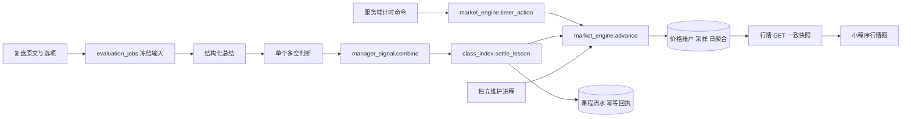

# Lifefund 功能接口与架构审查

审查基准：2026 年 10 月 11 日的本地源码。覆盖小程序入口、全部显式 HTTP 接口、后台任务、数据库归属及价格计算链路。本文已按本轮修复更新为当前实现清单。源码尚未部署；调用链分析和隔离数据库合成测量不代表生产延迟或吞吐量。

**已完成行情纯读与增量传输、页面响应裁剪、课表快照收敛、计时单次读取、v7 顺序执行、公共能力归位和维护进程分离。** 53 个 HTTP 接口与 30 张业务表保持不变，没有新增聚合接口、缓存表或中间件。旧执行器完整退役仍未完成，具体条件见文末；不能把“当前路径精简”写成“所有历史路径已删除”。

精简的目标是：每项业务规则只有一个权威实现；页面只接收它要显示的数据；模型只输出判断；价格由代码统一计算；历史记录保留结果和证据，不无限保留所有旧写入流程。沿用现有单体后端和 PostgreSQL，不新增微服务、通用仓储、事件总线或万能业务框架。失败明确返回失败，同一次操作复用已成功阶段；不悄悄换旧算法、编造默认成绩或模拟价格作为兜底。

## 实际产品范围

页面注册以 [app.json](miniprogram/app.json) 为准。入口可达性按页面、组件注册和本地 `require` 链核对。

| 页面或能力 | 实际功能 | 当前实现与范围 |
| --- | --- | --- |
| 首页 | 指数入口、上课指数摘要 | [index.js](miniprogram/pages/index/index.js)；只有上课指数调用真实行情 |
| 上课指数 | 连续行情、分时、日周月 K 线、图表缩放与查看价格 | [market.js](miniprogram/pages/market/market.js)；当前页面没有流水列表和详情弹层 |
| 课表 | 学期、节次、课程模板、周视图、单次调整、删除、助手浮层 | [timetable.js](miniprogram/pages/timetable/timetable.js)、`week-timetable`、`timetable-assistant` |
| 计时 | 当前课程识别、开始、暂停、恢复、结束、离线结束同步、打开复盘 | [timer.js](miniprogram/pages/timer/timer.js)；服务端片段是计时事实来源 |
| 复盘 | 七天列表、草稿、参与情况和文字、提交、等待结果、失败重试、无效回答重填 | [review.js](miniprogram/pages/review/review.js)、共用 `review-panel`；计时页使用同一面板 |
| 我的 | 微信登录、资料、头像、续期、退出 | [settings.js](miniprogram/pages/settings/settings.js) |
| 算法指数、家务指数、娱乐指数 | 展示入口和“筹备中”提示 | 未发现对应业务路由、价格引擎或独立数据模型，不能算已实现 |
| 人工课后记录 | 后端具备补记、缺席、请假、停课、纠错能力 | 无入口的 `lesson-outcomes` 组件与 service 已删除；后端 `apply_decision` 仍被新复盘调用 |
| 未完成档案 | 48 小时归档及查询 | 后台维护与 HTTP 查询存在，小程序没有调用入口 |
| 通用聊天 | 带鉴权、限流和配额的模型对话 | `/api/chat` 仍注册；小程序没有聊天页面或调用 |

## 接口清单

共 **53 个显式注册的 method 与 path 组合**：身份与头像 7、课表 10、课表助手 7、计时 6、复盘 5、评估 5、课后记录 5、行情 5、未完成档案 1、基础接口 2。FastAPI 自动提供的 OpenAPI、Swagger、ReDoc 文档路由不计入业务清单。

除 `/health`、微信登录和头像图片读取外，均通过 Bearer 会话识别用户。课表、助手命令、计时、复盘、评估控制、课后记录的业务写入共用 `db.mutate`，要求 `Idempotency-Key`，在同一事务保存业务结果和幂等回执。图片上传、登录和资料修改不走这个封装。表内的 `version` 分别属于对应记录，不能互换。

“当前调用”指当前注册的小程序页面可达调用；“兼容”指代码仍支持历史状态；“无页面入口”不代表服务端能力可以直接删除。

### 身份与头像

以下路径使用 [auth.py](backend/auth.py)、[avatars.py](backend/avatars.py)，前端入口为 [auth.js](miniprogram/services/auth.js)。

| 编号 | HTTP 接口 | 唯一处理函数与实现 | 输入和返回及调用状态 |
| --- | --- | --- | --- |
| 01 | `POST /api/auth/login` | `auth.login → issue_session` | 微信 `code` → token、到期时间、用户；当前调用 |
| 02 | `POST /api/auth/refresh` | `auth.refresh → issue_session` | 当前 token → 原会话轮换 token；当前调用 |
| 03 | `POST /api/auth/logout` | `auth.logout` | 撤销当前会话 → 204；当前调用 |
| 04 | `GET /api/users/me` | `auth.me` | 当前用户资料；当前调用 |
| 05 | `PATCH /api/users/me` | `auth.update_me` | 昵称、时区 → 更新后资料；当前调用 |
| 06 | `POST /api/users/me/avatar` | `avatars.upload_avatar → normalize_avatar → save_avatar` | 原始图片字节 → 用户资料；当前调用 |
| 07 | `GET /api/avatars/{avatar_id}` | `avatars.get_avatar` | 图片 ID → JPEG；头像展示使用，公开读取 |

### 学期和课表

路由在 [timetables.py](backend/timetables.py)，写入动作在 [timetable_actions.py](backend/timetable_actions.py)。前端 [timetable.js](miniprogram/services/timetable.js) 直接包装这些路由，没有第二套手工课表服务端实现。

| 编号 | HTTP 接口 | 唯一处理函数与实现 | 输入和返回及调用状态 |
| --- | --- | --- | --- |
| 08 | `GET /api/timetables/semesters` | `list_semesters` | 学期列表、节次、当地日期等；课表页调用，计时页已不再读取学期 |
| 09 | `POST /api/timetables/semesters` | `create_semester → create_semester_record` | 名称、学期日期、第一周周一、时区、节次 → 学期，201 |
| 10 | `PATCH /api/timetables/semesters/{semester_id}` | `patch_semester` | 学期 `version` 及修改字段 → 学期；当前调用 |
| 11 | `GET /api/timetables/courses` | `list_courses` | `semester_id` → 课程模板列表；当前调用 |
| 12 | `POST /api/timetables/courses` | `create_course → create_course_record` | 学期、星期、周次、单双周、时间等 → 模板，201；同事务生成课次 |
| 13 | `PATCH /api/timetables/courses/{course_id}` | `patch_course → update_course_record` | 模板 `version` 及字段 → 模板；保护已记录、过去和单独调整的课次 |
| 14 | `DELETE /api/timetables/courses/{course_id}` | `delete_course → delete_course_record` | query `version` → 204；软删除模板及可删除课次 |
| 15 | `GET /api/lessons` | `list_lessons` | `semester_id/date_from/date_to`，最多 93 天 → 课次列表 |
| 16 | `PATCH /api/lessons/{lesson_id}` | `patch_lesson → update_lesson_record` | 课次 `version`、时间或状态等 → 课次 |
| 17 | `DELETE /api/lessons/{lesson_id}` | `delete_lesson → delete_lesson_record` | query `version` → 204；已有学习记录禁止删除 |

### 课表助手

路由前缀来自 [schedule_api.py](backend/schedule_api.py) 的 `/api/timetable-agent`。前端由 [timetable-agent.js](miniprogram/services/timetable-agent.js) 和助手组件调用；模型任务由 `schedule_worker` 执行。

| 编号 | HTTP 接口 | 唯一处理函数与实现 | 输入和返回及调用状态 |
| --- | --- | --- | --- |
| 18 | `GET /api/timetable-agent/threads` | `list_threads` | 可选 `semester_id` → 最多 100 个对话摘要 |
| 19 | `POST /api/timetable-agent/threads` | `create_thread` | 可选学期、标题 → 对话详情，201 |
| 20 | `GET /api/timetable-agent/threads/{thread_id}` | `get_thread → detail` | 支持 `known_version`；未变化仅返回 ID、版本与 `unchanged=true`；变化后返回最近最多 50 个 run 的详情 |
| 21 | `POST /api/timetable-agent/threads/{thread_id}/messages` | `post_message` | 对话 `version`、文字、至多 3 个图片 ID → 对话详情，202；普通输入排队，确定确认词可直接进入 `queue_decision` |
| 22 | `POST /api/timetable-agent/threads/{thread_id}/runs/{run_id}/confirm` | `confirm_run → queue_decision` | 对话 `version`、`apply/cancel` → 对话详情，202 |
| 23 | `POST /api/timetable-agent/threads/{thread_id}/runs/{run_id}/retry` | `retry_run` | 对话 `version` → 原失败任务重新排队，202 |
| 24 | `POST /api/timetable-agent/threads/{thread_id}/images` | `upload_image → normalize_schedule_image → save_image` | 原始图片字节 → ID、格式、过期时间，201 |

确认按钮和确认文字最终调用同一 `queue_decision`，属于两个输入入口共用一个实现。图片识别、方案预览、应用没有额外公开 HTTP 接口。

### 计时

路由和服务端状态转换在 [study_sessions.py](backend/study_sessions.py)，前端唯一正式实现为 [timer.js](miniprogram/services/timer.js)。

| 编号 | HTTP 接口 | 唯一处理函数与实现 | 输入和返回及调用状态 |
| --- | --- | --- | --- |
| 25 | `GET /api/sessions` | `list_sessions` | 活跃记录、最近 20 条结束记录、片段、服务端时间及当前可计时 `lessons`；会关闭超时计时 |
| 26 | `GET /api/sessions/{session_id}` | `get_session` | 单条计时；也可能触发用户的超时计时收尾 |
| 27 | `POST /api/sessions` | `start_session → timer_action` | `lesson_id` → 计时，201；写入片段并激活或更新行情 |
| 28 | `POST /api/sessions/{session_id}/pause` | `pause_session → transition` | 计时 `version` → 暂停记录，关闭当前片段、更新行情状态 |
| 29 | `POST /api/sessions/{session_id}/resume` | `resume_session → transition` | 计时 `version` → 恢复记录，写新片段、更新行情状态 |
| 30 | `POST /api/sessions/{session_id}/finish` | `finish_session → transition → finish_record` | `version`，可含 `deferred/requested_finish_at` → 结束记录 |

暂停、恢复和结束有不同状态约束，保留明确命令是合理的；它们共用 `transition`，无需再套通用动作工厂。

### 复盘记录

路由在 [reviews.py](backend/reviews.py)，前端为 [reviews.js](miniprogram/services/reviews.js) 和 [review-controller.js](miniprogram/services/review-controller.js)。

| 编号 | HTTP 接口 | 唯一处理函数与实现 | 输入和返回及调用状态 |
| --- | --- | --- | --- |
| 31 | `GET /api/reviews` | `list_reviews` | `status/limit/cursor/compact` → 七天列表；前端固定 `compact=true`，摘要不含片段、答案与完整评估；会收尾计时并补建未计时记录 |
| 32 | `GET /api/reviews/{session_id}` | `get_review → result` | 复盘、计时、评估 envelope；打开面板使用 |
| 33 | `PUT /api/reviews/{session_id}` | `save_review → write_review(submit=False)` | 复盘 `version`、问题版本、答案、参与选项 → 云端草稿 |
| 34 | `POST /api/reviews/{session_id}/submit` | `submit_review → write_review(submit=True) → enqueue_evaluation` | 同上；原子保存提交与任务，HTTP 返回复盘记录 |
| 35 | `PATCH /api/reviews/{session_id}/note` | `save_reflection` | `note_version` 作为请求 `version`、`note` → 复盘；写入封装仍存在，当前界面无新增心得入口 |

当前新问题为 `class-review-v2`，一段文字配合结构化选项；API 仍接受 `class-review-v1` 三问，因此旧工作流不只是只读历史代码。

### 评估控制

路由在 [evaluation_api.py](backend/evaluation_api.py)。实际模型执行在 worker，不在 HTTP 请求内。

| 编号 | HTTP 接口 | 唯一处理函数与实现 | 输入和返回及调用状态 |
| --- | --- | --- | --- |
| 36 | `GET /api/reviews/{session_id}/evaluation` | `get_evaluation → response → job_result` | 评估、纠错期限等；特殊参与结果含复盘；前端在 queued/running 时轮询 |
| 37 | `POST /api/reviews/{session_id}/evaluation/retry` | `retry_evaluation` | 任务 `version` → 原失败任务重排队；当前失败重试入口 |
| 38 | `POST /api/reviews/{session_id}/evaluation/clarify` | `clarify_evaluation` | 任务 `version`、补充文字、参与选项 → 评估；旧 needs_input 状态兼容 |
| 39 | `POST /api/reviews/{session_id}/evaluation/finish` | `finish_review` | 任务 `version` → 将 needs_input 转为 hold；旧流程兼容 |
| 40 | `POST /api/reviews/{session_id}/evaluation/revise` | `revise_evaluation → enqueue_evaluation` | 复盘输入及其 `version` → 新任务与复盘；当前 UI 仅给无效回答重填，后端许可范围更宽 |

草稿保存和提交不是重复接口：前者保存输入，后者产生付费评估任务。重试沿用同一次输入；修订产生新输入版本。它们不应为减少路由数字而混为一个不清楚的命令。

### 课后参与记录

路由在 [lesson_outcomes.py](backend/lesson_outcomes.py)。当前小程序的无入口组件已删除，自动未到课结果仍复用 `apply_decision`，不能连同整个模块删除。

| 编号 | HTTP 接口 | 唯一处理函数与实现 | 输入和返回及调用状态 |
| --- | --- | --- | --- |
| 41 | `GET /api/lesson-outcomes` | `list_outcomes` | `status/limit/cursor` → 待确认或已确认参与记录；无当前页面入口 |
| 42 | `GET /api/lessons/{lesson_id}/outcome` | `get_outcome → response` | 单条参与记录、期限、可执行操作；无当前页面入口 |
| 43 | `POST /api/lessons/{lesson_id}/outcome` | `confirm_outcome → decide → apply_decision` | 课次与参与版本、决定、原因、可选自报时长与计时版本 → 参与记录及结算 |
| 44 | `PATCH /api/lessons/{lesson_id}/outcome` | `correct_outcome → decide → apply_decision` | 同上，已确认记录纠错；服务端保留 |
| 45 | `PATCH /api/lessons/{lesson_id}/outcome/note` | `save_note → save_record` | 课次与参与版本、备注 → 参与记录；服务端保留 |

决定限定为 `makeup/absent/leave/cancelled`。人工补记必须提供自报时长；它和“忘记计时的零时长复盘”不是同一个事实，不能靠改名混用。

### 行情与基础能力

行情路由在 [class_index.py](backend/class_index.py)，前端在 [class-index.js](miniprogram/services/class-index.js)。

| 编号 | HTTP 接口 | 唯一处理函数与实现 | 输入和返回及调用状态 |
| --- | --- | --- | --- |
| 46 | `GET /api/indices/class` | `get_index → market_context/quote_result` | 当前价格、昨收、限幅、OHLC、实际行情时刻；首页调用；纯读，不返回 `last_event` |
| 47 | `GET /api/indices/class/events` | `list_events → event_result` | `limit/cursor` → 流水摘要；service 导出存在，当前页面不调用 |
| 48 | `GET /api/indices/class/events/{event_id}` | `get_event → event_result(detail=True)` | 流水及完整证据；当前页面不调用，服务端审计能力 |
| 49 | `GET /api/indices/class/candles` | `get_candles → candles_result` | `period=day/week/month`、`limit/before` 或 `since` → K 线、游标与同快照 `quote`；刷新仅取末尾周期 |
| 50 | `GET /api/indices/class/intraday` | `get_intraday → intraday_result` | 可选 `date/cursor` → SQL 降采样点、OHLC、同快照 `quote`；增量返回 `cursor/replace_from`，纯读 |
| 51 | `GET /api/learning/incomplete` | [learning_lifecycle.py](backend/learning_lifecycle.py) 的 `list_incomplete` | `limit` → 未重开的归档；无当前小程序调用 |
| 52 | `GET /health` | [main.py](backend/main.py) 的 `health` | 进程存活；不是数据库或 worker 就绪检查 |
| 53 | `POST /api/chat` | [main.py](backend/main.py) 的 `chat` | 交替消息 → DeepSeek 文本；遗留联通测试能力，无当前产品入口 |

## 后台任务与内部实现归属

[ecosystem.config.js](backend/ecosystem.config.js) 配置四个应用、共五个进程：HTTP API 一个、课表 worker 一个、评估 worker 两个、学习维护一个。它们共享 PostgreSQL。LangGraph 检查点使用 `checkpoint_location` 选定的独立 schema；不能将它误计为新的业务服务。

| 实际功能 | 权威入口 | 实际下游和边界 |
| --- | --- | --- |
| 身份校验 | `auth.get_auth_session/get_current_user` | 数据库校验 token 摘要、吊销、期限和用户归属 |
| 幂等业务写入 | `db.mutate` | 用户锁 → 请求指纹 → 执行业务动作 → 回执与业务一起提交 |
| 模板展开与改课 | `timetable_actions.*_record` | 使用 `timetable_actions.generate` 生成课次；手工和 AI 共用 |
| 排课冲突 | `timetable_actions.assert_no_overlap` | [schedule_conflicts.find_conflicts](backend/schedule_conflicts.py)；跨学期有效时间不能重叠 |
| 排课预览与应用 | `schedule_plan.preview_plan/apply_plan` | 共用 `_execute`；预览在回滚 savepoint 内执行，应用原子提交 |
| 排课任务执行 | `schedule_worker.Worker.run_once` | claim → load_state → [schedule_graph.build_graph](backend/schedule_graph.py) → 等待确认或应用 → finish |
| 图片课表识别 | `schedule_worker.Worker.extract_images` | `schedule_vision.analyze_schedule_image` → `schedule_image_reader.invoke_image_reader/bind_reading`；按图片缓存结果 |
| 图片结果转排课操作 | `schedule_image_reader.compile_image_imports_with_progress` | 把识别结果和导入进度转为受校验的操作，不直接写课表 |
| 文字课表规划 | `schedule_worker.Worker.interpret` | `schedule_model.prepare_messages/invoke_planner`；成功输出按输入 hash 缓存，校验失败最多两次 repair |
| 课表上下文 | `Worker.load_state`、`ScheduleTools.memory/retrieve` | 目标学期课表、活动任务历史、待确认方案、知识检索；固定注册器转发已删除 |
| 模型费用记录 | `schedule_budget.reserve/settle`、`evaluation_worker.Worker.reserve/settle_call` | 前者仅计量，后者执行每日调用与预算上限；不是两个可互换的预算接口 |
| 超时计时收尾 | `study_sessions.close_expired_sessions/expire_sessions` | 同一收尾算法由会话查询、写命令和维护进程调用 |
| 未计时复盘占位 | `review_records.ensure_recent_reviews/maintain_review_records` | 首次有效计时完成后开始追踪；最近七天已结束课程补建无片段 finished 记录 |
| 新复盘排队 | `evaluation_api.enqueue_evaluation` | 冻结输入及版本；新 v2 问题默认 v7；旧问卷和 legacy 补建走旧分支 |
| 评估任务领取与恢复 | `evaluation_worker.Worker.claim/run_once` | 队列行锁、租约、任务 advisory lock、版本核对、分角色调用缓存 |
| 当前复盘评估 | `LongShortEvaluationRuntime.run` | 总结 → 一个多空判断 → `Worker.complete`；未到课和无效回答在总结阶段后直接分支 |
| 参与决定 | `lesson_outcomes.apply_decision` | 修改参与事实、撤销旧任务、写修订记录、统一结算；手工和自动结果共用 |
| 课程消息结算 | `class_index.settle_lesson` | 唯一消息入账入口；复盘、缺席、纠错最终都调用它 |
| 多空判断转消息比例 | `manager_signal.combine` | 当前单经理 `class-signal-v2`；兼容旧双经理，不负责改变账户价格 |
| 连续价格推进 | `market_engine.advance` | `market_math.step`；计时动作和消息结算按精确时间推进，后台按完整时间格推进；查询不推进 |
| 行情事实写入 | `market_engine.timer_action/record_point` | 保存状态事件、采样点、日 OHLC；没有由客户端写价格的接口 |
| 学习维护循环 | `learning_worker.main/maintain` | `--mode evaluation` 领取评估；独立 `--mode maintenance` 推进行情并维护超时计时、占位、归档与补建 |
| 未完成归档与补结算 | `learning_lifecycle.archive_incomplete/backfill_outcomes` | 48 小时档案、已存在参与事实的结算回执修复；不凭空判缺席 |
| 任务追踪 | `agents.tools.registry.record_trace` | 保留模型阶段与历史工具追踪；v7 与课表已移除固定 ToolRegistry 转发 |

### 实际执行的复盘版本

以 [Worker.run_once](backend/evaluation_worker.py) 的分派为准，不以文件名的新旧判断是否死代码。

| 工作流值 | 实现 | 当前状态 |
| --- | --- | --- |
| `class-agents-v5` | `agents/evaluation_runtime_v7.py` 的 `LongShortEvaluationRuntime` | 新 v2 复盘默认；正常学习两次模型调用：总结、单个多空判断 |
| `class-agents-v4` | `agents/evaluation_runtime_v6.py` 的 `SummaryEvaluationRuntime` | 旧任务恢复；总结后两个经理 |
| `class-agents-v3` | `agents/evaluation_runtime_v5.py` 的 `DirectEvaluationRuntime` | 旧任务恢复；直接评分再经理判断 |
| `class-agents-v2` | `agents/evaluation_runtime.py` 的 `EvaluationRuntime` | 旧问卷、legacy 补建及历史任务；证据门槛、补问等旧行为 |
| `legacy-v1` | `evaluation_worker.Worker.assess/complete` | 最早版本任务恢复 |

v7 使用普通顺序编排，复用 `EvaluationRuntime` 的持久调用缓存、预算及阶段执行方法，不执行旧 graph。`review_v7` 契约及 `roles_v7` 上下文已独立，不再调用 v5/v6 校验器或旧上下文再改写证据 ID。历史实现保持原契约；旧问卷写入口仍能生成旧流程新任务，完整退役不能仅等待队列清空。

## 数据权威与存储归属

ORM 共声明 **30 张业务表**；不包含 Alembic 版本表和 LangGraph 自建表。表的职责以 [models.py](backend/models.py)、[evaluation_models.py](backend/evaluation_models.py)、[index_models.py](backend/index_models.py)、[lifecycle_models.py](backend/lifecycle_models.py)、[agents/models.py](backend/agents/models.py) 为准。

| 业务 | 表 | 权威与可派生数据 |
| --- | --- | --- |
| 用户与登录 | `users`、`auth_sessions` | 身份及资料；头像字节也在 users 中，普通读取延迟加载头像 |
| 遗留聊天 | `chat_daily_usage` | 聊天日配额，与复盘配额分开 |
| 课表 | `semesters`、`course_templates`、`lessons` | 模板表达重复安排，lesson 表达实际课次；单次例外使二者都有存在价值 |
| 幂等回执 | `timetable_mutations` | 已承诺的 HTTP 写入结果；名字是课表，实际服务多个业务 |
| 学习事实 | `study_sessions`、`study_segments`、`reviews`、`lesson_outcomes` | 计时状态与片段、用户原文、参与决定；不能用总结覆盖用户原文 |
| 课表任务 | `schedule_threads`、`schedule_runs`、`schedule_images` | 对话、方案和确认、图片；不是另一套已生效课表 |
| 课表模型计量 | `schedule_daily_usage`、`schedule_model_calls` | 费用计量及成功调用缓存 |
| 复盘任务 | `evaluation_jobs`、`evaluation_calls`、`evaluation_daily_usage` | 冻结输入、任务结果、付费调用缓存和日配额 |
| 价格账本 | `class_index_accounts`、`class_index_events`、`class_index_receipts` | 当前价格、不可变课程消息与纠错流水、幂等来源 |
| 连续行情 | `class_market_states`、`class_market_actions`、`class_market_points`、`class_market_days` | 随机种子和推进检查点、状态事实、五秒采样、日聚合 |
| 生命周期 | `learning_archives`、`outcome_revisions` | 未完成标记、参与决定的历史修订 |
| Agent 记忆与追踪 | `agent_memories`、`agent_traces` | 来源于业务记录的派生记忆与追踪；不应成为当前事实的第二来源 |

同一数据“多处出现”不一定都该删：冻结输入能防止历史答案被改写，模型成功缓存能避免重复付费，价格回执能防止重复涨跌。应删除的是无独立用途的完整镜像，以及把审计数据塞进高频展示响应的做法。

## 价格与数据流审查

### 当前价格链路

当前学习复盘的原始消息率为 `0.03 × 有符号强度 / 100`，见 [manager_signal.py](backend/manager_signal.py)。计时还通过连续行情影响价格，但新复盘消息不再使用旧的“时长 40% 加质量 60%”公式。缺席和免罚走固定参与规则。消息幅度、当日限幅、精度和纠错均由代码执行，模型没有直接设置价格的权限。

这条规则归属是合理的：`market_math` 管纯计算，`market_engine` 管连续行情持久化，`settle_lesson` 管一次性课程消息和历史差额纠错。连续变化和离散消息是两个真实业务来源，不应为“一个实现”强行混成一个巨型函数。需要调整的是 HTTP、序列化、锁和任务编排的位置。

## 逐项修复结果

编号对应原审查的十一项问题。下列“已实现”指本地源码及回归，不表示已发布。

| 项 | 原问题 | 当前改动与边界 |
| --- | --- | --- |
| 1 | 行情重复请求 | 已实现。分时和 K 线均从图表响应读取 `quote`，正常刷新一次请求；首页保留轻量报价。删掉事件数变化后再取报价的分支。 |
| 2 | 查询推进价格、占用户写锁 | 已实现普通行情及流水、复盘详情、评估详情、档案、助手详情的一致只读事务；GET 不推进价格。会话和复盘列表仍承担既有收尾/补建，不能当纯读处理。严重停机积压下业务命令的精确追赶仍有边界，见下文。 |
| 3 | 每次读取并重传全天采样 | 已实现 SQL 分钟首尾/极值筛选与增量游标，所有非 tick 边界均保留。K 线 `since` 只读末尾周期；历史翻页继续用 `before`。数据库仍须扫描所选时间范围来计算极值，没有声称初次查询恒定成本。 |
| 4 | 审计对象反复复制 | 已实现普通事件/评估结算响应剥离 `evidence/rule_snapshot`，完整证据仅走既有流水详情；v7 证据内部保留一份输入、一份判断，不再写无用途学习记忆。列表直接构造摘要；前端缓存一份 evaluation，视图仅投影用到的字段。 |
| 5 | 助手轮询重复整段详情 | 已实现 `known_version`；未变化时不查 runs、消息或预览。领取任务也递增线程版本，让 queued → running 可见。视图仅传对话摘要、消息和当前二十条变更。 |
| 6 | 全用户课表反复快照 | 已实现目标学期课程/课次读取，预览复用执行前基线，执行前后各一份快照。新 hash 只包含目标学期数据及用户时区；其他学期改名不使它失效。跨学期冲突校验仍覆盖全部有效课次，尚未进一步缩为相交区间查询。 |
| 7 | 固定步骤套图与工具注册 | 已实现 v7「准备一次 → 总结 → 多空判断 → 原子结算」，以 job 和模型成功回执恢复，不再维护第二份 graph 进度。课表仍保留确有确认分支的 graph，但直接调用既有读、预览、应用函数。 |
| 8 | 公共能力放在业务路由 | 已实现 `db.py` 持有事务、归属、版本及检查点连接工具；`timetable_actions.py` 持有课表校验和写动作，路由单向调用；小程序身份快照统一归 `session.js`。没有新建 repository/service/adapter 层。 |
| 9 | 旧执行与多种展示没有退出条件 | 部分完成。删除原型计时、不可达课后记录 UI/service 与面板历史/独立模式；当前页面为一个列表页、一个单记录面板。v7 契约与上下文独立。旧问卷入口、旧任务执行器和草稿恢复仍保留，完整退役条件见下文。 |
| 10 | 计时页多请求拼课次 | 已实现现有 `/sessions` 同事务返回可计时课次。计时页每轮一次请求，不再查询学期再逐学期查课；待确认计时操作和离线结束继续保留。 |
| 11 | 评估与行情维护共用串行进程 | 已实现独立维护模式与两个评估进程配置；复用原任务表、领取和租约。维护满一百户后 0.1 秒继续，未满等待一秒；归档等较慢工作每三十秒执行。配置数不是生产容量结论。 |

### 接口更新约定

- `intraday.cursor` 是服务端生成的 `业务日:序号`。同日刷新返回末尾可变化分钟的 `replace_from`，客户端保留时间严格早于该边界的旧点，再拼新点；新业务日返回完整点列并清空旧图。非法游标明确返回 422。客户端不自行估算新的价格。
- `candles.since` 和 `before` 不能同时使用。实时刷新传已有末根蜡烛的日期，按日期替换返回周期；已加载的更早历史保留。报价与图表来自同一 PostgreSQL 快照。
- `threads/{id}?known_version=N` 未变化时返回 `{id, version, unchanged: true}`。初次读取和版本变化返回原详情契约，无新增任务状态接口。
- `sessions.lessons` 由服务端用户归属及可开始的时间窗直接查询；`reviews?compact=true` 的 session 是列表摘要，不含 `segments`，详情仍从原接口读取。
- 普通流水和评估中的 settlement 是展示摘要；审计证据从 `/api/indices/class/events/{event_id}` 读取。历史 job 中已有的大对象在响应时裁剪，不批量改写历史证据。

### 恢复与不变量

价格纯函数 `market_math.py`、`manager_signal.py`、`rules.py` 与本轮修改前逐字节一致。没有更换随机算法、单课比例、限幅、舍入或纠错公式；模型提示词也未改动。v7 总结器与多空 Agent 的重构前后消息，已用相同输入逐字节核对一致。

已有 v7 任务恢复只接受当前签名，或精确匹配本轮重构前的代码/契约签名；后者还必须核对提示词和已经持久化的上下文内容哈希。匹配后更新实现签名并继续复用成功调用；未知签名明确失败。旧课表待确认方案的无前缀 hash 使用原全量算法核对，新方案写 `semester-v1:` hash。两者均执行同一课表应用函数。这些是有边界的历史迁移，不在失败时换算法重试。

账户隔离、同账户写入串行、冻结输入、租约、成功模型调用缓存、幂等回执以及旧账本保留。普通只读事务开始于鉴权的第一次 SQL 之前，避免多次查询拼出不同版本的价格与图表。无数据库迁移，无生产数据改写。

## 尚未完成的收尾边界

1. **旧执行器完整退役。** `class-review-v1` 仍允许新写入，历史 pending 补建仍走其原工作流。因此不能宣称后端已经只剩一个评估执行器。下一步必须统计实际 job 的版本/状态和未确认写入，明确旧三问草稿的用户可见迁移规则，停止旧新建入口，再排空或明确终止旧任务。不能自动把旧三段原文当作新分支答案，也不能删除已付费但未结算任务。本轮没有连接生产数据库，无法完成该数据核对。
2. **长时间停机后的业务写入成本。** 普通 GET 已完全移出追赶链；计时状态变化和消息入账仍调用 `advance(exact=True, max_steps=None)`，确保按原顺序精确入账。严重积压时一次业务事务仍可能较长。若要设硬上限，需要同时定义命令等待/重试协议，避免丢掉离线结束或改变事件生效时间；本轮没有用跳步、虚构现价或回退旧规则来掩盖它。
3. **容量与保留周期。** 原始五秒点每天约 17,280 条/已激活账户（另有业务边界），本轮未删除或归档历史原始点。跨学期冲突校验仍是全用户有效课次范围。生产用户规模下的 SQL 扫描、行情延迟、队列等待及保留周期尚未压测；需要基于实际指标决定范围收紧与归档策略。

这些限制与已完成的代码修复分开记录，不能用回归通过替代上线容量证明。

## 验证与部署边界

本轮使用独立临时 PostgreSQL 实例和模拟模型供应器，不读取生产库、不调用真实付费模型、不发布服务。最终完整后端回归 **500/500 通过**，耗时 621.753 秒；前端 **13/13 个测试文件通过**。

回归覆盖：行情只读、分钟增量极值与消息边界、日周月 K 线、账户隔离、并发计时和离线结束、价格限幅与差额纠错、v5/v6/v7 冻结恢复、成功模型调用复用、双 worker 单次结算、助手版本短响应、跨学期冲突、旧方案 hash 与图片部分导入恢复。既有测试按新接口契约更新；新断言添加在原回归文件中，没有留下临时测试文件。

两小时合成行情对照：数据库有 1,443 个原始采样；完整分时返回 403 点、63,556 字节；五秒后的增量返回 2 点、1,126 字节，减少约 98.2%。客户端按 `replace_from` 合并后点列与完整读取严格一致。字节数按紧凑 UTF-8 JSON 计算；该结果只证明这一输入的传输与合并行为，不代表真实用户全日曲线或请求延迟。

部署时须同时启用 API 和 `learning_worker --mode maintenance`，另启动 `learning_worker --mode evaluation`。仅运行默认评估模式不再承担连续行情维护；PM2 配置已体现该职责。没有新增迁移，现有迁移及历史账本保留。前端契约随本次源码一起更新，微信真机显示与交互需编译后核对。

53 条显式 HTTP 注册项与本轮基线逐项相同，30 张 ORM 业务表不变。工作区未提供可用 Git 元数据，使用本轮临时源码快照核对，不以提交号声称线上版本已核验。既有回归测试随契约调整保留；本轮专用 PostgreSQL 实例已停止；临时数据库目录、运行器、测量脚本、日志和源码对照快照均已删除。项目内未留下临时文件，正式回归测试与历史验收资料保留。
