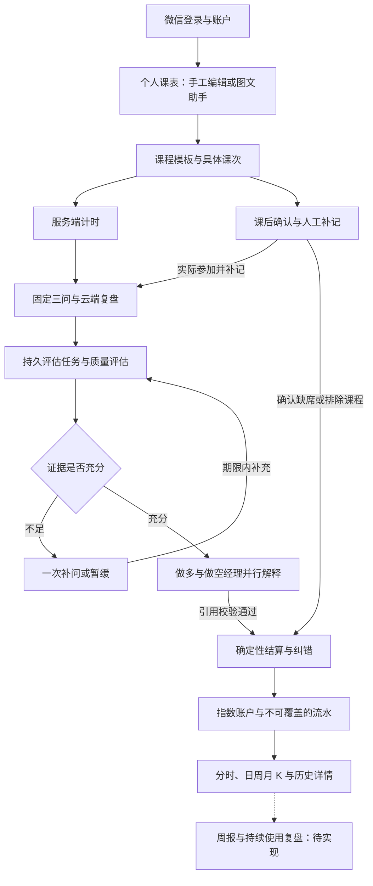

# 三倍做多人生（Lifefund）持续执行计划书

> 版本：v1.25｜更新日期：2026-10-03  
> 产品形态：仅微信小程序。当前阶段：T07 评分、T08 结算、T09 真实行情代码已实现；T11 多空经理与周/月 K 提前接入，回放与封单继续后置。此前 T02–T06、T10 仍待真机验收。  
> 本轮调整：补充模块输入输出、运行流程、异常恢复与协作关系；用 LaTeX 说明计时、评分、结算、纠错和行情等计算口径，并校正与现有代码不一致的旧描述。本轮仅完善文档；最近一次后端验证与发布仍为 §9.20 的 333 项测试及 17:39 发布核验。课表助手继续不限每日费用和调用次数，真实节次与简短确认见 §9.19。  
> 本文同时作为产品定义、开发任务板和复盘入口。每完成一项任务，同步更新状态与验收证据；调整规则时记录原因和版本。

阅读顺序：§2.5 看整体架构；§3–§8 看各模块如何工作；§9、§12、§13 查开发状态与历史证据；§10–§11 查验收和持续使用方法。正文中的「已实现」指已有代码，真机验证仍以任务板为准；标注「建议」「待实现」的方案不代表已交付。公式采用行内 `$...$` 和独立行 `$$...$$`，数值规则版本仍为 `class-v1.0`。

## 1. 产品目标与核心构想

把「今天有没有认真上课」变成可记录、可回顾、有反馈的个人成长过程。用户导入课表，上课时计时，下课后完成简短复盘；系统根据投入和学习质量，让「上课指数」上涨或下跌，并用基金经理的口吻解释原因。

产品的趣味来自股票盘面，长期价值来自持续上课与复盘。指数代表本产品规则下的行为记录，不代表真实能力或人的价值。

### 1.1 原始构想保留清单

- 首页提供上课、算法、家务、娱乐四个指数入口，每个指数对应独立子项目。
- 当前只开发上课指数，其余入口显示「筹备中」，不生成虚假数据。
- 用户提供课表图片与文字说明，由 LangGraph 课表 Agent 建立课程、假期与调休方案；确认后存入 PostgreSQL，之后保留对话入口持续修改安排。
- 课表默认展示完整周网格：星期横排、节次或时间纵排；点击空白编排，点击课程查看并区分单次调整与每周安排。手动编辑与课表助手共用账户下的同一份数据库记录。
- 上课开始计时，下课结束计时，随后回答与本节课有关的问题。
- 系统结合时长和复盘质量得出结果；做多经理解释积极因素，做空经理解释消极因素。
- 认真上课可以推动指数上涨；确认缺席、明确严重分心等可以使指数下跌。
- 盘面参考 A 股的视觉和交互，提供分时、日 K、周 K、月 K、涨跌停和模拟封单。
- 盘面固定高度、不可折叠；图表时间轴左右滑动，不靠无限压缩图形容纳所有历史。
- 分时变化需要有起伏，但不得让随机动画改变最终结算结果。

「三倍做多人生」先作为品牌名，不默认将每次涨跌乘以三。首版不涉及真实交易、资金充值、提现或杠杆交易。

### 1.2 首轮成功标准

先自己持续使用，再考虑邀请其他用户。首轮验证持续两周，并至少包含 10 节有效计划课程；不足则延长。

| 目标 | 验收口径 |
| --- | --- |
| 完整闭环可用 | 同一用户能完成课表确认 → 计时 → 复盘 → 结算 → 查看历史 |
| 容易坚持 | 不含首次导入，每节课主动操作时间的中位数不超过 3 分钟 |
| 记录覆盖足够 | 至少 80% 的有效计划课程有已确认结果，包括正常记录、补记或确认缺席；请假、停课不计入分母 |
| 有实际复盘 | 已确认参加的课程中，至少 70% 完成复盘；分母为零时不评估 |
| 账目可信 | 重试、刷新、跨设备和服务重启均不造成重复结算或丢失已提交记录 |
| 反馈能理解 | 每次变化均能看到对应课程、输入证据、评分、规则版本和涨跌原因 |

以上是试用目标，并非已经达成。指数持续上涨本身不算产品成功；应同时观察缺失记录、复盘质量和实际使用负担。

## 2. 当前基础、技术与范围

### 2.1 仓库现状

以下依据 2026-10-03 当前代码。计时、云端复盘和课后确认已接通评分与真实指数，首次闭环交付见 §9.10，后续 Agent 与课表改进及最近发布见 §9.13–§9.20。

| 模块 | 已有内容 | 尚缺内容 |
| --- | --- | --- |
| 微信小程序 | 六页与四标签导航；复盘评分轮询、一次补问、失败重试、7 天修订；上课现价、分时/日周月 K、双经理观点和流水详情 | 微信原生编译、真机与跨设备完整验收 |
| 后端 | 持久评估任务、DeepSeek 结构化评分、原子结算、历史纠错、48 小时归档和个人行情 API | 健康/积压监控、运维告警与数据管理 |
| 数值规则 | Decimal 执行 `class-v1.0`；单课/日限幅、补记 0.8、原规则目标差额纠错，保存截断且不结转 | 两周真实使用后复核参数 |
| AI | LangGraph 质量评估与独立双经理工作流；证据门槛通过后异步并行调用经理，持久记忆、个人数据/产品规则 RAG、引用校验和恢复；低置信度最多补问一次 | 实现及验证见 §9.13；持续真实使用质量验收与漂移监控 |
| 数据层 | 迁移已至 `0012_agent_workflows`，包含任务、费用、账本、归档、删除标记、Agent 记忆和执行追踪 | 完整备份恢复演练 |
| 运行环境 | API、课表 worker；新增独立 learning worker 负责评估、归档与旧记录补处理 | 小程序重新编译、全业务告警与恢复演练 |

代码与自动测试不替代微信真机验收；真实模型样例与 mock 测试分别记录，未将用户真实课堂资料用于测试。其他三个指数继续标记「筹备中」。

聊天测试页及入口已移除；后端 `/api/chat` 只保留历史联通用途，不作为产品入口。

### 2.2 技术路线

- **仅做微信小程序，不安排 Web、Next.js 或第二套客户端。**
- 小程序沿用已有原生 WXML、WXSS、JavaScript 基础；是否引入 TypeScript 在有明确收益时再单独决定，不为改栈阻塞闭环。
- 后端沿用 FastAPI + Python + Pydantic；数据库采用 PostgreSQL，迁移采用 Alembic。
- LLM 通过后端调用，密钥不进入小程序。先验证模型的图片输入、结构化输出和成本，再确定各流程使用的模型。
- 课表 Agent 明确采用 LangGraph，图节点及确认中断通过 PostgreSQL checkpoint 恢复；课程校验、批量写入与数值结算使用确定性 Python。
- 首版采用数据库任务表和独立 worker 处理耗时任务，避免仅靠请求进程内后台任务导致重启丢失。

### 2.3 版本边界

| 版本 | 必须完成 | 暂缓内容 |
| --- | --- | --- |
| MVP：先验证闭环 | 用户身份、手工课表、图文课表 Agent 与持续对话、可靠计时、简短复盘、评分结算、基础分时与日 K、历史记录 | 完整多 Agent 编排、周/月 K、封单和拟真动画 |
| v0.2：补齐原始体验 | 多空经理解释、周/月 K、有起伏的走势回放、模拟封单 | 算法、家务、娱乐指数，社交和商业化 |
| v0.3：持续使用 | 补记体验优化、周报、成本监控、数据管理、小范围邀请试用 | 根据两轮复盘再决定的新功能 |

用户于 2026-10-02 要求图文课表，将 T10 提前纳入首版；2026-10-03 要求评分和做多/做空基金经理反映到上课指数，本轮合并交付 T07–T09，并提前实现 T11 的双经理与周/月 K。手工录入继续保留。

### 2.4 还差什么：按交付顺序推进

代码已接通「个人课表 → 计时/补记 → 云端复盘 → 评分与双经理 → 指数结算 → 真实行情和纠错」。

| 顺序 | 剩余工作 | 完成标准 | 对应任务 |
| --- | --- | --- | --- |
| 1 | 微信完整闭环验收 | 当前源码重新编译，实测计时恢复、断网重试、补问/修订、真实分数与指数、窄屏图表横滑及两设备冲突 | T02–T09，§13.5 |
| 并行收尾 | 既有登录/课表/助手真机验收 | 真实微信与至少 5 张代表性截图逐字段核对 | T03–T04、T10 |
| 2 | 运维与周报 | 数据库/worker/积压与费用告警、备份恢复演练、数据导出删除、覆盖率和缺失率周报 | T12 |
| 3 | 真实持续使用 | 至少两周且不少于 10 节有效计划课程，记录负担、质量与覆盖率，决定下一版 | T13 |
| 后续体验 | 走势回放与模拟封单 | 明确模拟标识、结果一致且不污染真实 OHLC | T11 剩余 |

质量评估与双经理共用一组 UTC 日调用次数和预算，与课表及遗留聊天分别统计；统一费用展示/告警仍待做。算法、家务和娱乐指数继续筹备中。

### 2.5 整体架构与模块交接

系统以「一节具体日期的课程」为主线：课表生成课次，计时和课后确认记录参加情况，复盘提供学习证据，评估解释证据，结算把有效结果转换成指数变化，行情与历史再将结果展示给用户。各模块通过课次 ID、学习记录 ID 和输入版本关联，页面无需自行拼凑一份独立账本。



请假、停课等排除分支首次只留下处理凭据，不产生涨跌；若该课此前已结算，则按纠错规则调整。资料不全保持待补齐或归档，不进入结算。图中的经理观点通过后才触发正常学习结算，但经理本身没有修改分数或价格的权限。

| 模块 | 接收什么 | 如何处理、交付什么 | 主要说明 |
| --- | --- | --- | --- |
| 账户与页面入口 | 微信登录凭据、用户操作 | 建立后端会话，确定数据归属，组织全局和指数内部导航 | §3.2–§3.3 |
| 课表与课表助手 | 学期、节次、图片、文字、已有安排 | 提取事实、补齐必要信息、预演变更；确认后生成模板和课次 | §4.1 |
| 计时 | 课次、开始/暂停/继续/结束操作 | 保存服务端时间片段，计算有效时长并冻结课程快照 | §4.2 |
| 课后确认与归档 | 未记录课次、原因、自报时长、截止时刻 | 分流补记/缺席/排除；归档资料不全，保留纠错入口 | §4.3 |
| 复盘与质量评估 | 三问答案、当次时长、规则 | 保存草稿与提交版本；校验证据，输出三项分数或补问 | §5.2 |
| 双经理 | 当次文字证据、规则、相关个人历史 | 独立生成优势与风险解释，汇合并校验引用 | §5.1、§5.6 |
| 上下文、记忆与检索 | 当前任务、持久来源、角色权限 | 选取该角色需要的资料，过滤失效来源，记录可追溯清单 | §5.6 |
| 结算与纠错 | 已验证评分或参与原因、原规则、账户价格 | Decimal 计算、限幅、原子记账，历史修正追加差额 | §5.3–§5.5、§7.5 |
| 行情与历史 | 按顺序保存的真实流水 | 生成现价、分时、OHLC，支持逐笔回查证据 | §6.1 |
| 任务与运行保障 | 已持久化任务、租约、调用结果 | worker 领取、恢复、版本检查、费用记录；保障业务幂等 | §7.2、§7.5、§8 |
| 周报与数据管理 | 课程、复盘、流水和费用记录 | 计划汇总覆盖率与负担，提供导出、删除及恢复能力 | §8.2、§11.4，T12 待完善 |

运行时有三个主要进程：FastAPI 接收请求并读写业务数据，课表 worker 执行课表工作流，学习 worker 执行评估并维护归档。PostgreSQL 同时保存业务事实、任务及图检查点；检查点负责恢复执行进度，业务表负责判断操作是否真正生效。小程序通过查询任务状态更新页面，收到「已入队」不等于已经保存课表或完成结算。

## 3. 使用流程与页面

### 3.1 主流程

1. 首次进入：建立用户身份，可选填写头像、昵称；新课表使用北京时间（`Asia/Shanghai`），开始使用时配置学期起止日期和节次时间表。
2. 创建课表：手工录入，或在课表助手发送截图、学期和假期说明；补齐问题、核对日期变更后确认保存。后续临时安排继续通过该入口修改。
3. 课前：从首页进入上课指数，在课表中查看当前或下一节课并开始。
4. 上课：点击开始，服务端记录时间；锁屏、切后台或离开页面后可以恢复。
5. 下课：点击结束，核对课程和有效时长，进入复盘。
6. 复盘：回答固定三个问题，说明学到了什么、哪里不理解、是否明显分心。
7. 结算：系统生成评分和涨跌，多空经理解释原因，写入账本和行情。
8. 回顾：查看历史课程与走势，每周回顾投入、复盘完成率和下一步改进。

### 3.2 页面清单

当前交付为 6 页（5 个核心页与设置页），课表助手作为课表页内浮层，不含通用聊天测试页。全局底栏仅「首页、我的」；从首页进入上课指数后，底栏依次为「指数、课表、计时、复盘」，默认打开指数页。计时是模块内的同级独立页面，切换不增加页面栈。后续指数各自组织专属功能，不共用课表与复盘。下表同时列出后续业务页面需求，历史详情已在指数页抽屉实现，周报尚未实现。

| 页面 | 必要信息与操作 | 验收重点 |
| --- | --- | --- |
| 指数首页 | 四个指数入口、上课指数现价与今日涨跌、个人账户入口 | 未上线入口明确标记，下一步操作清楚 |
| 课表管理 | 周视图、课程增改、导入确认、学期和节次配置 | 支持单双周、临时调课、请假和停课 |
| 课表助手 | 持续对话、截图上传、澄清问题、逐项变更预览与确认、历史对话恢复 | 初始化和后续修改均可用；确认前不落正式课表，重试和重启不重复写入 |
| 上课记录 | 课程名、计时、暂停/恢复、结束 | 刷新、断网和重复点击不产生重复记录 |
| 课后复盘 | 2～3 问、草稿、提交、稍后完成 | 失败不丢答案，模型超时不影响已保存计时 |
| 指数详情 | 现价、涨跌、分时/日/周/月 K、结算事件 | 固定盘面高度，时间轴水平滑动 |
| 历史详情 | 课程、时长、答案、评分、经理解释、修正入口 | 能从一次涨跌追溯到原始记录 |
| 个人设置 | 登录、头像选择、昵称快速填写、手动续期和退出；当前无时区选择入口 | 真实微信登录成功；保存后重新进入仍保留；失败可重试 |
| 周报与数据管理（后续） | 每周回顾、数据导出/删除 | 汇总可追溯、个人数据可管理 |

小程序提醒首版以页面内提示为主。订阅消息另行验证平台能力、用户授权和模板条件，不把后台精准推送作为计时正确性的前提。

「我的」中头像由用户点击选择后即时上传，昵称支持选择微信昵称或自行填写，点击「保存设置」后提交昵称。头像和昵称均为可选资料，不要求填写才能登录。后端保留时区字段，但当前小程序没有时区选择器，新学期使用 `Asia/Shanghai`。当前仅支持手动续期，临近过期自动续期作为后续体验改进，不阻塞 T04。

### 3.3 账户与客户端如何工作

小程序调用微信登录取得一次性 code，再交给后端换取微信身份；后端据此找到或创建用户，签发应用自己的随机 Bearer 令牌。数据库只保存令牌哈希和到期、撤销状态。每次访问课表、计时、复盘或行情，后端先验证令牌，再用会话中的用户 ID 查询数据；传入一个课程 UUID 不会自动获得读取权限。

手动续期会在同一会话锁内轮换令牌，旧令牌立即失效；退出会撤销会话。头像和昵称是独立的可选资料，不参与身份判断。对应实现为 [auth.py](backend/auth.py) 和 [avatars.py](backend/avatars.py)。

页面分工是展示和收集输入：课表页编辑安排，计时页控制状态，复盘页保存答案，指数页读取结算结果。客户端保留草稿和失败请求，恢复连接后携带原幂等键重试；若服务器发现数据版本已被另一设备修改，返回冲突并要求基于最新内容处理。页面只有收到成功结果后才显示「已保存」，收到评估任务编号后先显示「待评估」，轮询到已结算才更新结果。

## 4. 课表、计时与异常处理

### 4.1 课表导入规则

识别字段：课程名、星期、起止时间或节次、周次范围、单双周、地点（可选）。

- 识别结果只生成草稿，用户确认后才成为正式课表。
- 优先沿用已绑定学期、截图中明确时间和用户已确认的信息；仍缺少学期起始日或节次时间表时才补问，不由模型猜测。
- 低置信度字段、时间缺失、课程重叠、异常周次需突出展示。
- 图片识别失败时可手工录入；当前已用虚构截图完成真实图片模型联调，用户的真实课表仍需逐字段核对。
- 课程模板生成具体日期的课程实例；调课或停课修改实例，已结算记录保留当时快照。
- 课程导入确认后删除原图；仅删除或调整旧课不提前清除尚待导入的截图。取消方案会清图，未完成导入最多保留 7 天；结构化课表保留至用户删除。
- 删除课程安排会移除所有未产生计时或课后记录的课次，包括过去误录、调课、请假和停课安排；支持仅删除一次。真实学习记录和指数证据保留，删除与停课使用不同状态。
- 每轮最多两个真正缺少信息的问题；已确认的删除范围和重复安排不再追问。周次日期由服务器提供。已有具体预览时，可点击按钮或回复“确认”执行；“删除”仅直接确认纯删除预览，混合方案需明确确认。

课表 Agent 按用户提供的日期处理假期，不内置或猜测学校校历。“A 日补 B 日的课”明确解释为将 B 日的具体课次移到 A 日，保留来源课次、原周次及单双周结果；A 日已有课程默认保留。若要求额外复制一份课程，需明确说明，当前不能用移动代替复制。

图片和描述共同参与初始化，后续对话读取已保存课表。所有变更先由代码预演并展示具体日期、课程和前后差异；模糊节次、补课方向或来源周次先追问。假期取消与补课整批应用，最终检查冲突；手工修改使待确认方案过期时须重新生成。临时变动保留每次对话和确认记录，已有真实学习记录的课次仍受保护。

#### 4.1.1 学期、课程模板与课次如何配合

学期保存起止日期、首周星期一、时区和节次时间表；课程模板保存「星期几、哪些周、什么时间上什么课」；课程实例则对应某一天真正要处理的一节课。计时、复盘和结算都绑定课程实例，避免一次调课改变整学期或已经完成的记录。

设首周星期一的日期为 $d_0$，周次为 $w$，星期编号为 $k\in\{1,\ldots,7\}$，模板在该周对应的日期为：

$$
d(w,k)=d_0+\bigl(7(w-1)+k-1\bigr)\,\text{天}.
$$

服务器只为模板周次范围内、位于学期起止日之间的日期生成实例；单周要求 $w\bmod 2=1$，双周要求 $w\bmod 2=0$。节次先通过学期节次表转换为实际时刻，再结合学期时区保存为带时区时间戳。只有节次而缺少可用作息时需补齐，不猜测默认时间；已明确起止时刻的课程可以直接录入。

手工编辑与助手确认都进入同一套课表校验和事务服务：检查时段、重叠、归属、版本及学习记录保护后整体提交。修改每周模板影响未来未单独调整的课次；单次调课保留原课次 ID 和来源周次。已有计时或课后记录的课次不能被删除操作抹掉。实现入口见 [timetables.py](backend/timetables.py) 与 [timetable_actions.py](backend/timetable_actions.py)。

#### 4.1.2 图文课表助手的执行步骤

| 步骤 | 怎样工作 | 产生什么结果 |
| --- | --- | --- |
| 保存请求 | API 校验账户和对话版本，保存文字、私密图片引用及任务，再交给 worker | 可恢复的任务；此时正式课表尚未改变 |
| 读取图片 | 几何检测定位受支持网格中的星期、节次与课程卡；只读图像模型核对卡片文字及真实作息 | 带卡片 ID 的结构化图片事实；不可靠的几何检测不提供猜测坐标 |
| 准备上下文 | 图片读取、规则/历史检索、任务记忆分支汇合；保留原始要求、提问及后续答复关联 | 当前任务所需事实，包括较早确认的周次、假期和删除范围 |
| 生成方案 | 规划模型输出澄清问题或结构化操作；图片导入只引用已经读取的卡片，由代码展开课程操作 | 可校验的候选变更，不把模型再次转抄的时间当作图片事实 |
| 预演与修复 | 确定性代码生成拟变更课次，检查重叠和受保护记录；将结构化冲突交回规划，最多修复两次 | 逐日期、逐课程的前后差异；持续冲突则等待补充，不绕过校验 |
| 等待确认 | LangGraph 在有效预览处保存检查点并暂停；用户确认绑定该方案和版本 | 可跨请求、跨重启恢复的确认状态 |
| 原子应用 | 恢复后重查版本与权限，在同一业务事务内写入节次、课程、课次及导入进度 | `applied` 和应用摘要；方案过期或冲突则整批不提交 |
| 后续修改 | 下一轮读取最新数据库及未完成任务；部分导入继续剩余卡片 | 同一份课表持续修改；全部导入或明确取消后清理本任务已引用图片 |

上表描述受支持规则网格的主路径。几何检测无可靠结果的图片保留原有受限图文规划路径，仍需预演和确认；已读出的卡片缺失、重复或文字不确定会拒绝该读取结果。受支持与不支持网格混合在同批图片中时，当前会要求分开对话处理，不能跳过未读图片就宣称导入完成。

例如用户要求「第 9 周无课」，服务器先把第 9 周换算成具体日期范围，再预演取消这些日期中的课程；后续简短回复不会使先前的第 1～19 周范围丢失。若手动编辑改变了待确认方案依赖的课表，旧确认不能覆盖新数据，必须重新预演。图节点见 [schedule_graph.py](backend/schedule_graph.py)，运行、确认和提交见 [schedule_worker.py](backend/schedule_worker.py)。

### 4.2 计时规则

- 计时页自动识别课表当前课程并显示名称、上课时段和地点，无需手动选择；相邻宽限时段重叠时优先正在上课的课程。
- 开始、暂停、恢复、结束使用服务端时间，只能在本节课开始前 10 分钟至结束后 10 分钟内操作，包含边界；客户端计数只负责显示。
- 同一用户同一时刻最多有一条进行中或暂停中的记录。
- 暂停时段不计入时长；多个片段先合并去重，再累计。
- 有效时长是活动片段与课程计划时间窗的交集，不超过本节计划时长。
- 提前开始、拖延结束不额外加分；有效时长按课表结束时间封顶。超过下课后 10 分钟仍未结束的记录，在同步计时或开始下一节课时按截止时刻自动收尾，暂停时间不补算。
- 首版联网才能正式开始。结束时断网，先保存本地待提交操作，恢复后核对，按补记处理，不能直接信任客户端声称的时间。
- 退出小程序不等于停止计时，也不证明用户一直专注。时长与学习质量分别评估。

当前实现边界：断网结束先保存待同步意图；首次请求未到达且仍在操作时段内时，重试使用收到请求时的服务端时间结束并标记补记，不采用本机点击结束的时刻。若首次已成功但响应丢失，重试重放原结果；超时未送达的操作通过读取自动收尾后的记录完成同步。有效时长仍按计划窗封顶；能否评分由复盘首次提交的 168 小时期限单独控制。本次计时规则修改无需数据库迁移，生效需重启 API 并重新编译小程序。

#### 4.2.1 活动片段如何变成有效时长

开始计时会创建学习记录和一个开放片段；暂停会关闭片段；继续会新建片段；结束会关闭剩余开放片段并把学习记录置为 `finished`。服务端同时返回当前时间和已保存片段，客户端据此显示秒表，因此关闭页面或锁屏不会抹掉计时状态。

设课程计划窗为 $[s,e)$，活动片段为 $[a_j,b_j)$。尚未关闭的片段以查询时的服务端时间作为临时终点。先对片段求并集得到互不重叠的区间 $[u_i,v_i)$，再计算：

$$
\begin{aligned}
T_{\mathrm{plan}} &= e-s,\\
T_{\mathrm{elapsed}} &= \sum_i(v_i-u_i),\\
T_{\mathrm{eff}} &= \min\left\{
T_{\mathrm{plan}},
\sum_i \max\bigl(0,\min(v_i,e)-\max(u_i,s)\bigr)
\right\}.
\end{aligned}
$$

时间差均换算成秒，最终按实现保存整数秒。$T_{\mathrm{elapsed}}$ 表示活动片段总时长，$T_{\mathrm{eff}}$ 才参与结算，且 $0\le T_{\mathrm{eff}}\le T_{\mathrm{plan}}$。例如计划 09:00–10:00，08:55 开始、09:20 暂停、09:30 继续、10:10 结束：活动共 65 分钟，有效时长为 $20+30=50$ 分钟。重复或重叠片段先合并，所以不会重复计时。

人工补记走独立的自报时长字段，校验后直接提供有效时长，不伪造服务端活动片段；其参与比例另受 §5.3 的补记上限约束。实现见 [study_sessions.py](backend/study_sessions.py)。

### 4.3 没有计时或没有复盘

**本节规则已实现，待真机验收。** 无计时不自动判缺席；课后确认保留明确原因。计划结束 48 小时仍未确认或复盘则归档为资料不全，不结算。168 小时内可补记、修订已提交答案或纠正原因/自报时长；超期仍可保存草稿/备注，超时活动计时按 §4.2 自动收尾，但不能新增评分输入。按时提交的持久任务允许超期完成或失败重试。详见 §9.7/§9.10。

原始想法包含「整节课未启动计时就做空」。为避免忘记操作造成误罚，**先确认原因再结算**；用户于 2026-10-02 在 T01 确认按建议值启动。

| 情况 | 建议默认处理 |
| --- | --- |
| 完全没有启动计时 | 课后生成待确认记录，询问忘记计时、缺席、请假或停课 |
| 忘记计时但实际参加 | 允许补记并保留标识；时长参与度最高按 0.8 计，质量照常复盘 |
| 确认无故缺席 | 按确认缺席规则做空 |
| 自述大部分时间玩手机 | 降低专注项，并结合回忆、理解质量统一计算，避免多次重复扣分 |
| 请假或停课 | 排除该课，不涨不跌，不纳入参与率分母 |
| 已结束计时但没复盘 | 保留待复盘，不将未回答当作零分 |
| 48 小时仍未确认或复盘 | 标记资料不全并归档，不结算；周报显示缺失比例 |

课后 7 天内允许补记或纠错。未结算记录在补齐并完成评估后、实际提交结算的当天入账；已结算记录追加一条关联原事件和上一版本的净差额修正流水，不覆盖旧流水。超过期限允许备注，暂不支持自动改价。

归档与纠错采用两个独立时限。设计划结束时刻为 $t_{\mathrm{end}}$：

$$
t_{\mathrm{archive}}=t_{\mathrm{end}}+48\,\text{小时},
\qquad
t_{\mathrm{deadline}}=t_{\mathrm{end}}+168\,\text{小时}.
$$

归档只是标记「资料尚未补齐」，不会删除计时、答案或把质量设为零。在 $t\le t_{\mathrm{deadline}}$ 时仍可补记、补充或纠错并重开归档；超过该时刻仅保留草稿和备注操作；超时活动计时按 §4.2 自动收尾。按时提交但仍在排队或失败重试的任务，可以在截止后完成。

学习 worker 周期性扫描已过 48 小时且仍缺确认、未结束计时或未提交复盘的课次，写入归档；已提交并等待模型的复盘不因模型耗时变成「未复盘」。将缺席改为补记时，先按排除该课的目标修正原缺席影响，再等待新复盘评分追加后续差额，全部保留版本。实现见 [lesson_outcomes.py](backend/lesson_outcomes.py) 与 [learning_lifecycle.py](backend/learning_lifecycle.py)。

如果决定保留「不启动就自动做空」，应单独设计严格模式，明确开启方式、提醒、宽限期、惩罚值和纠错入口，再加入开发范围。

## 5. Agent 分工与涨跌规则

### 5.1 模型判断证据，代码执行结算

| 角色 | 输入 | 输出 | 权限边界 |
| --- | --- | --- | --- |
| 课表助手 Agent（LangGraph） | 图片、文字、学期配置、当前课表与对话 | 必要问题、课程及假期/调休变更预览 | 用户确认后由确定性服务写入，模型不能自行确认 |
| 固定三问复盘流程（非 Agent） | 课程与已结束计时记录 | `class-review-v1` 三问、版本化原始回答 | 页面固定题目，后端保存和入队；目前没有动态出题模型 |
| 质量评估 Agent | 当次三问回答、补充、计时摘要与规则 | 分项评分、证据状态、置信度及一次补问 | 不接收历史表现参与评分，不直接修改指数 |
| 做多经理 Agent | 当次回答、评估文字证据、规则及相关个人历史 | 有依据的学习优势、建议与引用 | 不接收结构化分项数值重评，无改分或写价权限 |
| 做空经理 Agent | 当次回答、评估文字证据、规则及相关个人历史 | 有依据的风险、建议与引用 | 不为对立而挑错，无改分或写价权限 |
| 结算引擎（非 Agent） | 有效记录、评分、版本化规则 | 唯一结算结果与流水 | 唯一可改变指数的模块 |

当前实际有四个模型角色、两张 LangGraph：课表单独一张；质量评估与两位经理共用另一张。各角色的运行方式、代码入口、权限、恢复和验收证据见[独立报告总览](backend/agents/reports/README.md)。原表中的“复盘 Agent 生成 2～3 个问题”不符合现有固定三问实现，本轮据代码更正；动态出题未计入已交付范围。

这是对「经理 Agent 决定涨跌」的实现收敛：经理提供判断和解释，确定性规则执行数值，避免相同表现因随机回复得到不可解释的价格。

多空经理不反复辩论直到达成一致。最终文案必须与实际结算相容。按用户最新要求，两位经理使用独立提示词和模型调用，在 LangGraph 中异步并行执行；各自读取已经保存的质量评估中的文字证据与充分性，不接收分项数值或对方观点，汇合并通过引用校验后才允许确定性结算。此前一次模型输出两方观点的方案保留为旧任务兼容路径。

### 5.2 复盘与评分

默认问题：

1. 这节课主要讲了什么？用自己的话写出一个关键点。
2. 选一个概念举例、解释用途，或写出你仍不理解的问题。
3. 这节课大约有多少时间专注？是否存在明显分心？

质量分 $Q$ 为 0～100：

| 维度 | 分值 | 依据 |
| --- | --- | --- |
| 内容回忆 | 40 | 是否提供与本节课有关的具体内容 |
| 理解与反思 | 40 | 是否有合理解释、例子或具体疑问；提出疑问本身不扣分 |
| 专注自评 | 20 | 用户陈述和已有证据，不能声称检测到了手机使用行为 |

输出使用 Pydantic Schema 校验，包括各维度分数、依据、置信度和缺失信息。总分由代码相加，简短有效回答也可以高分，长回答不自动加分。

低置信度时最多补问一次；仍不足则保存记录，暂停质量结算。没有教材或可靠参考资料时，主要判断复盘内容的具体性与一致性，不保证对所有学科事实作出准确判断。

#### 5.2.1 从答案到可结算评分

用户输入先保存为本机草稿，可主动保存到云端；提交时后端检查三问均非空、记录已结束及首次提交期限，随后在同一事务内固定答案、问题版本、学习记录版本和时长快照，并创建评估任务。模型从该快照读取证据，提交后再改答案要走「修订」生成新版本，不能原地覆盖正在评估的输入。

设内容回忆分为 $q_r$、理解与反思分为 $q_u$、专注自评分为 $q_f$：

$$
Q=q_r+q_u+q_f,\qquad
q_r,q_u\in[0,40],\quad q_f\in[0,20].
$$

这里的 40/40/20 已体现在各项满分中，相加时不再乘一次权重。模型同时为每项返回证据文字及 `sufficient`（充分）、`missing`（缺失）、`contradictory`（矛盾）状态。令置信度为 $c\in[0,1]$，各项证据状态为 $e_r,e_u,e_f$，进入经理解释和结算的证据门槛为：

$$
G=(c\ge0.70)\ \land\
\bigwedge_{j\in\{r,u,f\}}\left(e_j=\text{sufficient}\right).
$$

置信度只用于决定证据是否足够，不乘入质量分；高置信度也不能弥补某项证据缺失。门槛未通过且仍有补充机会、仍在期限内时，任务进入 `needs_input`；用户补充一次后重评，仍不足则进入 `hold`，保留记录但不结算。格式错误或模型故障进入失败分支供重试，不把失败当作零分。

门槛通过后，评估结果先保存，再并行生成双经理观点；两份结果通过校验后，学习 worker 才调用结算。前端区分「已提交」「待补充」「暂缓」「失败」「已结算」，避免把任务受理当作评分成功。入口见 [reviews.py](backend/reviews.py)、[evaluation_api.py](backend/evaluation_api.py) 与 [evaluation_worker.py](backend/evaluation_worker.py)。

### 5.3 首轮计算参数

以下是本产品的模拟规则，不声称复刻真实交易所制度。用户于 2026-10-02 确认建议初值，形成规则版本 `class-v1.0`；试用后复核，变更仅作用于未来数据。

| 参数 | 初始值 |
| --- | --- |
| 初始指数 | 1000.00 点 |
| 单节课原始变化范围 | -3% ～ +3% |
| 单日变化范围 | 相对上一日收盘 -10% ～ +10% |
| 最低指数 | 1.00 点 |
| 默认业务时区 | Asia/Shanghai |
| 行情日 | 自然日；周末有课也能结算，无事件日平盘 |

#### 5.3.1 时间与质量怎样转换为单课变化

为避免混淆，$D$ 表示时长参与比例，$Q$ 表示质量分，$S$ 表示综合分，$r$ 表示尚未经过日限幅的单课变化率。价格和点数均以「指数点」为单位；公式中的 $0.03$ 对应 $3\%$。

定义限幅函数：

$$
\operatorname{clip}(x,a,b)=\min\bigl(b,\max(a,x)\bigr).
$$

正常计时与补记使用相同的时长比例计算，但补记的上限为 $0.8$：

$$
\begin{aligned}
D_0 &= \operatorname{clip}\left(\frac{T_{\mathrm{eff}}}{T_{\mathrm{plan}}},0,1\right),\qquad T_{\mathrm{plan}}>0,\\
D &=
\begin{cases}
D_0, & \text{正常计时},\\
\min(D_0,0.8), & \text{补记},
\end{cases}\\
S &=100\left(0.4D+0.6\frac{Q}{100}\right)=40D+0.6Q,\\
r &=\operatorname{clip}\left(\frac{S-60}{40}\times0.03,-0.03,0.03\right).
\end{aligned}
$$

$S=60$ 为中性，$S>60$ 得到正向原始变化，$S<60$ 得到负向原始变化；$S\le20$ 时触及单课下限。补记的 $0.8$ 是时长比例上限，不是把整个质量分或最终收益乘以 $0.8$。确认无故缺席直接使用 $r=-0.03$，不虚构一份零分复盘；请假、停课和资料不全不进入参加课程公式。

| 示例 | 输入 | 原始变化 |
| --- | --- | --- |
| 完整上课且复盘充分 | $D=1,\ Q=90,\ S=94$ | $+2.55\%$ |
| 完整计时但严重分心、复盘不足 | $D=1,\ Q=20,\ S=52$ | $-0.60\%$ |
| 忘记计时后补记、复盘充分 | $D=0.8,\ Q=90,\ S=86$ | $+1.95\%$ |
| 只完成一半时间、复盘一般 | $D=0.5,\ Q=50,\ S=50$ | $-0.75\%$ |
| 确认无故缺席 | 专用规则 | -3.00% |

#### 5.3.2 日限幅、舍入与实际入账

设结算前价格为 $P$、前一自然日收盘为 $C_{\mathrm{prev}}$，首日使用 $C_{\mathrm{prev}}=1000.00$。先把日下界向上、上界向下取到 0.01 点，得到合法区间：

$$
\begin{aligned}
L &=\frac{\left\lceil100\max(1.00,0.90C_{\mathrm{prev}})\right\rceil}{100},\\
U &=\frac{\left\lfloor100(1.10C_{\mathrm{prev}})\right\rfloor}{100}.
\end{aligned}
$$

令 $\operatorname{round}_{0.01}$ 表示用 Decimal 的 `ROUND_HALF_UP` 舍入至两位小数，则一次正常结算为：

$$
\begin{aligned}
P_{\mathrm{raw}} &=P(1+r),\\
P_{\mathrm{rounded}} &=\operatorname{round}_{0.01}(P_{\mathrm{raw}}),\\
P' &=\operatorname{clip}(P_{\mathrm{rounded}},L,U),\\
\Delta_{\mathrm{raw}} &=Pr,\\
\Delta_{\mathrm{actual}} &=P'-P,\qquad
r_{\mathrm{actual}}=\frac{P'-P}{P},\\
\Delta_{\mathrm{clip}} &=P_{\mathrm{rounded}}-P',\\
\Delta_{\mathrm{round}} &=P_{\mathrm{rounded}}-P_{\mathrm{raw}}.
\end{aligned}
$$

这里 $P'$ 是最终指数，$\Delta_{\mathrm{clip}}$ 是因边界丢弃的有符号点数，$\Delta_{\mathrm{round}}$ 是舍入差。两者分开保存，并满足：

$$
\Delta_{\mathrm{actual}}
=\Delta_{\mathrm{raw}}+\Delta_{\mathrm{round}}-\Delta_{\mathrm{clip}}.
$$

一天多节课按服务端结算顺序逐次更新 $P$，当天 $C_{\mathrm{prev}}$ 保持不变，因此同一日不会因多次结算而反复抬高日上限。例如 $1000.00$ 经 $+2.55\%$ 后为 $1025.50$，下一节以 $1025.50$ 计算，但当天上限仍为 $1100.00$。只有在忽略逐次舍入且没有触及限幅时，才可用 $P_n=P_0\prod_{i=1}^{n}(1+r_i)$ 简写；实际账本始终逐笔应用上述规则。

达到涨停后的额外正向结果保留行为记录，不结转为次日补涨；负向结果仍可使指数离开涨停。跌停对称处理。随机走势不增加或减少最终收益。

### 5.4 纠错与版本

- 保存模型、提示词版本、输入摘要、规则版本和评分快照。
- 普通请求重试复用已完成评估，不重新抽取一个更有利的分数。
- 新规则默认仅影响未来结算，不静默重算历史。
- 已结算纠错保留原流水，以原规则版本和原结算前价格计算替代结果。
- 新版本与上一版本按原条件计算的「目标点数差」作为纠错当天的一条净额调整，仍受当天涨跌停约束；不改写过去 K 线。
- 修正被截断的部分明确展示，不结转。再次修正引用最新有效版本，并记录此前已生效修正，避免重复补偿。
- 周报计划区分本周课程变化和历史修正变化。连续修正、跨日涨跌停和重复请求的实现口径见 §5.5。

设原事件结算前价格、前收分别为 $P_{\mathrm{orig}}$、$C_{\mathrm{orig}}$，由原规则得到的上下界为 $L_{\mathrm{orig}},U_{\mathrm{orig}}$。第 $j$ 版有效结果的目标点数为：

$$
\tau_j=
\begin{cases}
\operatorname{clip}\left(
\operatorname{round}_{0.01}\left(P_{\mathrm{orig}}(1+r_j)\right),
L_{\mathrm{orig}},U_{\mathrm{orig}}
\right)-P_{\mathrm{orig}}, & \text{参加或确认缺席},\\
0, & \text{改为排除该课}.
\end{cases}
$$

$\tau_0$ 为原事件实际生效点数。纠错当天价格为 $P$，当天上下界为 $L,U$，本次申请调整与最终价格为：

$$
\delta_j=\tau_j-\tau_{j-1},
\qquad
P'=\operatorname{clip}\left(\operatorname{round}_{0.01}(P+\delta_j),L,U\right).
$$

实际调整为 $P'-P$，截断量仍按 §5.3.2 的点数口径记录。无论本次是否被截断，最新目标都推进到 $\tau_j$；后续相同目标的调整为零。这保证「未生效部分不结转」，不会把昨天被涨跌停截断的修正偷偷补到今天。纠错使用固定点数差，不将修订后的收益率重新乘以今天的现价。

### 5.5 T01 边界算例与数值约定（2026-10-02）

规则可执行规格见 `backend/rules.py`，测试见 `backend/tests/test_rules.py`。数值规则已由 `class_index.py` 接入事务账本，T08 实现与验证见 §9.10。

- 价格使用 Decimal，最终价格采用 `ROUND_HALF_UP` 保留两位小数；日下界向上、上界向下取分。
- 截断点数为 $\Delta_{\mathrm{clip}}=P_{\mathrm{rounded}}-P'$，允许正负号；亚分舍入差单独记录，不混入涨跌停截断量。
- 复盘缺失、低置信度、未确认、请假和停课不调用评分公式；缺失质量分不能填零。
- 纠错的每个版本都以**原事件的规则、结算前价格和前日收盘**重算目标点数。本次调整为「新版本目标点数 − 上一版本目标点数」。当前日受限而未生效的部分永久丢弃，目标版本仍向前推进；后续同目标纠错不得追补。流水需同时保存原版本、上一版本、目标、实际调整和截断量。
- 上述连续纠错口径是对“不结转、引用最新版本”的实施细化。实际净变化可能与重算目标有差异，差异可由累计截断量解释；必须在历史详情展示，不静默修补。

| 场景 | 输入 | 预期 |
| --- | --- | --- |
| 同日两节充分复盘 | 前收 $1000.00$，两次 $+2.55\%$ | $1025.50\rightarrow1051.65$，当日上限始终 $1100.00$ |
| 涨停截断 | 前收 $1000.00$，现价 $1099.00$，$+3\%$ | 最终 $1100.00$，实际 $+1.00$，截断 $+31.97$ 点 |
| 跌停截断 | 前收 $1000.00$，现价 $901.00$，$-3\%$ | 最终 $900.00$，实际 $-1.00$，截断 $-26.03$ 点 |
| 涨停后负向结果 | 前收 $1000.00$，现价 $1100.00$，$-3\%$ | $1067.00$，可离开涨停 |
| 最低值与非整分界限 | 前收 $1.01$ | 合法边界 $[1.00,1.11]$；$1.00$ 再下跌仍为 $1.00$ |
| 日界限内收舍入 | 前收 $1000.01$ | 合法边界 $[900.01,1100.01]$ |
| 半分舍入 | $1000.00\times(1+0.000005)$ | $1000.01$，舍入差 $+0.005$ 点 |
| 跨日纠错 | 原课 $+25.50$ 改为 $-6.00$；纠错日前收/现价均 $1100.00$ | 当天净调整 $-31.50$，最终 $1068.50$；原日 K 不改 |
| 再次纠错恢复原评分 | 上一目标 $-6.00$，新目标 $+25.50$ | 调整 $+31.50$，不重复补偿第一版 |
| 纠错截断不跨日追补 | 原目标 $+25.50\rightarrow+30.00$；当天仅剩 $+2.00$ 空间 | 实际 $+2.00$，丢弃 $+2.50$；次日仍提交 $+30.00$ 调整为 $0$ |
| 截断后的新版本 | 上例最新目标 $+30.00$，再改为 $+20.00$ | 调整 $-10.00$；之前丢弃的 $+2.50$ 不追补 |

重复 HTTP 请求的幂等、防并发与“7 天内可改”由 T08 的事务及状态验证实现；纯函数结果一致不等于已验证账本幂等。

### 5.6 双经理、上下文与个人检索如何协作

**双经理的工作流。** 质量评估通过证据门槛后，LangGraph 同时启动做多和做空分支。做多经理寻找有证据支持的收获、有效方法和下一步行动；做空经理指出具体遗漏、理解矛盾和执行风险，也可以说明目前没有足够负面证据。两者各自输出观点和来源 ID，不读取对方结论，不互相辩论，也不生成第二份评分。

服务器为经理投影输入：保留当次答案、补充回答、评估的文字证据、充分性与置信度，移除结构化分项数值；再附上允许使用的规则和相关个人历史。每份报告必须至少引用一条当次证据，其他引用必须属于该角色实际收到的来源。单个分支失败时保留已经保存的质量评估和成功分支，普通重试复用成功响应；两份报告汇合并校验通过后才结算。具体图见 [evaluation_graph.py](backend/agents/evaluation_graph.py)，角色契约见 [roles.py](backend/agents/roles.py)。

**三类上下文各司其职。**

| 类型 | 如何产生、怎样使用 | 不能承担的职责 |
| --- | --- | --- |
| 当前任务事实 | 从真实课表、当前输入版本、未执行方案和当前复盘构建；课表任务保留原要求与答复关联 | 不能被旧历史覆盖，不能因检索排名低而被遗忘 |
| 持久记忆 | 从已保存任务、复盘或评估派生，带来源 ID 和版本；读取时复核源记录有效性 | 不替代原始业务记录，不把过去表现当作本次评分证据 |
| 相关资料检索（RAG） | 在本账户资料和服务端规则中选取相关片段，再按角色权限筛选 | 不包含外部教材库，不证明学科事实，也不授予修改课表的权限 |

当前检索采用中文双字和英文词项切分，再用 BM25 排序。若需理解排序过程，当前实现可写为：

$$
\begin{aligned}
\operatorname{BM25}(q,d)
&=\sum_{t\in\mathcal{T}(q)}
\operatorname{IDF}(t)\,
\frac{f(t,d)(k_1+1)}
{f(t,d)+k_1\left(1-b+b\frac{\ell_d}{\bar{\ell}}\right)},\\
\operatorname{IDF}(t)
&=\ln\left(1+\frac{N-n_t+0.5}{n_t+0.5}\right),
\qquad k_1=1.2,\quad b=0.75.
\end{aligned}
$$

$q$ 是检索请求，$d$ 是候选资料块，$\mathcal{T}(q)$ 为去重后的词项；$f(t,d)$ 是词频，$\ell_d$ 和 $\bar{\ell}$ 为文档词项数及其平均值，$N$ 为候选块数，$n_t$ 为包含词项的块数。它给出相关性排序，不是学习分数或事实置信度。规则块优先保留，再补充命中的个人历史；当前通常最多六块，其中经理最多三块个人历史。质量评分器的实际输入不含个人历史。实现见 [retrieval.py](backend/agents/retrieval.py)。

上下文构建器统一检查来源、版本和内容哈希，按角色裁剪可选旧资料。评分/经理单次文本输入限 48,000 UTF-8 字节，课表规划限 256 KiB；必要事实仍超限时明确失败，不截断操作或证据。任务冻结提示词与上下文摘要，重试发现版本漂移就停止并保留结果。追踪记录节点状态、耗时、来源和摘要，完整私密文本仍放在相应业务记录中。实现见 [context.py](backend/agents/context.py) 与 [memory.py](backend/agents/memory.py)。

### 5.7 一节课从输入到指数的算例

假设课程计划 60 分钟，有效计时也为 60 分钟，三项质量分分别为 $36$、$36$、$18$，证据充分、置信度达标；当前价格与前收均为 $1000.00$。则：

$$
\begin{aligned}
Q&=36+36+18=90,\qquad D=\frac{60}{60}=1,\\
S&=40\times1+0.6\times90=94,\\
r&=\frac{94-60}{40}\times0.03=0.0255=2.55\%,\\
P'&=\operatorname{clip}\left(1000.00\times1.0255,900.00,1100.00\right)
=1025.50.
\end{aligned}
$$

做多经理可以引用具体概念和例子，做空经理可以指出尚未回答的疑问；这些文字不再加减点数。事务提交后，页面同时读取质量分 90、实际变化 $+25.50$ 点、现价 $1025.50$ 和两份观点。若这是补记且自报完整时长，则 $D=0.8$、$S=86$，原始变化为 $1.95\%$；若随后修订证据，则通过 §5.4 追加差额。

## 6. 行情与盘面设计

### 6.1 基础口径

- MVP 分时先使用真实结算事件点，点按可查看课程与涨跌原因。
- 每日开盘等于上一日收盘，高低取当日开盘及有效行情点的最大最小值，收盘等于最后一个点；无事件日四价相同。
- 周 K 按用户时区的周一至周日聚合，月 K 按自然月聚合；未结束周期标记「进行中」。
- 补记以实际完成结算的业务日入账，课程发生时间和提交时间单独保留。
- 图表容器固定高度、不可折叠，设置可读的最小点距或 K 线宽度，超出屏幕后横向滑动。
- 历史不足时展示实际数据与空状态，不编造历史行情。
- 默认采用红涨绿跌的视觉，并同时提供正负号、数字和文字，避免只靠颜色判断。

#### 6.1.1 分时、K 线与历史详情如何生成

行情接口读取本人账本，按账户事件顺序聚合。当前实现直接从流水计算日、周、月行情，没有独立持久化的 K 线表或异步行情刷新任务；将来可以增加缓存，但流水仍是重建依据。分时只返回真实结算时间和结算后价格，页面点击一个点后用事件 ID 查询对应的课程、原始回答、评分、经理观点及修正规则。

设自然日 $d$ 的前收为 $C_{d-1}$，当日有 $n$ 个结算后价格 $p_{d,1},\ldots,p_{d,n}$，定义 $p_{d,0}=C_{d-1}$。日 K 的开、高、低、收为：

$$
O_d=C_{d-1},\qquad
H_d=\max_{0\le i\le n}p_{d,i},\qquad
L_d=\min_{0\le i\le n}p_{d,i},\qquad
C_d=p_{d,n}.
$$

当 $n=0$ 时，四价都等于前收；但在账户第一次结算前，K 线返回空列表，不向过去补造历史。设某周或某月覆盖已发生的日期集合 $\mathcal{D}=\{d_1,\ldots,d_m\}$，聚合口径为：

$$
O_{\mathcal{D}}=O_{d_1},\qquad
H_{\mathcal{D}}=\max_{d\in\mathcal{D}}H_d,\qquad
L_{\mathcal{D}}=\min_{d\in\mathcal{D}}L_d,\qquad
C_{\mathcal{D}}=C_{d_m}.
$$

代码直接对周期内流水聚合，与上述从日 K 聚合的口径一致；周按周一至周日，月按自然月，未结束周期标为「进行中」。今日涨跌幅显示为 $(P-C_{\mathrm{prev}})/C_{\mathrm{prev}}\times100\%$，单笔涨跌幅则以该笔结算前价格为分母，两者不能混用。实现见 [class_index.py](backend/class_index.py)。

### 6.2 有起伏的走势（v0.2）

拟真目标是让一次结算有自然的视觉变化，同时保持账本可信。建议将起伏设计成明确标记的「模拟走势回放」：

- 起点为结算前价格，终点严格等于结算后价格，中间生成有限个受约束过渡点。
- 使用固定种子，关联结算事件和算法版本，同一事件刷新后走势不变。
- 所有点受当日涨跌停和最低指数约束，不穿越边界。
- 回放使用相对进度轴，不假装是课程进行期间已知的实时价格。
- 过渡点只用于动画，不写入真实时间的历史分时，不影响日 K 高低价；历史图保留真实结算点。

可采用以下受约束插值作为后续候选算法，尚未实现，也未改变真实结算规则。令相对进度为 $u\in[0,1]$，起终点为 $P_{\mathrm{before}},P_{\mathrm{after}}$，固定种子生成的扰动满足 $\varepsilon(0)=\varepsilon(1)=0$：

$$
\widetilde{P}(u)=\operatorname{clip}\left(
(1-u)P_{\mathrm{before}}+uP_{\mathrm{after}}+\varepsilon(u),L,U
\right).
$$

因此起点、终点和日界限固定，中间扰动只影响视觉。扰动幅度、采样数量及算法版本在 T11 实施时确定；播放组件读取已完成事件后生成过渡点，不把它们写入账本。若后续希望历史分时持续波动，需另行明确模拟时间轴及 OHLC 口径。

### 6.3 涨跌停和模拟封单（v0.2）

- 涨跌停以第 5 节规则为准，界面标注为模拟指数。
- 达到涨停或跌停时显示模拟封单；用被截断的变化映射「模拟强度」，不显示成真实订单或人民币资金。
- 初始映射建议：每被截断 0.1 个百分点，对应 1 个强度单位，按比例累加；公式纳入规则版本。
- 同方向结果可继续累加强度；价格离开对应涨跌停或进入新的一天时清零。
- 实际价格碰到边界但没有被截断时，显示已触及涨跌停、强度为零，不凭空生成订单。
- 封单及经理文案来自存储事件，刷新不能重新随机变化。

为把上述映射写清楚，建议统一以当日前收 $C_{\mathrm{prev}}$ 为基准，把同方向截断点数换算成比例。单次强度增量可定义为：

$$
\Delta I=\frac{\lvert\Delta_{\mathrm{clip}}\rvert/C_{\mathrm{prev}}}{0.001}.
$$

其中 $0.001=0.1\%$ 对应 0.1 个百分点；例如前收 $1000$ 点、截断 $2$ 点，增加 $2$ 个强度单位。只在当前对应边界累加，离开该边界或跨日清零。该分母选择及是否纳入纠错事件仍是 T11 的待确认设计，不能作为现有已上线字段；封单只是由截断证据生成的模拟展示，不参与价格计算。

## 7. 数据与后端实现

### 7.1 核心对象

| 对象 | 用途与关键字段 |
| --- | --- |
| 用户与配置 | 用户 ID、平台身份标识、昵称、头像、时区；数据管理设置后续补齐 |
| 学期与课表草稿 | 起止日、节次表、识别结果、确认状态、图片清理时间 |
| 课程模板 | 用户、课程名、星期、周次、单双周、起止时间 |
| 课程实例 | 实际日期、模板快照、计划时长、调课/请假/停课状态 |
| 上课记录与计时片段 | 开始、暂停、恢复、结束、补记标识、输入版本 |
| 复盘与评估 | 问答、分项评分、依据、置信度、模型与提示词版本 |
| 指数账户与流水 | 前后价格、原始/实际变化、截断量、来源、规则版本、修正关系 |
| 行情聚合（派生视图） | 从真实流水按日、周、月计算 OHLC，当前没有独立行情表 |
| 后台任务 | 类型、状态、重试次数、幂等键、错误摘要、耗时和成本 |

业务数据按用户隔离，数据库存带时区时间戳，展示与日归属按用户时区。时区变更只影响未来业务日期，不静默移动历史结算。行情可以从流水重建，不能成为唯一账本。

### 7.2 状态与可靠性

```text
待上课 → 计时中 ↔ 已暂停 → 待复盘 → 待评估 → 待结算 → 已结算
未计时 → 待确认 → 补记 / 确认缺席 / 请假 / 停课 / 资料不全
```

状态链已由独立实体协作实现：计时 running/paused/finished，复盘 draft/pending_evaluation，评估 queued/running/needs_input/hold/failed/succeeded/superseded；评分完成与流水在事务中关联。

补记回到待复盘，确认缺席进入待结算；请假、停课和资料不全属于非结算分支。任务的排队、运行和失败状态单独保存，不覆盖业务状态。

- 写操作携带幂等键；数据库约束每节课仅有一个有效结算版本。
- 结算事务锁定用户行作为该账户的串行互斥点，原子写入流水、处理凭据与当前价格；行情查询直接聚合已提交流水。
- 模型调用放在结算事务之外，避免等待模型时长期持锁。
- 提交后先持久化任务，再由 worker 执行；进程重启后能够继续处理。
- worker 可重新领取租约已过期的任务，当前每轮最多领取执行 3 次；捕获到模型超时或格式失败时保存失败状态，供用户手动重试。进程中断恢复、模型失败重试和课表最多两次冲突修复是不同机制，不能相加当作固定模型调用次数。
- 任务检查输入版本，旧模型结果不得覆盖新答案。
- 数据库不可用时不能显示已保存，客户端保留待提交草稿并提示。

### 7.3 已实现接口与后续业务 API 草案

已上线的账户与头像接口如下，返回格式、上传限制及部署命令见 [backend/README.md](backend/README.md)：

| 接口 | 用途 | 身份要求 |
| --- | --- | --- |
| `POST /api/auth/login` | 微信 code 换取应用令牌和本人资料 | 微信一次性 code |
| `POST /api/auth/refresh`、`POST /api/auth/logout` | 轮换令牌、撤销会话 | 当前有效 Bearer |
| `GET /api/users/me`、`PATCH /api/users/me` | 读取资料、保存昵称和时区 | 当前有效 Bearer |
| `POST /api/users/me/avatar` | 上传并保存本人头像 | 当前有效 Bearer |
| `GET /api/avatars/{avatar_id}` | 读取当前头像图片 | 公开随机 UUID 地址 |

T04 已实现以下需登录的个人课表接口，契约详见后端 README：

| 接口 | 用途 |
| --- | --- |
| `GET/POST /api/timetables/semesters`、`PATCH /api/timetables/semesters/{id}` | 学期日期、首周、时区与节次配置 |
| `GET/POST /api/timetables/courses`、`PATCH/DELETE /api/timetables/courses/{id}` | 每周课程模板与事务内实例生成 |
| `GET /api/lessons`、`PATCH/DELETE /api/lessons/{id}` | 按日期查询、单次调课、请假、停课与恢复；删除未记录的一次安排 |

写操作携带 `Idempotency-Key`，修改/删除另带 `version`；冲突返回 409，保留已存数据。课程按创建时的学期时区保存快照；模板编辑仅影响未来未单独调整的实例；删除会移除全部未记录安排，真实学习记录保留。课表、计时与评估/结算已接通，发布记录见 §9.10、§9.12。

T10 新增 `/api/timetable-agent/threads` 的创建/查询、对话详情、私密图片上传、消息入队、方案确认与失败重试，共 7 个操作。助手接口与旧 `/api/chat` 分开；202 只表示任务入队，任务状态 `applied` 才表示课表已应用。完整路径、请求字段和状态见 [backend/README.md](backend/README.md)。

T05 以下 6 个计时操作已于 2026-10-02 随 `0005_study_sessions` 发布，该轮正式库为 `0007_lesson_outcomes`；最新迁移和发布以 §9.10 为准：

| 接口 | 已实现行为 |
| --- | --- |
| `GET /api/sessions` | 当前活动计时与最近 20 条完成记录，带服务端时间 |
| `POST /api/sessions` | 关联真实课次开始计时；每人最多一条进行中或暂停记录 |
| `GET /api/sessions/{id}` | 读取本人单条记录与课程快照 |
| `POST /api/sessions/{id}/pause`、`/resume`、`/finish` | 暂停、继续、结束；版本校验与持久幂等，结束支持延迟投递标记 |

上述为真实计时接口；人工补记与原因确认由独立接口提供，避免伪造活动片段。详细字段和部署步骤见 [backend/README.md](backend/README.md)。

| 课后接口 | 已实现行为 |
| --- | --- |
| `GET /api/lesson-outcomes` | 自动查询已结束且无正常计时的课次，待确认/已确认/全部筛选和游标分页 |
| `GET /api/lessons/{id}/outcome` | 读取当前原因、备注、课次版本、记录版本、服务端截止时刻与补记复盘 ID |
| `POST /api/lessons/{id}/outcome` | 确认 makeup/absent/leave/cancelled；人工补记同时原子创建已结束学习记录；校验 168 小时边界 |
| `PATCH /api/lessons/{id}/outcome/note` | 保存备注，超期仍可操作；不改变已确认原因、时长或指数 |

复盘接口已于本次发布，均校验 Bearer 会话与账户归属：

| 接口 | 已实现行为 |
| --- | --- |
| `GET /api/reviews` | 已结束计时的复盘列表；all/pending/submitted 筛选，游标分页，默认 20、最多 50 条 |
| `GET /api/reviews/{session_id}` | 包含课程快照、三项答案、问题版本和输入版本；未保存草稿为 version=0，查询不写库 |
| `PUT /api/reviews/{session_id}` | 持久保存部分或完整草稿，版本校验和幂等 |
| `POST /api/reviews/{session_id}/submit` | 三问非空才接受；固定输入快照并同事务创建评估任务；pending_evaluation 表示已提交，具体处理状态从 evaluation 接口读取 |

新增已实现的评分、纠错与行情接口（均需身份校验；写操作需幂等键和当前版本）：

| 接口 | 行为 |
| --- | --- |
| `GET /api/reviews/{session_id}/evaluation` | 当前输入版本的评分状态、三分项、证据、置信度、经理与实际结算 |
| `POST .../evaluation/retry` | 重试失败任务，复用已保存模型结果 |
| `POST .../evaluation/clarify` | 低置信度的一次补充回答，7 天内 |
| `POST .../evaluation/revise` | 修订已提交三问，新输入版本；完全相同答案不重抽 |
| `PATCH /api/lessons/{lesson_id}/outcome` | 7 天内更改已确认参与情况或补记时长；文字补充走原备注接口 |
| `GET /api/learning/incomplete` | 当前账户持久化资料不全归档 |
| `GET /api/indices/class` | 当前价、前收、今日涨跌与上下限 |
| `GET /api/indices/class/events`、`.../events/{event_id}` | 游标分页流水与完整输入/规则快照 |
| `GET /api/indices/class/intraday?date=YYYY-MM-DD` | 指定业务日的真实结算点 |
| `GET /api/indices/class/candles?period=day\|week\|month` | 自然日/周/月 OHLC，支持向前分页和进行中标记 |

`/api/reports/weekly` 尚未实现。`/health` 仍只检查 API 进程，不检查数据库、worker 或积压，完整健康/费用监控归 T12。

### 7.4 首轮数据模型草图与约束

首个迁移 `0001_identity_chat_quota` 落地身份与历史联通测试配额；`0002_user_avatar` 新增可空头像字段；`0003_timetables` 新增学期、课程模板、实例及幂等结果表，保留既有用户、头像和会话。后续业务表在相应任务开始时单独迁移，避免把未验证的远期模型提前冻结。

| 对象 | 核心字段与关系 | 唯一约束 / 原子性要求 | 实施任务 |
| --- | --- | --- | --- |
| users | UUID、微信 app ID/open ID、昵称、头像 UUID/图片数据、IANA 时区、创建时间 | 微信身份和非空头像 UUID 分别唯一；头像字节延迟加载；客户端不能指定身份或头像归属 | T03，已迁移至 `0002_user_avatar` |
| auth_sessions | UUID、user_id、token_hash、创建/到期/吊销时间 | 仅保存随机 token 的 SHA-256；续期保留会话 ID，在行锁内重检并轮换 token_hash，旧 token 失效；退出锁定同一会话撤销 | T03，已迁移 |
| chat_daily_usage | user_id、UTC 日期、已预留调用次数 | `(user_id, usage_date)` 主键，计数非负，带上限条件的原子 upsert | T03，已迁移 |
| semesters、course_templates | user_id、学期起止/周次起算、时区、节次表；课程名、星期、周次、单双周、时段、地点、version | 组合外键约束模板归属；日期、周次和时段校验；课程按用户串行写入及检查重叠 | T04，`0003_timetables` |
| lessons | UUID、user_id、semester_id、course_id、week_number、original_start_at、计划开始/结束、课程快照、状态、version | `(course_id, week_number)` 唯一；结束晚于开始；实例调整保留 ID、原周次及原发生时间 | T04，`0003_timetables` |
| timetable_mutations | user_id、key、请求摘要、响应状态与内容、created_at | `(user_id, key)` 主键；幂等结果与业务数据同事务提交，服务重启后可重放 | T04，`0003_timetables` |
| schedule_threads / schedule_runs | user_id、学期、消息、版本、任务状态、方案、预览、结果、租约 | 用户归属组合外键；一次只处理同对话的一条请求，版本冲突不覆盖；确认写课表与应用结果同事务提交 | T10，`0004_schedule_agent` |
| schedule_images | user_id、thread_id、私有图片内容、到期时间 | 鉴权上传，无公开 URL；导入或取消后清图，仅删旧课不提前清图，未完成最多 7 天 | T10，`0004_schedule_agent` |
| schedule_daily_usage / schedule_model_calls | UTC 日期、调用次数、在途费用预估、输入/输出 token、单价快照、保守费用估计 | 模型调用前原子记账，无费用预算或调用次数上限；未知用量保留上界，不误称供应商实际账单 | T10，`0004_schedule_agent` |
| LangGraph checkpoints | 图 run ID、节点状态、待确认中断与恢复信息 | 独立 PostgreSQL schema；课表与评分前缀隔离，不保存图片字节，业务幂等补足 checkpoint 与业务事务边界 | T07/T10，显式 setup |
| study_sessions | UUID、user_id、lesson_id、phase、version、课程快照、补记标记、服务端时间 | lesson_id 唯一；每个 user_id 最多一条进行中/暂停记录 | T05，`0005_study_sessions`，已部署 |
| study_segments | UUID、user_id、session_id、start_at、end_at | 每条记录最多一个开放片段；结束不早于开始；累计取合并区间与课程窗交集 | T05，`0005_study_sessions`，已部署 |
| reviews / evaluation_jobs | 复盘、评分快照、依据/置信度、模型/提示词版本、租约、实际结算 | `(session_id, review_version, session_version)` 唯一；领取与完成均检版本和 voided；User 锁原子提交 | T06/T07，0006/0008 |
| class_index_accounts / events / receipts | 当前价、前收、账户顺序、课程版本、目标/实际/截断、完整证据与原规则 | User 锁；课程 revision 和前继唯一；source receipt 防止重复结算，排除情况也存 receipt | T08，0009 |
| evaluation_calls / daily_usage | 请求摘要、返回结果、token、单价、预留与实扣预算 | UTC 日、调用前预留、未知费用保守计上界、已保存输出复用 | T07，0008 |
| learning_archives / outcome_revisions | 归档原因/重开时间；每版参与情况和自报时长证据 | 原记录保留；撤回补记置 voided 并提升版本，旧评估不可覆盖 | T05–T08，0010 |
| agent_memories / agent_traces | 按账户的来源记忆、来源版本与范围；节点、状态、耗时和阶段 | 回读核对原记录状态与版本，不将旧成绩当本次证据；追踪不存凭据或原始私密文本 | T07/T10/T11，0012 |

所有后续跨业务表关系都要验证 user_id 一致，查询条件来自后端会话。UUID 不能替代权限检查。时区保存为用户配置，未来流水同时固化结算业务日期和当时的时区，修改时区不搬移历史。

48 小时归档从课程计划结束时刻计算；补记/纠错截止为该时刻之后连续 168 小时（包含截止瞬间），用服务端时间判断。边界已统一：新评分输入和纠错限 168 小时内；活动计时超期仍可关闭，草稿和备注仍可保存；按时提交任务可在期限后完成或重试。

遗留联通测试接口的调用配额仍是 `AI_DAILY_REQUEST_LIMIT`（默认 20 次 / UTC 日），上游失败的已发起尝试也计入，变更个人时区不能重置。课表助手另行保存调用次数、token 用量、单价快照和每日保守费用，无每日费用预算和调用次数上限，旧 `SCHEDULE_DAILY_BUDGET_MICRO_CNY` 配置不再读取；二者分别统计，不把旧聊天调用次数当作人民币金额。

### 7.5 一次操作如何做到可恢复、不重复生效

**请求层。** 写请求携带幂等键和必要的当前版本。服务器把幂等键与请求摘要一起保存；相同键、相同内容重放原结果，相同键却改变内容则拒绝。版本控制解决「两台设备同时改不同内容」的冲突，幂等解决「同一次操作重发」的重复，两者各有作用。

**任务层。** API 先保存业务输入和任务，再返回任务状态。worker 用行锁领取任务并记录租约持有者、到期时间和尝试次数；运行时利用数据库互斥锁避免同一任务并发执行，提交前再检查租约及输入版本。崩溃后，过期租约允许其他 worker 接手，LangGraph checkpoint 恢复节点进度，模型调用表复用已保存的有效响应。新答案使旧任务失效时，旧结果标为 `superseded`，不得覆盖新输入。

**结算层。** 通过证据和版本校验后，学习 worker 在同一业务事务中锁定用户、检查来源凭据、读取现价和原事件、计算价格、追加流水、更新账户及任务结果并保存评估记忆。任何一步失败都会回滚这一事务；若提交已成功但 HTTP 响应丢失，重试会读到同一凭据和流水，不再加一次涨跌。确认缺席和排除课程由课后确认服务调用同一个结算入口。

| 故障位置 | 用户能看到什么 | 恢复方式 |
| --- | --- | --- |
| 提交前断网 | 本机草稿或待提交操作 | 恢复后用原请求重试，不宣称已云端保存 |
| 已入队，worker 暂停 | 待评估或课表处理中 | 持久任务保留，worker 恢复后继续 |
| 一个经理失败 | 当前任务失败或尚未完成，已有评分保留 | 重试缺失步骤，复用已缓存成功输出 |
| 模型完成但响应尚未落库 | 无法确认该次模型结果 | 可能再次调用并计费；业务幂等仍阻止重复结算 |
| 结算已提交但客户端未收到 | 客户端仍显示处理中或重试 | 查询或重放同一结果，价格只改变一次 |
| 用户修订时旧模型仍在运行 | 新版本成为当前输入 | 旧任务提交前校验失败，不得生效 |

图检查点、模型缓存和业务事务不是同一个事务，因此只能保证业务效果幂等，不能承诺外部模型请求绝对只发生一次。数据库任务表、幂等凭据和来源版本共同补足这个边界。

## 8. 成本、隐私与降级

- API Key 仅保留在后端，不进入小程序、版本库、日志或导出包。
- 用户身份从后端会话取得，不相信客户端传来的用户 ID、分数或指数。
- 当前头像由用户主动选择，压缩并去除元数据后存入 PostgreSQL；头像链接用于公开展示，知道链接即可读取，替换后旧链接失效。该公开读取方式不用于未来课表原图、复盘答案等个人业务资料。
- 课表与问答可能包含个人信息，上传前说明用途；日志不输出完整图片、回答或凭据。
- 图片和回答属于业务输入，不能改变系统指令；Agent 只返回受约束结构。
- 固定三问不调用模型。新流程一次证据充分的复盘通常为 1 次质量评估、2 次独立经理调用，共 3 次；若先补问再通过，通常为 2 次质量评估和 2 次经理调用，共 4 次。失败重试、旧任务兼容与缓存命中会改变实际次数，不把该示例当硬上限。
- 评分与两位经理共用可配置的每用户每日费用预算，默认人民币 1 元；课表助手无费用预算和调用次数限制，仅统计输入、输出及图片费用。预算和配置单价均不等同供应商账单。
- 当前代码中课表和学习评估的默认估算费率均为输入 2 元、输出 8 元 / 百万 token，可由后端配置调整；这是项目记账参数，不是本轮核实的供应商现价。调用前记录在途费用预估，已知用量后结算，图片计入输入；课表费用仅统计、不触发限额拦截。供应商实际账单可能不同，费率调整应保留历史调用的单价快照。
- 评分达到上限或模型故障时继续保存计时和答案，使用固定问题，评估等待恢复，不编造分数。
- T12 目标：每日备份数据库，每月至少恢复演练一次；最多损失 24 小时数据、4 小时内恢复。已有发布前备份证据，自动备份与完整恢复能力仍需实施和演练验证。
- 对外试用前完成数据导出、删除和备份清理说明。备份初始保留 30 天，恢复后重新执行已登记的删除请求。

### 8.1 用量、费用与降级如何工作

设第 $i$ 次调用的输入、输出 token 数为 $n_{\mathrm{in},i},n_{\mathrm{out},i}$，对应单价为 $p_{\mathrm{in},i},p_{\mathrm{out},i}$（单位：元/百万 token），按配置估算的费用为：

$$
\widehat{F}_i=
\frac{n_{\mathrm{in},i}p_{\mathrm{in},i}
+n_{\mathrm{out},i}p_{\mathrm{out},i}}{10^6},
\qquad
\widehat{F}_{\mathrm{day}}=\sum_{i\in\mathcal{C}_{\mathrm{day}}}\widehat{F}_i.
$$

$\mathcal{C}_{\mathrm{day}}$ 表示该账户、该服务在同一 UTC 日内记录的调用集合。代码以微元整数累计费用，并保存每次调用的费率和用量；无法获知用量时保留保守预估上界，不能将未知调用计作免费。费用日使用 UTC，课程和行情日使用业务时区，两者统计边界不同。

学习评估与双经理共用默认 20 次/UTC 日和 1 元/UTC 日额度；实际发起调用前，先原子预留次数及费用上界，完成后用已知用量记账。设已计费用为 $F_{\mathrm{used}}$、在途预留为 $F_{\mathrm{pending}}$、本次预留为 $F_{\mathrm{reserve}}$、预算为 $B$，费用准入条件为：

$$
F_{\mathrm{used}}+F_{\mathrm{pending}}+F_{\mathrm{reserve}}\le B.
$$

还需通过次数限制，成功缓存命中不新增模型调用。课表助手沿用逐次记账，但不执行上述每日预算或次数准入；读取图片、规划和有限修复都继续计费统计。课表的单次输入大小、输出 token 和修复次数约束仍然存在，取消日额度不等于无限单次请求。

学习模型暂不可用或额度不足时，计时与答案照常保存，评分保留失败状态并提示恢复后重试；不伪造分数，也不让前端自算涨跌。T12 将在现有调用与节点记录之上增加统一费用展示、失败率、任务积压和服务告警，当前 `/health` 仅证明 API 进程可响应。

### 8.2 数据管理与备份恢复怎样落地（T12）

导出计划按账户汇总课表、学习记录、复盘、评分和流水，并保留时间、版本与修正关系，使用户能从一个行情点追溯原始证据。删除计划覆盖主业务数据、助手附件、派生记忆、检查点及后续备份清理；需记录删除请求，避免恢复旧备份后让已删除资料重新出现。这两项尚未完成产品入口和全链路验收。

恢复演练应在隔离数据库中导入备份，核验用户归属、记录数量、关键外键、当前价与最新流水的一致性，再检查未完成任务能否继续且不重复结算。备份文件能够读取只能证明文件完整，不能替代恢复演练。将故障时刻记为 $t_{\mathrm{failure}}$、可恢复数据时刻记为 $t_{\mathrm{recoverable}}$、服务恢复时刻记为 $t_{\mathrm{restored}}$，首轮目标为：

$$
t_{\mathrm{failure}}-t_{\mathrm{recoverable}}\le24\,\text{小时},
\qquad
t_{\mathrm{restored}}-t_{\mathrm{failure}}\le4\,\text{小时}.
$$

这些是待演练验证的目标，不代表已经提供的恢复承诺。

## 9. 开发路线与任务板

### 9.1 阶段安排

以下为单人开发的初步排期，约 6～8 周；实际按每周可投入时间调整。阶段验收决定是否推进，不能因日期到了就算完成。

| 阶段 | 建议周期 | 交付物 | 验收门槛 |
| --- | --- | --- | --- |
| 0：规则与页面 | 2～3 天 | 规则默认值、5 个页面草图、数据模型草图 | 纸面走通正常上课、忘记计时、模型失败三条流程 |
| 1：可靠记录 | 第 1～2 周 | 用户身份、数据库迁移、手工课表、课程实例、计时 | 重启不丢记录、用户隔离、重复操作不建重复记录 |
| 2：MVP 闭环 | 第 3～4 周 | 复盘、评估、结算、流水、基础分时和日 K | 核心用例通过，连续使用至少 3 个有课日 |
| 3：原始体验 | 第 5～6 周 | 图片导入、多空经理、周/月 K、走势回放、封单 | 课表可校正、图表口径一致、任务失败可恢复 |
| 4：持续试用 | 第 7～8 周 | 两周使用数据、周报、费用统计、恢复演练 | 按成功标准复盘，形成下一版决策 |

当前阶段 1、2 的代码与后端已交付，阶段 3 的课表助手、多空经理及周/月 K 已提前实施；本轮完善 Agent 编排、记忆和检索。真机闭环和连续三个有课日的使用验收仍未完成，不能把代码交付当作阶段验收通过。以上周期是计划估算，不是实际已投入时间或交付日期承诺。

进度不足时优先延期封单动画与走势回放。课表 Agent 和独立经理已按用户要求实施；保留手工课表、可靠计时、可解释结算和数据恢复。

### 9.2 当前任务板

状态统一使用：待办、部分实现、进行中、阻塞、待部署、待验收、完成、延期。代码通过测试不等于部署或真机验收完成；“部分实现”须列明已做与未做内容。任一时刻最多一个主要开发任务进行中。

| ID | 任务 | 依赖 | 交付证据 / 待办验收目标 | 状态 |
| --- | --- | --- | --- | --- |
| T01 | 确认评分、未计时、补记和行情默认规则 | 无 | 用户 2026-10-02 确认建议值；§5.5 边界算例；`backend/tests/test_rules.py` 9 项通过 | 完成 |
| T02 | 首页、课表、计时、复盘、指数详情原型 | T01 | 6 页、两层导航与主题 SVG；「我的」已增加头像和微信昵称填写；开发者工具与真机检查待完成 | 待验收 |
| T03 | 数据库、用户身份与个人资料 | T01 | `0002_user_avatar` 已上线；AppSecret 已配置；账户与头像接口已核验；后端测试通过，前端资料 14/14 通过，真实微信登录/资料操作待验收，见 §13 | 待验收 |
| T04 | 手工课表与课程实例 | T03 | `0003_timetables` 和 9 个课表操作已上线；当前课表 31/31、布局 16/16、组件 7/7 通过；真实课程逐项验收待完成 | 待验收 |
| T05 | 可靠计时与状态恢复 | T04 | 主路径已部署：`0005` 计时迁移、API/worker 重启、本机及 HTTPS 6 个接口鉴权核验通过；待微信真机验收，见 §9.6；课后确认/补记已发布，见 §9.9 | 待验收 |
| T06 | 固定复盘问题、云端草稿与提交 | T05 | `0006_reviews`、4 个接口已部署；云端恢复、版本冲突、幂等提交、待评估、待复盘筛选及历史分页；13 项后端和 28 项前端测试通过，真机待验收 | 待验收 |
| T07 | 结构化评估与持久任务 | T06 | 三分项 schema、证据门槛、单次补问、PostgreSQL checkpoint、逐角色缓存、来源记忆与预算；24 组合成样例与上下文验收，最新见 §9.14 | 待验收 |
| T08 | 结算引擎、流水与修正 | T07 | 账户/流水/receipt 同事务；原规则目标差额、截断不结转、连续纠错和并发测试通过 | 待验收 |
| T09 | 首页指数、分时、日 K、历史详情 | T08、T02 | 真实现价/涨跌、分时、日周月 K、分页历史与课程/证据/规则追溯；待微信视觉和交互验收 | 待验收 |
| T10 | LangGraph 图文课表 Agent 与持续对话 | T04 | 图文方案、确认原子写入和持久对话已实现；真实原图 14 个课程块、长对话续接及隔离库导入通过，见 §9.16；更多截图与微信闭环待验收 | 待验收 |
| T11 | 多空经理、周/月 K、走势回放与封单 | T09 | 独立经理基于同份已存评估异步并行、引用校验，无写价权限；周/月聚合已实现；模拟回放和封单未实现 | 部分实现 |
| T12 | 周报、成本监控、数据管理与恢复演练 | T09 | 已有逐调用费用与节点追踪；待周报、统一费用展示、告警、导出/删除及完整恢复演练 | 部分实现 |
| T13 | 两周试用和下一版决策 | T10～T12 | 指标、问题排序、后续任务 | 待办 |

T07–T09 的代码闭环已完成；T11 经理和周/月 K 按本次需求提前实现。T02–T10 的真实微信操作仍需 §13.5 验收，不能以自动测试代替；下一主要开发项转为 T12。

### 9.3 当前执行清单

- [x] 确认第 12 节评分、未计时、补记、行情默认值，建立 `class-v1.0`。
- [ ] 填写每周可投入开发时间（尚未提供，不虚构工时）。
- [ ] 准备一份自己的真实课表，以及单双周、调课、无课日样例。
- [x] 完成五个核心页与设置页、主题 SVG 和两层导航；上课模块顺序为指数、课表、计时、复盘。
- [ ] 在微信开发者工具与真机演示主流程并检查视觉；需核对真实评分与涨跌。
- [x] 定义课程实例、计时片段、评估、指数流水的字段与唯一约束草图，见 §7.4。
- [x] 复用服务器已有 PostgreSQL 与 lifefund 账号/数据库，完成身份及头像迁移、用户隔离与持久化测试。
- [x] 配置 `WECHAT_APP_SECRET`，确认 AppID 与小程序匹配；重启新后端并核验公开接口和上传大小限制。
- [x] 接入头像选择上传、微信昵称快速填写；历史验证记录保留，当前测试结果统一见 §13.2。
- [ ] 用当前源码重新编译小程序，完成真实登录、头像/昵称保存、再次进入、手动续期、过期重登和退出验收。
- [x] 按 §9.4 实现 T04，将个人课表接到数据库；后端完成迁移与发布核验，小程序保存失败保留输入。
- [ ] 以 2026-09-07 至 2027-01-17 的学期配置录入真实课程，完成 T04 真机验收。
- [x] 提前实现 T10：课表助手入口、LangGraph 图文解析与确认中断、私密图片、持久化对话、批量改课及后台 worker。
- [ ] 用真实课表截图及学校假期/调休说明完成 T10 真机逐项核对，特别检查来源日期、单双周和目标日原有课程。
- [x] 实现 T05 计时服务、`0005` 迁移、同级独立页面、真实课表选课、恢复及断网结束重试；验证证据见 §13.2。
- [x] 复盘关联已完成计时，固定三问；输入自动保存本机，可保存云端及版本化提交，提交后为待评估。
- [x] 备份正式库，执行 T05 迁移并重启 API/worker，公开计时接口与既有业务鉴权检查通过。
- [ ] 重新编译小程序并完成 §9.6 的计时真机验收。
- [x] 修复资料页 2 项、周课表组件 1 项旧接口测试，保留昵称草稿和课表不被修改的断言；该轮前端 213/213 通过；当前统计见 §9.10。
- [x] 实现并发布 T06 云端草稿、版本化提交、跨设备恢复、待复盘筛选和历史分页。
- [ ] 真机验收 T06：断网重试、退出重进、两设备冲突、历史记录与已提交结果、评分与修订入口。
- [x] 实现并发布未计时待确认、四类原因、人工自报时长、168 小时边界与超期备注，接入云端复盘。
- [ ] 真机验收课后确认/补记、跨设备冲突、断网恢复及超期备注。
- [x] 实现 48 小时归档、7 天纠错、统一期限；接通持久评估、双经理、账本和真实行情。
- [ ] 真机验收评分、补问、失败重试、纠错净差额及分时/日周月 K，见 §13.5。
- [ ] 周末记录实际耗时、阻塞和下一周最多三个交付目标。

### 9.4 T04 手工课表与课程实例

**目标：登录用户能保存自己的课表，并按实际日期查看课程；重新进入、切换账户、请求重试和服务重启后，记录仍正确。** T04 不包含图片识别、正式计时、AI 评分或结算，分别留在 T10、T05、T07、T08。

用户已提供学期 **2026-09-07 至 2027-01-17**：起始日为周一，按 **2026-09-07 为第 1 周周一，共 19 周**验证。当前文档未记录真实课程与节次验收结果，实际录入时再核对；当前小程序新学期固定使用 `Asia/Shanghai`，后端保留学期时区快照。开发使用独立测试课程，不将测试样例或学期配置自动写入正式账户。

| 小任务 | 交付范围 | 验收目标 | 状态 |
| --- | --- | --- | --- |
| T04-A 数据模型与迁移 | 学期、课程模板、课程实例及幂等记录；外键、用户归属、时间和唯一约束 | 迁移往返、模型检查及旧账户/头像/会话保留测试通过，正式库已升级 | 完成 |
| T04-B 手工录入接口 | 学期配置、课程新增/编辑/删除、周次与时间校验 | 非法输入、身份隔离、版本冲突、幂等及并发测试通过 | 完成 |
| T04-C 实例生成与查询 | 按星期、周次范围、单双周生成具体日期；按日/周查询 | 19 周跨年、学期首尾、时区/DST、无课日与重复生成测试通过 | 完成 |
| T04-D 课程变动 | 调课、请假、停课；保留实例原发生标识和快照 | 历史保护、单次调整、冲突回滚和软删除测试通过 | 完成 |
| T04-E 小程序接入 | 替换课表页内存预览；保存、加载、错误和重试状态 | 当前 31 项课表交互测试通过，含网格点选、计时选课、保存中离页、冲突、换账户与旧响应；微信原生界面待验收 | 待验收 |
| T04-F 联调验收 | 真实课表逐项核对，用户隔离、重试与恢复验证 | 自动验证及公开接口核验通过；真实课程、真机操作证据待补齐 | 待验收 |
| T04-G 整张周课表 | 七天网格、节次/时间轴、点击排课与详情、每周/单次编辑、助手浮层刷新 | 已接入同一份个人课表；手机宽度排版与交互验证，微信原生界面待验收 | 待验收 |

接口路径已按 §7.3 落地。新增、生成和变更操作沿用 §7.2 的幂等要求；模板更新与实例生成在事务中保持一致。课程重叠明确返回日期和课程冲突，整次修改回滚。与未来计时或结算关联的数据保留当时快照，不随模板编辑改写历史。

当前周课表默认显示周一至周日，支持周次选择、回到本周和日程列表；现有组件已无展开阅读入口，旧测试及历史验证中的展开行为不代表当前功能。节次表有配置时按节次排版，未配置时左侧时间轴留空，已有课程按实际时间继续显示；任意时间、课间安排及节次范围外的早晚课仍完整显示。点击空白时段默认仅所选周，可改为从本周起每周重复；点击课程查看完整信息，区分调整这一次与编辑每周安排，已开始课次保留历史。停课和请假单列于「本周变更」，不遮挡有效课程。保留用户修改后的课表助手浮层，确认应用后刷新网格。

数据继续复用 PostgreSQL 中按 `user_id` 归属的学期、课程模板和日期课次，手动操作与 Agent 没有各自独立的课表副本。周课表布局改动本身不新增数据库迁移，也不自动导入参考截图中的课程；后续计时新增迁移见 §9.6。

T04 完成清单（已勾选项为自动验证；真机验收单独保留）：

- [x] 同一周可录入多门课程，课程名、星期、时间、周次和地点正确保存。
- [x] 普通周、单周、双周、学期首尾与跨月样例生成结果正确。
- [x] 调课、请假和停课可保存，其他课程及原发生标识保持正确。
- [x] 重复点击、请求重试和并发生成不产生重复课程实例。
- [x] 用户 A 无法读取或修改用户 B 的学期、模板和实例。
- [x] 后端应用重建后仍可读取已保存课表及重放幂等结果；前端页面重建重新加载记录。
- [x] 保存失败或断网时保留输入，界面不误报已保存。
- [ ] 小程序完全退出后再次进入，真机确认原课表可读取。
- [ ] 真实课表与计时联调验收通过；复盘可保存云端并提交待评估，评分已接入，需同场验证指数与流水。

### 9.5 T10：LangGraph 图文课表 Agent 与持续修改

**用户要求：首次通过图片和描述建立课表，说明放假、调休及哪天补哪天的课；后续保留对话入口处理突发安排。** 本轮已实现，手工编辑继续可用。

| 子任务 | 实现与证据 | 状态 |
| --- | --- | --- |
| T10-A 图文理解 | DeepSeek `deepseek-flash` 图片+JSON 解析，Pydantic 操作 schema；缺学期/节次或含糊日期先追问；虚构图片真实联调通过 | 完成 |
| T10-B 确定性课表变更 | 共用手工课表规则；只读预演、整批事务、假期+补课、日期互换、用户隔离、快照过期与幂等 | 完成 |
| T10-C LangGraph 与任务恢复 | StateGraph → 解析 → 校验预览 → interrupt 确认 → 应用；PostgresSaver + 数据库任务队列、租约、worker；重启确认恢复测试通过 | 完成 |
| T10-D 小程序持续入口 | 课表助手浮层、截图上传、历史对话、补充说明、逐项前后对照、确认/取消、轮询与失败重试，31 项交互测试通过 | 待验收 |
| T10-E 真实样例与手机 | 已验证用户授权原图的 14 个课程块、19 周及第 9 周停课；真实模型方案在隔离库生成 266 课次。至少 5 张代表性截图及微信完整交互仍待补齐 | 待验收 |

持久化业务记录与图 checkpoint 分开管理，图片字节不写入 checkpoint。模型生成方案不能自行确认，也不能把图片里的文本当系统指令。待确认方案可继续对话修改；明确点击确认后，代码重查最新课表并原子提交。

首版限制：只支持移动源课次，不支持复制同一课次；时间须在同一天内；已有历史课次不能改写。对话页面恢复最近 50 轮，模型参考最近 12 轮及当前课表；不是跨用户或无限上下文记忆。图片每张 2 MiB，单条最多 3 张，待处理安排最多 6 张；不清楚时可补充截图或直接手工修改。

### 9.6 T05：计时主路径部署与验收

**已实现且后端已发布的内容：** 服务端时间、活动片段持久化、暂停扣除、有效时长封顶、账户隔离、唯一活动记录、幂等与版本冲突保护；独立计时页、今日课程、最近完成、离线结束待同步及页面恢复。提前开始的课次快照受保护，手工编辑和课表助手不能覆盖。

| 子任务 | 交付与完成标准 | 状态 |
| --- | --- | --- |
| T05-A 服务与数据 | 6 个接口、2 张新表和幂等记录；15 项新增后端测试及迁移往返通过 | 完成 |
| T05-B 小程序计时 | 四标签导航、选课、开始/暂停/继续/结束、恢复与错误提示；21 项服务、14 项页面测试通过 | 完成 |
| T05-C 计时发布 | 2026-10-02 21:42（北京时间）完成正式库备份/升级，API 与 worker 重启；本机/HTTPS 健康、6 个计时接口及原账户/课表/助手鉴权核验通过 | 完成 |
| T05-D 微信真机 | 当前源码重新编译；真实课次验证切页/锁屏/重启、暂停、重复点击、两设备冲突、账户切换和课尾封顶 | 待验收 |
| T05-E 断网与复盘衔接 | 结束断网不误称保存；恢复网络核对补记标记；计时完成进入对应复盘，草稿不串账户或课程 | 待验收 |

T05-C 已完成，T05-D～E 真机验收完成前不关闭 T05。课后确认与首次人工补记已按 §9.9 交付、待真机验收；归档与纠错已按 §9.7 实现，仍需分别真机验收。

### 9.7 异常流程与复盘闭环

| 场景 | 当前行为 |
| --- | --- |
| 未计时/缺复盘达 48 小时 | worker 持久归档为资料不全，不自动缺席/补零，不结算；补齐后重开 |
| 7 天内更正 | 修订答案、参与情况、自报时长留新版本；原流水不可改写，新净差额记入纠错当天 |
| 补记撤回 | 保留原计时和答案，标为 voided 并增加输入版本；旧在途评估失效 |
| 缺席改为补记待评分 | 先用零目标调整撤销缺席目标；质量充足后按同一原基准写新目标，不重复补偿 |
| 超过 168 小时 | 禁止新评分输入或参与情况修改；允许备注/草稿和关闭计时；按时提交任务可继续或重试 |
| 低置信度 | 阈值 0.70，最多补问一次；仍不足则 hold，不当零分，也不修改指数 |
| 失败/进程中断 | 持久租约、同输入重放、已保存模型结果复用；领取和结算均重检当前输入 |
| 涨跌限制 | Decimal、单课 ±3%、单日 ±10%、最低 1；被截断部分丢弃、不结转 |

统一监控、费用展示/告警、数据导出删除和完整备份恢复演练仍属于 T12。

### 9.8 T06：云端复盘交付与验收

- [x] `reviews` 表通过复合外键绑定所属账户与计时，每条计时一份复盘；仅结束计时可填写。
- [x] 三项答案各最多 2000 字，固定 `class-review-v1` 问题版本；草稿可不完整，提交三问均须非空。
- [x] 云端写入校验输入版本和持久幂等键；已提交答案须走专门修订入口，重复请求不产生额外版本。
- [x] 保留旧版本机草稿；两设备冲突展示双方答案，由用户明确选择；慢响应、退出和换账户不会覆盖新输入。
- [x] 断网保存/提交保留原请求，重启后沿用相同 key 与完整内容重试；存储失败不冒充持久保存。
- [x] 全部/待复盘/已提交筛选、稳定游标分页和更早计时的直接打开入口。
- [x] 正式库备份、`0005 → 0006`、模型一致性检查与 API 重启；本机和公开 HTTPS 接口核验通过。
- [ ] 微信真机验证保存后换设备读取、冲突选择、提交只读、断网重进、旧草稿与长答案展示。

T06 主路径已交付，保持待验收。`pending_evaluation` 表示答案已提交；提交时已同事务创建 T07 任务，详情页轮询 queued/running/needs_input/hold/failed/succeeded；7 天内可通过专门入口修订。

### 9.9 课后确认与人工补记交付

- [x] 计时页内独立组件提供待确认/已确认/全部筛选及分页，不增加页面和底栏项。
- [x] 查询已结束、正常安排且没有计时的课次；已有进行中/已结束计时、课表已请假/停课的课次不重复确认；查询本身不落缺席记录。
- [x] 原因确认必须明确选择忘记计时、无故缺席、请假或停课并填写说明；不修改历史课表安排；主动确认无故缺席按规则结算，请假/停课排除。
- [x] 人工补记时长以整秒存储、页面输入整数分钟，范围为 0 到计划时长；`source=manual`、`is_makeup=true`，不生成活动片段，可继续云端复盘。
- [x] 服务端校验课后连续 168 小时（含截止瞬间）；超期拒绝新增原因/补记，允许保存备注；已成功请求跨截止时间重放仍返回原结果。
- [x] 课次与课后记录双版本、按账户幂等键、事务内唯一补记；原版本保留审计，7 天内可更正原因类别/时长；文字补充单独备注，避免重抽评分。
- [x] 本机草稿与待确认请求按账户隔离；断网/重启可沿用原请求；保存备注不清空未提交原因，确认原因不丢未保存备注。
- [x] `0007_lesson_outcomes` 迁移与 API/worker 发布，后端新增 15 项、前端新增 22 项测试通过。
- [ ] 微信真机确认四类原因、补记到复盘、整数分钟/长说明输入、断网重进、两设备冲突和超期备注。

补记在结算中执行时长参与度最高 0.8；已接通 48 小时归档、168 小时内修订和净差额账本。历史课后确认验证保留，新链路见 §9.10。

### 9.10 T07–T09：评分、双经理、账本与行情交付（2026-10-03）

**该轮历史交付链路（已由 §9.13 升级）：** 提交复盘时同事务入队，独立 `lifefund-learning-worker` 执行 LangGraph「质量评估 → 做多经理 → 做空经理 → 代码结算」。该轮三种角色共用一次 DeepSeek JSON 输出；经理没有写价权限。三分项由代码加总，置信度低于 0.70 或任一维证据 missing/contradictory 时最多补问一次，仍不足则暂缓。保存输入、模型 `deepseek-flash`、提示词 `class-evaluation-v1.1`、证据与规则版本；重试复用已存评分，旧答案/已撤回补记任务不能落库。

**指数与纠错：** 实际执行质量 40/40/20、时长/质量 40%/60%、单课 ±3%、单日 ±10%、补记 $D\le0.8$；当前账户、流水和来源 receipt 原子提交。7 天内修订答案/参与情况/人工时长，通过原规则的新旧目标差额调整当日指数，保留原始流水和过去行情；截断不结转。补齐 48 小时资料不全归档、重开、统一 168 小时输入期限与超期仅存草稿/备注；按时任务可延后完成。

**小程序：** 首页与指数页显示真实价、今日变化、分时及日/周/月 K，固定图高与横向滑动；历史分页、课程/答案/评分/规则详情、做多/做空观点与实际结算方向、截断、原始/上一版本追溯均已接入。复盘页显示任务进度、逐项证据、一次补问、失败重试和修订；待确认请求跨重启保留。其他三个指数继续筹备中。

| 验证 | 本轮证据 |
| --- | --- |
| 后端 | 当前 **207/207** 通过、无跳过；先完整 192 项，再最终相关 83 项（含新增生命周期 12 项与评分校验新增 3 项），其余未改测试沿用完整回归结果。覆盖评分/任务 24、账本 19、归档与纠错 12，以及既有 152 项 |
| 前端 | **250/250** 通过；指数 19、复盘 43、课后确认/纠错 25，包含异步旧响应、换账户、断网持久请求、旧分数不贴新答案、历史/图表竞态 |
| 静态页面 | JS/JSON/WXML/事件检查通过；375/430 两宽度共 **30 场景**通过，无页面横溢/坏图/底栏遮挡；发现并修复长英文课程名换行及补记纠错文案。不等于微信原生编译 |
| 真实评分样例 | 24 组脱敏合成样例，首轮 17/24；加强证据门槛后整组 **20/24**，四个被安全拒绝的样例单独诊断并复验 **4/4**；不能写成整组一次 24/24。确认修复了对“否定伪造监控”的误拒绝；另外三次原契约错误未复现、原因未知，失败可重试且不改指数 |
| 真实输出接结算 | 合成样例 $Q=90$、有效时长 3300 秒/计划时长 3600 秒，真实模型输出在隔离库完整入队/处理后 $1000.00\rightarrow1023.00$（$+23.00$ 点）；第二次处理无额外事件。未写生产测试记录 |
| 模型成本 | 样例主回归/诊断/复验 56 次共估算 **0.327100 元**；另两次前期合成联调共 0.011488 元，本轮总约 **0.338588 元**，均不使用生产课堂资料。费用为配置单价估算，非供应商账单 |
| 迁移 | 隔离库 `0007 ↔ 0010` 往返及历史复盘/补记/备注保留、旧记录回填通过；正式库已从 `0007_lesson_outcomes` 升级至 `0010_learning_lifecycle`，Alembic 无模型差异 |

正式发布前备份：`/root/backups/lifefund/20261003-003037-before-learning/lifefund.dump`（58,230 字节），SHA-256 `8355520b2c908adca0694ca99ae8f84fee5ce7e1e59ceb3258015c4d9535ca93`，完整读取校验通过。2026-10-03 00:40（北京时间）重启 API/课表 worker、新增 learning worker 并保存 PM2 启动列表；00:42 完成本机及公开 HTTPS 核验：健康接口 200，25 个计时/复盘/纠错/评分/行情操作均已注册，非法令牌返回 401 且 no-store；既有账户/课表/助手鉴权正常，三个进程无额外重启，原有数据数量不变。

可重跑的合成验收脚本为 `backend/scripts/evaluation_benchmark.py`：必须显式给 `--budget-cny` 和新的 `--output` 路径，最多并发 2、调用前预留预算，不连接业务数据库。原样例与本轮精简结果分别在 `backend/tests/fixtures/evaluation_cases.json`、`evaluation_benchmark_20261003.json`，保留失败与复验区别。

剩余：当前源码重新编译及微信真机/跨设备闭环验收；T12 周报、数据库/worker 与费用告警、数据管理和完整恢复演练；T11 模拟回放/封单后置。模型输出仍可能失败，产品已保留输入并支持重试，持续使用中继续校准评分质量。

### 9.11 开发者工具选图读取兼容修复（2026-10-03）

用户反馈：手机微信可以上传课表图片，微信开发者工具总提示“无法读取图片”。当前项目开启隔离运行环境，原前端 `instanceof ArrayBuffer` 判断会拒绝另一个 JavaScript 环境返回的合法字节；隔离 VM 已复现相同提示及上传请求未发出，近期后端日志未发现对应解码失败请求。

- [x] 新增共用 `binary-upload.js`，使用原生 byteLength getter 校验真实缓冲区，并复制到本环境后发送；课表截图及头像均接入。
- [x] 保留 2 MB 大小校验、空文件/伪造对象拒绝、账户切换保护及文字草稿；手机原有二进制上传协议保持兼容。
- [x] 新增跨环境课表上传、头像上传、非法数据和超限 4 项回归；课表助手 34/34、资料 15/15、鉴权 11/11，共 60 项相关测试通过，修改的 JS 语法检查通过。
- [x] 手机微信课表图片上传正常（用户反馈，仅此单项，不代替识别质量或完整课表流程验收）。
- [ ] 开发者工具重新编译后，用同一图片验证上传与后续识别；本地 VM 自动测试不替代原生开发者工具实测。

本轮为小程序读取逻辑修复，无数据库或服务端协议变更。此前评分与行情发布证据保留在 §9.10；真机全流程与 T12 待办保持不变。

### 9.12 课表删除与重复追问修复（2026-10-03）

用户实测暴露两处根因：删除模板只取消未来且未单独调整的课次，导致过去的误录仍参与冲突检查；助手把已确认的信息反复当成缺失信息，文字确认也会替代预览并重新调用模型。另发现仅删除旧课就提前清理待导入图片的问题。

- [x] 新增课次软删除状态与单次删除接口；手动和助手共用动作。删除整门课包含所有未记录课次，日期和单次调整不再阻挡；计时、课后确认、复盘与指数证据不删除。课表查询、冲突检测、课后待确认和缺失资料列表排除已删安排，模板编辑不会复活已删除课次。
- [x] 课程详情增加“删除这一次／删除整门课”；预览明确标明删除，避免前后内容看起来相同；失败重试、版本和账户隔离仍生效。
- [x] 对现有有效预览回复“确认”直接入确认队列，复用原方案和幂等保护，不重问模型；对纯删除预览回复“删除”同样生效。否定、带修改要求、附新图或范围不明确的混合方案继续走新提案；过期预览拒绝写入。
- [x] 合并已确认的历史要求，问题最多两条，只补真正缺失的信息；地点可留空，学期和周次沿用服务器事实。服务器提供每周日期，减少周次换算错误；保留最近 12 轮用户回答和最近未完成方案，压缩重复的旧回复与旧方案。
- [x] 仅删除旧课时保留待导入图；完成课程导入或取消后清理，仍执行原有 7 天上限。

验证证据：

| 检查 | 结果与边界 |
| --- | --- |
| 后端回归 | 完整运行 219 项，其中 217 项首跑通过；两项旧断言分别适配删除后不再返回停课项、旧 schema 只读取旧字段，随后两项及迁移修复共 3 项定向复验通过。无未解决失败 |
| 删除与导入 | 隔离库验证过去误录＋单独调整课次一并删除后导入同一时段、预览回滚、单次删除不影响其他周、学习记录保护、所有权、版本和重复请求 |
| 小程序回归 | 课表 34/34、助手 34/34，共 68 项；涉及的 JS 语法检查通过 |
| 布局 | 320×568、375×667、430×812，未来／过去课程共 6 组浏览器代理检查；长名称、长备注可滚动，删除按钮可见，无横向溢出。不是微信原生运行验收 |
| 真实模型 | 虚构截图实测：明确替换、一次整体确认均直接产出删旧课＋导入＋第 9 周停课；确实缺少节次时间时仅一条问题；旧图片已清理时仍能从未完成方案继续导入。4/4 通过，未发送用户原图作测试 |
| 正式部署 | 12:30（北京时间）升级至 `0011_timetable_deletion` 并重启 API、课表 worker、学习 worker；三进程在线。12:31 本机与公开 HTTPS 健康 200，26 个业务操作鉴权 401/no-store，Alembic 与模型无差异 |
| 旧数据修复 | 修复此前已经删除课程遗留的 1 条未记录课次，保留原数据行与审计；重新预演用户之前失败的方案，删除 3 个旧模板／12 次未记录安排、新建 14 个模板／266 次安排可通过冲突校验，预演已全部回滚，尚未实际导入 |

发布前备份：`/root/backups/lifefund/20261003-122904-before-timetable-fix/lifefund.dump`，185,865 字节；SHA-256 `5367f6c79e465aac36d935f10a2edb7b333deece586293106eb381a98cda76ae`，归档已完整读取校验。

待完成：小程序重新编译／预览，在原对话继续导入，核对真实截图的星期、节次和第 9 周停课日期；真机确认单次／整门删除及文字确认体验。T12 运维、周报、数据导出删除、完整恢复演练及 T11 回放／封单仍未完成。课程安排删除不等于个人学习数据删除。

### 9.13 Agent 编排、独立经理、记忆与个人 RAG（2026-10-03）

用户明确要求课表助手和多空经理使用 LangGraph 编排，分离 prompts/tools，完善路由、调用、异步并行、记忆与 RAG；检索首期只用个人数据和产品规则。

| 交付 | 当前行为 |
| --- | --- |
| 课表流程 | 查询/修改路由 → 并行检索与记忆 → 图文结构化方案 → 确定性预演 → 持久确认中断 → 幂等应用。只读请求拒绝模型提出的修改；已有确认和未完成提案进入记忆，避免重复询问 |
| 评分与经理 | `class-agents-v2`：质量评估 → 证据门槛 → 异步并行独立调用做多/做空经理 → 引用校验 → 原 `class-v1.0` 结算。每位经理独立提示词、结构和调用，不能改分或写价 |
| prompts/tools | 提示词文件、严格输入输出结构、图定义、运行时、检索、记忆与工具注册分开；工具由账户、任务、阶段与确认状态约束，模型不能改账户或调用任意 SQL |
| 持久恢复 | 两套图均使用 PostgreSQL checkpoint；模型结果先落库并按输入/角色/模型/提示词哈希/检索快照缓存。单边失败保留成功分支，补充回答开启新图，旧版本任务继续旧契约 |
| 来源记忆 | `agent_memories` 按账户与课程/学期保存真实来源记录；读取时核对源状态、复盘/计时版本和撤回状态。历史证据不当作本次表现，旧分数不送给当前评估器 |
| RAG | 中文双字与英文词项 BM25；版本化规则、当前课表上下文、同学期对话及同课程历史复盘/评估。每块带来源、版本和摘要哈希；默认六块、16 KB，规则优先、无相关历史不编造 |
| 诊断和预算 | 节点/工具状态、耗时和阶段单独留痕；三角色逐次预占并共用原评分日预算。正常复盘三次调用，证据不足一次；20 次/日、1 元上限继续有效 |

代码结构与两套流程图见 [Agent 架构说明](backend/agents/README.md)。迁移 `0012_agent_workflows` 增加版本化工作流、质量缓存、检索快照、记忆和执行追踪；保留旧任务输入和业务记录。提示词或模型变更会阻止旧任务静默重新抽分。

已发现并修复一个真实模型边界：正确拒绝“假装监控”的引用被旧校验器误判为监控事实。校验现在按引号范围识别请求并要求明确拒绝，后续正面声称监控仍拒绝；原始失败样例保留。异步 checkpoint 使用持久 pipeline，失败分支恢复测试无数据库中断清理警告。

| 验证 | 证据与边界 |
| --- | --- |
| 后端 | 完整 **240/240** 通过、无跳过；最终引用校验再测 **15/15**。新增并行屏障、单边失败换 worker 恢复、成功响应缓存、来源隔离/失效、预算竞争、提示词版本保护和旧任务兼容等测试 |
| 前端 | `node --test tests/miniprogram/*.test.js` **12/12 个测试文件**通过；当前 runner 按文件计数，不把它写成 12 条业务用例。此次未改小程序界面 |
| 真实模型 | **24 组合成复盘**覆盖简短有效、具体疑问、空话、分心、缺失、矛盾和注入。首轮 **23/24**；修复引用误判后各样例最新结果 **24/24**，包含有意放入历史检索片段的改分指令。诊断/复测原始结果均保留于 `backend/tests/fixtures/agents_benchmark_20261003.json`；共 64 次角色调用，按配置费率估算 0.296772 元，非供应商账单。没有发送个人资料 |
| 迁移 | 隔离库 `0011 ↔ 0012` 往返、旧待处理输入保留及模型差异检查通过。正式库升级至 `0012_agent_workflows`，checkpoint 初始化完成，Alembic 无差异 |
| 发布 | 北京时间 **13:27** 重启 API、课表 worker、学习 worker；三进程在线且核验期间未额外重启。本机及公开 HTTPS 健康 200，26 个业务操作无效令牌均返回 401/no-store；原账户、课表及助手鉴权正常。原有业务表记录数量不变，未向正式账户写测试数据 |

发布前备份：`/root/backups/lifefund/20261003-131938-before-agent-workflows/lifefund.dump`，186,039 字节；SHA-256 `ffdf9ba4b67bab637befd4208b70735c493c1645d4e7c2b686e6e62a259447cf`，完整归档读取校验通过。

当前限制与下一步：RAG 是有范围和条数上限的文本检索，尚无教材、上传资料库或向量语义检索；按本次用户范围无需先补教材库。模型语义质量仍需真实使用验收；待完成真机闭环、真实课表截图逐项核对和至少三个有课日试用。T12 周报、统一费用展示、告警、数据导出/删除及完整备份恢复演练，T11 回放/封单继续待办。节点留痕已实现，不等于全部运维监控已完成。

### 9.14 上下文工程与可重现验收（2026-10-03）

按用户要求，把严谨 Agent 开发落实为代码契约与可运行验收条件。参考官方上下文工程、持久化与记忆实践，详见 [Agent 工程验收约定](backend/agents/ENGINEERING.md)。

| 本轮补齐 | 实际约束 |
| --- | --- |
| 统一上下文构建 | `context-v1` 按角色选择字段；账户、密钥和连接保留在服务端。评分器只接收当次回答、补充与规则；经理可接收相关历史，但不接收分项数值重新评判 |
| 长上下文预算 | 质量/经理各 48,000 UTF-8 字节，课表 256 KiB，包含系统文本和 Schema。按优先级裁剪旧助手回复、历史来源及较早轮次；完整保护当前事实、待执行方案和当前证据，必要资料超限则明确拒绝 |
| 来源与冲突处理 | 校验来源版本、内容摘要及官方规则正文；去重重复来源，拒绝冲突版本和伪造规则。经理不能引用未实际送入其上下文的来源；显式已取消的提案不会由旧历史重新引入 |
| 清单与重放 | 保存上下文策略、代码/提示词哈希、逐角色输入摘要、来源清单、字节量与裁剪计数。普通重试保持原输入，补充回答重新编译；无新策略字段的旧任务沿用原消息路径 |
| 工具与依赖检查 | 被拒绝或参数无效的工具调用也留状态记录，拒绝重复工具名；既有 `requirements.lock.txt` 与已验收环境的 66 项依赖一致，`pip check` 通过 |
| 发布检查 | `scripts/check_agent_release.py` 复验原始模型响应、重新计算样例条件、重建每次调用的实际上下文、核对锁文件；完整模式须提供隔离测试库并执行全后端测试，不能以跳过 DB 测试当作通过 |

验证：完整后端 **253/253** 通过，无跳过；最终上下文与证据契约 **17/17**；指数、复盘和课表助手前端 **3/3 个测试文件**通过。13 项新增上下文测试覆盖旧表现不影响评分输入、超长裁剪、隐私字段投影、取消提案不复活、来源冲突、旧任务、补充回答与代码版本变更。

真实评分测试两轮各 24 组，首轮 **21/24**，收紧角色输入与输出格式后原始第二轮 **23/24**。剩余一组为“未提供真实专注自述”被监控断言校验误拒；修复后对**同一份原始模型输出**复验，24 组全部通过当前契约，未改分、未替换原始输出，也未把复验记作新的模型调用。两轮共 112 次角色调用，配置费率估算 0.528408 元。三组虚构图片/文字课表真实模型验收 **3/3**：明确删除冲突旧课并导入、沿用已经确认的信息、缺节次时间时只问必要问题。所有原始失败与复验依据保存在 `backend/tests/fixtures/context_benchmark_20261003/`。

发布检查同时通过依赖版本、24 组当前结果和上下文摘要重建；修改分数后沿用“通过”标记、篡改上下文摘要的反例均被拒绝。北京时间 **13:58** 重启 API、课表及学习 worker；无需数据库迁移，原业务记录数量不变；本机/公开 HTTPS 健康和 26 个业务操作鉴权/no-store 检查通过，三进程稳定在线。

剩余工作：真实截图和微信主流程、至少三个有课日连续使用仍待验收；T12 告警、统一费用页面、周报、数据导出/删除、完整备份恢复演练继续待办。上下文预算是保守字节上限而非供应商精确 token 数；当前 RAG 仍为个人数据/产品规则的 BM25 检索，未加入教材库。自动验收不能保证所有自然语言输入都正确，后续问题需保留原始证据并加入回归。

### 9.15 Agent 代码逻辑核对与独立报告（2026-10-03）

按用户要求，核对 API 入队、LangGraph 路由与并发、角色提示词、严格输出结构、上下文投影、工具权限、记忆/RAG、费用预留、失败恢复和最终写入路径，分别编写报告。报告描述当前实现，未将产品角色、固定业务流程和后台进程混为一谈。

| 交付 | 说明 |
| --- | --- |
| [工作报告总览与代码导读](backend/agents/reports/README.md) | 四角色与两张图、页面到指数的链路、模块职责、checkpoint/调用缓存/业务事实的区别、版本及待办 |
| [课表助手报告书](backend/agents/reports/课表助手报告书.md) | 图文方案、确定性查询路由、记忆并行、必要补问、九种操作、节次配置、删除保护、有效预览的文字确认、原子应用及恢复 |
| [质量评估 Agent 报告书](backend/agents/reports/质量评估Agent报告书.md) | 固定三问、输入版本、40/40/20 分项与证据门槛、一次补充、双经理汇合、指数公式与纠错算例 |
| [做多基金经理 Agent 报告书](backend/agents/reports/做多基金经理Agent报告书.md) | 独立模型分支、优势解释、最小上下文、实际来源引用、结果展示与单边失败复用 |
| [做空基金经理 Agent 报告书](backend/agents/reports/做空基金经理Agent报告书.md) | 独立风险判断、不过度挑错、证据限制、无改分权限、失败与费用处理、产品展示 |

核对后更正 §5.1：当前复盘由页面提供固定三问，没有独立动态出题 Agent；多空经理读取评估的文字证据而非结构化数值分项，数值由固定规则计算。各报告给出实际函数、提示词、工具和测试位置，使用人工算例时明确标注，不以报告代替运行结果。

本轮只更新文档，不改运行代码、模型提示词、数据库和已保存评分，不新增部署。文档核对通过：9 份文档的 141 处本地链接、12 个显式测试函数引用、两张图全部节点、两份经理 JSON 示例，以及 1000.00 → 1018.00 的结算算例。另执行 `check_agent_release.py --report-only`，现有 24 组模型报告及上下文摘要复验通过，66 项锁定依赖匹配、`pip check` 通过；未新增模型调用，未重跑全量业务或真机测试。既有全量工程验收仍以 §9.14 为准。真实截图、微信闭环、连续有课日、T11 回放/封单、T12 运维与数据管理、T13 两周试用继续待办。

### 9.16 真实课表识别、冲突修复与任务记忆（2026-10-03）

本轮针对用户提供的原图及失败对话定位问题。图片中的十四个课程块没有相互重叠；旧规划流程在不同轮次改变星期和节次，制造了错误的拟导入冲突。原有最近十二轮压缩还会遗漏较早的整学期、删除和停课要求；“忽略”后曾返回无操作却要求确认，实际上没有可执行预览。

| 修复 | 已实现行为 |
| --- | --- |
| 独立读取图片 | 本地检测完整七列网格、节次轴和课程卡位置；只读图像模型转录名称、地点和时刻，代码绑定星期及起止节次。原图与放大裁片同时核对完整性，不让规划模型重新猜课程坐标 |
| 确定性导入 | `schedule_v3.txt` 规划模型通过 `import_image_courses` 引用已核对的图片和卡片，只选择课程及周次；代码展开为原有课程操作，再进行数据库预演 |
| 持久任务来源 | `schedule-task-v1` 保留未完成任务的原始用户要求、问题对应关系与图片来源，不依赖最近十二轮，也不把旧助手回复当作事实。上限为 200 轮、64 KiB，超限明确报错 |
| 分批导入与附件 | 已导入/剩余卡片进度与课程同事务提交；先导入部分课程后可跨重启继续剩余部分，已应用卡片不重复创建。完成或取消只清理任务引用的图片，保留已上传但尚未发送的新附件 |
| 并行与恢复 | 检索、记忆和图像抽取三分支汇合后规划；成功识图按账户、对话、图片及读取版本缓存。旧 checkpoint 使用原两分支图和原提示词恢复，既有确认不重新规划 |
| 冲突诊断 | 返回双方完整时间、现有/拟导入来源、课次版本、是否有学习记录，并合并跨周重复冲突。诊断和原要求回送模型最多修复两次，真实重叠仍禁止写入 |
| 短回复与取消 | 待办存在却生成空操作时不能假称完成或确认；“取消导入”等明确取消由 API 直接处理，无需模型额度或重新读图 |

原图验证获用户明确授权，允许发送到现用 `api.deepseek.com`，预算上限 1 元，且不修改正式课表。两次真实调用分别用于读取和规划：十四张卡的名称、星期、起止节次、地点及十一节时刻均与人工逐格核对一致；原图经实际上传规范化流程后几何结果一致。规划测试用授权图片事实和虚构账户/任务标识，在近期十二轮看不到早先要求、本轮只说“忽略”的条件下，仍保留第 1–19 周和第 9 周整周无课。第 1 周从 9 月 7 日开始，因此第 9 周为 **2026-11-02 至 11-08**，修正了旧回复中的周次日期错误。

真实编译方案又在专用 PostgreSQL 随机 schema 验证：预演零写入，删除虚构旧冲突课后生成 14 个课程模板和 266 个课次，其中第 9 周的 14 个课次停课。两次原图调用按配置费率估算约 0.030702 元，调用前累计预留上界 0.307404 元，低于授权预算；这不是供应商最终账单。另有完全虚构的八卡图片真实模型验收，证据见 [schedule_v3_benchmark_20261003.json](backend/tests/fixtures/schedule_v3_benchmark_20261003.json)。原图响应和诊断仅保存在服务器受限临时文件，不复制私人对话到公开测试样例。

自动验证：先完成后端全量 305/305；分批导入修复后，课表 120/120、手动课表及上下文兼容 35/35 通过；最后补入混合格式拦截和未发送附件保护后，图片/API 31/31 通过。相关前端两个文件各 34 项通过，既有 24 组评分报告与 66 项锁定依赖复验通过。分组含重复用例，不相加为一次全量；末次修改后未重复运行整个评分测试套件。

北京时间 2026-10-03 15:29，API、课表 worker 和学习 worker 已重启并保存 PM2 启动列表。本机与公开 HTTPS 健康、33 个操作（7 个课表助手及 26 个既有业务操作）的鉴权/no-store、进程稳定性通过；正式业务表数量与发布前一致。无数据库迁移，版本仍为 `0012_agent_workflows`，未修改正式课表。评分、经理输入及指数结算规则不变。

仍需完成：微信原对话继续导入并核对预览、确认后页面刷新及进程恢复；更多布局的代表性截图、至少三个有课日连续使用。网格检测不支持的图片仍走原图规划路径；受支持/不支持格式的混合批次会明确拒绝并保留资料，需分开对话导入；已有图像事实时不能同时手工添加无图片来源的新课。任务记忆与有限修复不等于全部自然语言质量已验收。T11 回放/封单、T12 运维与数据管理、T13 两周试用继续待办。实现与限制见更新后的[课表助手报告书](backend/agents/reports/课表助手报告书.md)。

### 9.17 取消课表助手每日调用次数限制（2026-10-03）

以下保留 15:58 的历史发布记录，当时保留的费用预算现已由 §9.20 取消。

用户在达到每日调用上限后明确要求“不限制次数”。已从 `schedule_budget.reserve()` 移除次数拦截，图像读取、方案规划和自动修复均不再因次数停止；`request_count`、token 用量和已发生费用继续保存，不清零历史记录。`AI_DAILY_REQUEST_LIMIT` 继续用于复盘评估和遗留聊天，课表独立的默认每日 1 元费用预算保留，仍在模型调用前原子预留。

本轮仅修改后端、配置说明和相关文档，不涉及前端或数据库迁移。新增回归覆盖原次数上限之后仍能生成有效预览、次数和费用继续累计，并验证预算不足仍会在模型调用前拒绝。完整后端 320/320 通过，包含原次数上限后的成功调用、继续记账和费用预算拦截；既有 24 组评分报告及 66 项锁定依赖离线复验通过，没有新增外部模型调用。北京时间 15:58 重启 API 与课表 worker，学习 worker 保持运行；本机及公开 HTTPS 健康、33 个操作的鉴权/no-store、进程稳定和正式业务表数量核验通过。数据库仍为 `0012_agent_workflows`，无前端修改或数据库迁移。

### 9.18 删除按钮点击无反馈修复（2026-10-03）

本次定位到前端原生确认弹窗的参数错误：`wx.showModal` 的确认按钮文字最多 4 个字符，原来的“删除整门课”和“删除这一次”均为 5 个字；原 `fail` 分支又直接当作用户取消，导致没有弹窗、没有删除请求，也没有错误提示。约束依据见[微信官方接口类型定义](https://github.com/wechat-miniprogram/api-typings/blob/master/types/wx/lib.wx.api.d.ts#L12080)。

[课表页面](miniprogram/pages/timetable/timetable.js)改用“删除课程”和“删除本次”，页面原有删除入口名称及删除范围说明保留。两个入口复用确认函数，平台失败回调或同步异常都会显示页面错误及提示；用户主动取消不会报错或发送删除请求。确认后的账户检查、版本、幂等重试和已有学习记录保护沿用原逻辑。

[课表交互测试](tests/miniprogram/timetable.test.js)的模拟器补上原生按钮字数限制，先在未修复代码上复现 9 项失败，再验证修复后 41/41 通过。新增覆盖弹窗失败/同步异常、主动取消和单次删除后的刷新；整门删除验证课程与课次从列表移除，单次删除保留每周模板。全部 12 个前端测试文件共 **264/264** 通过，页面 JavaScript 语法检查通过。

交付范围为前端源码、测试和文档，无后端改动、迁移或重启。需要在微信开发者工具重新编译，并重新预览/上传相应小程序版本，手机上的旧包不会随后端重启自动更新。上述结果是自动回归，实际微信确认框及删除后网格刷新仍需在新包中验收；测试未删除正式账户课程。

### 9.19 真实节次、简短确认与默认北京时间（2026-10-03）

问题根因：识图结果包含每节课的起止时间，但旧导入只写课程模板，没有保存学期 `periods`；前端于是回退到固定 08:00–22:00 整点轴。确认界面又逐条展开整个学期的课次及前后字段，导致用户要滑很久。

- **真实节次**：新任务采用版本化 `schedule_v4.txt`，导入时将图片的完整节次表和课程一起预演、确认、原子保存，保留空课节次和课间间隔。已有学期支持 `set_semester_periods`，只更新节次配置，不重排已保存课程的时刻。多图作息不同则要求选择一个来源，避免静默混写；旧 v2/v3 检查点沿用旧行为。
- **初始留空**：未配置时不显示编造的整点或节次；既有课程继续可见、可点开。学校节次以编号、开始时间、结束时间显示，切周沿用；学期设置里新增节次的时刻也默认空白。范围外课程仍按真实端点显示。
- **简短确认**：固定底部摘要显示每周安排数、课次数和节次数量，确认/取消始终可达；删除与停课数量直接提示。详情默认折叠，每页最多 20 项，可完整查看前后差异。超过 200 字的助手文本可展开；用户原话、服务器方案和实际确认内容不裁剪。
- **北京时间**：新学期默认使用北京时间，Agent 新建学期也统一此默认。预览不显示时区字段，旧助手回复的技术时区说明仅在展示层清理，保存的原始对话和课次不改写。后台保留明确指定其他时区的 API 兼容能力。

原图验收：复用已授权识别结果，在独立 PostgreSQL schema 预演零写入，确认后保存 **11 节时间、14 项每周安排和 266 个课次**，第 9 周 14 个停课保持正确。新增一次真实 DeepSeek 规划验证“只补齐时间轴、保留课程”：无澄清问题，只产出节次操作，回复 33 字；配置费率估算新增 0.011592 元，三次原图相关调用累计约 0.042294 元，累计预留上界 0.465226 元，未超过原授权 1 元，未写正式课表。脱敏证据见 [v4 验收记录](backend/tests/fixtures/schedule_v4_acceptance_20261003.json)。

前端 **269/269** 回归通过；375/430px 两种宽度、摘要/详情/键盘/小屏键盘/节次/空表共 **12 个静态场景**通过，确认按钮没有被遮挡。后端全量 **329/329** 通过；编排版本分支的最终调整另验 **7/7**，覆盖 v4 修复上限及 v2/v3 恢复，不将分组相加记作一次全量。既有 24 组评分报告与 66 项锁定依赖离线复验通过。静态浏览器渲染不等于微信原生或真机验收。

北京时间 **17:06** 重启 API 与课表 worker，学习 worker 保持运行；**17:07** 本机及公开 HTTPS 健康、各 33 个业务操作鉴权/no-store、进程稳定核验通过，正式业务表数量一致。数据库保持 `0012_agent_workflows`，无迁移，也未向正式课表写入测试数据。

交付包括前端与后端。小程序必须重新编译、预览/上传新包。旧版已导入但缺节次的课表可在原对话提供图片并说明“只按图补齐节次，保留现有课程”，核对后确认，**不必删除重导**；旧待确认方案不会被新代码静默增加操作。仍待完成微信真机体验、至少五张代表性截图、T12 运维/周报/数据管理及恢复演练，T11 回放/封单后置。

### 9.20 课表助手取消费用预算与次数限制（2026-10-03）

按用户要求，从 `schedule_budget.reserve()` 移除每日费用预算拦截；图像读取、方案规划和自动修复均无每日费用或调用次数上限。此前 §9.17 保留的每日 1 元限制由本节取代。`Settings` 与示例环境配置移除课表预算项，现有环境中的 `SCHEDULE_DAILY_BUDGET_MICRO_CNY` 不再读取。

每次实际调用仍在事务内记录次数、单价与在途费用预估，响应后记录 token 和保守费用，未知用量保留上界；历史用量不清零，成功缓存继续复用。评分及遗留聊天的原有限额、课表输入和图片大小、输出 token 与自动修复上限保持原有规则。本轮只改后端、配置说明和文档，不涉及前端或数据库迁移。

完整后端 **333/333** 通过，无跳过，使用独立临时 PostgreSQL。回归覆盖历史调用数、已计费用与在途费用超过旧上限后继续读图/规划，调用前原子记账、响应后费用累计、旧环境配置忽略及评分预算校验；已有缓存与失败恢复用例继续通过。既有 24 组评分记录及 66 项锁定依赖离线复验通过，本轮没有新增外部模型调用。

北京时间 **17:38** 重启 API 与课表 worker，**17:39** 完成本机及公开 HTTPS 健康、各 33 个操作的鉴权/no-store、进程稳定核验，正式业务表数量与发布前一致。数据库仍为 `0012_agent_workflows`，学习 worker 保持运行。本次后端策略调整无需重新编译小程序；旧预算失败记录可点击重试，不自动重放历史任务。

## 10. 验收清单

### 10.1 关键行为

- [ ] 完整完成「课表 → 计时 → 复盘 → 结算 → 图表」。
- [ ] 两次开始、结束或提交不会重复记录、评分或涨跌。
- [ ] 两台设备同时操作不会创建重叠活动记录或重复结算。
- [ ] 锁屏、刷新、服务重启后可恢复；暂停不累计，拖延结束不加分。
- [ ] 图片缺少周次或时间时提示补充，不自动编造。
- [ ] 调课、请假、停课不误罚，未计时进入待确认。
- [ ] 48 小时未回答归档，7 天内允许补记，超期不静默改价。
- [ ] 第 5 节算例及一天多课、涨跌停、最低值、舍入边界正确。
- [ ] 同一已存评分与规则重复计算得到同一结果。
- [ ] 超时、无效 JSON、超范围分数、过期任务不破坏记录。
- [ ] 补记、冲正、连续修正及重复请求保留关联，不重复加减分。
- [ ] 跨午夜、周末、跨月、无事件日的日期归属与 K 线聚合正确。
- [ ] 从流水重建行情，与当前指数和历史图表一致。
- [ ] 模拟回放端点、边界与种子一致，不污染历史开高低收。
- [ ] 用户 A 无法读取或修改用户 B 的课表、私有课表图片、复盘、任务和指数；头像按公开链接展示，但仅本人可修改。
- [ ] 备份恢复后，已有结算正确，待处理任务能安全继续。

### 10.2 验证方式

- 公式、状态转换、权限、幂等、聚合和冲正写自动化测试。
- 小程序在开发者工具和真机验证，重点检查后台恢复、窄屏图表、横向滑动和错误提示。
- 图片导入至少准备 5 张有代表性的课表，包含清晰、模糊、单双周和复杂节次情况，逐字段对照。
- AI 评估至少准备 20 组脱敏样例，覆盖认真复盘、简短有效回答、分心、敷衍、缺失证据和诱导改分。
- 修改模型或提示词时运行样例回归，比较是否落在人工可接受区间，不要求模型每次逐字相同。
- 关键规则测试通过后不反复扩大低收益测试范围，将精力转回实际使用。

## 11. 持续执行与复盘

### 11.1 每周节奏

- 周初 20 分钟：填写可投入时间，选择最多 3 个明确交付，预留约 30% 时间处理异常。
- 每次开工：先看当前阶段、正在进行任务和上一条下一步记录。
- 每次收工 5 分钟：更新状态、验证证据、阻塞和下次第一步，不只记录「写了代码」。
- 周末 30 分钟：实际走一遍完整流程，检查体验、数据和成本，决定下周继续与延期的内容。
- 每两周审视产品规则，每月检查备份恢复和是否具备扩展范围的条件。

### 11.2 每周记录模板

```text
周期：YYYY-MM-DD ～ YYYY-MM-DD
当前阶段 / 版本：
本周可投入时间 / 实际投入时间：
本周承诺（最多 3 项，关联任务 ID）：
完成内容与证据（代码位置、截图、测试或实际记录）：
未完成及原因：
有效计划课程数 / 已确认结果数 / 记录覆盖率：
确认参加课程数 / 完成复盘数 / 复盘完成率：
平均复盘耗时 / 单课主动操作时间中位数：
待确认、资料不全、失败任务、重复结算数量：
AI 调用数 / 实际或估算费用：
最影响使用的 1～3 个问题：
规则调整建议与依据：
下周承诺（最多 3 项）：
下一次开工的第一步：
```

分母为零记为「不适用」，不能当作达标。样本不足时先记录现象，不急于调整公式。

### 11.3 防止计划失去执行力

- 新想法进入待办池，不直接挤占当前阶段。
- 同一任务阻塞超过两次工作时段，记录原因，选择缩小范围、替代方案或需要补充的信息。
- 连续两周完不成承诺，降低下一周承诺量，不只顺延所有日期。
- 复盘太繁琐时先减少输入操作；评分困惑时先改善依据和解释，再调整数值。
- 缺失记录很多但指数上涨时，优先检查记录覆盖率，不能把漏记当成功。
- 超过一个月没有实际使用，暂停新功能，先解决不愿打开产品的原因。
- 只有上课指数稳定使用并完成至少两轮复盘，才讨论算法、家务、娱乐指数；新指数复用身份、流水、行情基础，单独定义有效行为与评分。

### 11.4 周报模块的统计口径与工作流程（T12，待实现）

周报计划按用户时区的周一至周日汇总，先用代码计算指标，再组织可回查的文字反馈。课程覆盖与复盘完成率按课程发生日归属，指数变化按实际结算日归属；晚交复盘可能更新过去一周的覆盖统计，但不会改写过去的行情。报告需显示生成时间和数据截止时刻，以解释后续补记造成的统计变化。

| 指标符号 | 去重后的统计对象 |
| --- | --- |
| $N_{\mathrm{plan}}$ | 本周有效计划课次；剔除请假、停课和已删除的无记录安排 |
| $N_{\mathrm{confirmed}}$ | 有明确结果的有效课次，包括正常结束记录、确认补记和确认缺席 |
| $N_{\mathrm{attended}}$ | 已确认参加的有效课次，包括正常记录和补记，不含缺席 |
| $N_{\mathrm{reviewed}}$ | 已确认参加且已提交完整复盘的课次；等待模型或暂缓评分仍算已完成复盘 |
| $N_{\mathrm{incomplete}}$ | 在统计截止时刻仍有未重开资料不全归档的有效课次 |

同一课次有多个修订版本时按截止时刻最新有效状态统计一次。覆盖率、复盘完成率和归档缺失率分别为：

$$
R_{\mathrm{coverage}}=\frac{N_{\mathrm{confirmed}}}{N_{\mathrm{plan}}},\qquad
R_{\mathrm{review}}=\frac{N_{\mathrm{reviewed}}}{N_{\mathrm{attended}}},\qquad
R_{\mathrm{incomplete}}=\frac{N_{\mathrm{incomplete}}}{N_{\mathrm{plan}}}.
$$

显示时转成百分比，任一指标分母为零时显示「不适用」。归档缺失率不等于 $1-R_{\mathrm{coverage}}$：一节已确认参加但未交复盘的课程，既可能计入已确认，也可能归档为资料不全；周报应另外列出仍在 48 小时窗口内的待确认和待复盘数量。

指数汇总从本周真实流水求和，并将首次结算与历史修正拆开：

$$
\Delta_{\mathrm{week}}
=\sum_{i\in\mathcal{E}_{\mathrm{new}}}\Delta_{\mathrm{actual},i}
+\sum_{j\in\mathcal{E}_{\mathrm{correction}}}\Delta_{\mathrm{actual},j}.
$$

$\mathcal{E}_{\mathrm{new}}$ 和 $\mathcal{E}_{\mathrm{correction}}$ 分别为本周入账的首次结算与修正事件集合；这里相加的是实际点数，不能直接相加每节课的百分比当作周收益率。周涨跌幅以周初价格为分母，由周末与周初价格之差计算。

周报最终回答四个问题：哪些课程被记录、哪些复盘有具体收获、哪些输入仍缺失、下周优先改进哪一步。统计结果关联课次或流水详情；缺少证据时显示缺失，不由模型补造。结合 §1.2 的两周试用目标，重点观察 $R_{\mathrm{coverage}}\ge80\%$、$R_{\mathrm{review}}\ge70\%$ 和单课主动操作时间中位数不超过 3 分钟，而不是只看指数是否上涨。

## 12. 决策、风险与变更记录

### 12.1 决策表

| 事项 | 当前方案 | 状态 / 最晚确认时间 |
| --- | --- | --- |
| 产品平台 | 仅微信小程序，不开发 Web | 已由用户确认 |
| 聊天测试页 | 不属于项目；移除小程序页面、路由和入口，现有后端测试接口与迁移暂留 | 用户 2026-10-02 明确要求 |
| 头像与昵称 | 用户主动选择头像、快速填写昵称；可选填写；头像公开链接展示，登录流程独立 | 用户 2026-10-02 要求实现；代码和后端已交付，真机待验收 |
| 首批用户 | 先自己使用，再小范围邀请 | 建议默认值，T01 |
| 未计时是否立即下跌 | 不立即下跌，先确认；无故缺席才做空 | 用户 2026-10-02 确认，`class-v1.0` |
| 时间与质量权重 | 40% 时间、60% 质量，60 分中性 | 用户 2026-10-02 确认；试用后复核 |
| 涨跌限制 | 单课 ±3%，单日 ±10% | 用户 2026-10-02 确认，`class-v1.0` |
| 补记与纠错 | 7 天内，补记时长参与度最高 0.8 | 用户 2026-10-02 确认；连续纠错见 §5.5 |
| 行情日期 | 自然日，周末有课也结算 | 用户 2026-10-02 确认，`class-v1.0` |
| 拟真程度 | 真实历史点 + 明确标记的模拟回放 | 建议默认值，T11 |
| 模型选择 | 课表助手与评分使用 DeepSeek `deepseek-flash`；新评分独立调用质量与两位经理，经理异步并行；旧单次调用仅兼容旧任务 | T07/T10/T11；详见 §9.13 |
| RAG 范围 | 个人数据与版本化产品规则；按账户隔离，不接教材或外部资料库 | 用户 2026-10-03 明确确认 |
| 课表助手限额 | 无每日费用预算和调用次数限制；次数、token 与费用继续统计 | 用户 2026-10-03 明确要求，见 §9.20 |
| 每周开发投入 | 暂未提供，按真实可用时间填写 | 第一次周计划 |

未确认项应在相关任务开始前落实，不影响无依赖的准备工作。不要把建议参数误写成已经得到用户确认的要求。

### 12.2 主要风险

| 风险 | 可观察信号 | 应对 |
| --- | --- | --- |
| 盘面挤占工期 | 图表反复打磨，主流程仍走不通 | 先完成 MVP，拟真体验后置 |
| 评分不稳定 | 类似答案分差大，解释缺乏证据 | 固定维度、保存结果、样例回归 |
| 忘记操作引发挫败 | 补记多、误罚反馈多 | 宽限与确认机制，优化开始入口 |
| 空挂计时操纵指数 | 长时长、低质量复盘长期同时出现 | 时长封顶，保留质量权重，不声称检测真实专注 |
| AI 费用增长 | 每课调用和重试增多 | 模板、缓存、费用统计；评分保留额度控制，课表助手不限额 |
| 数据丢失或重复 | 重启丢任务，重试重复涨跌 | 数据库约束、幂等事务、持久任务和恢复演练 |

### 12.3 变更记录

| 日期 | 版本 | 变更 | 原因 / 影响 |
| --- | --- | --- | --- |
| 2026-09-30 | v1.0 | 补齐产品范围、建议规则、开发路线、验收与复盘机制；确认只做微信小程序 | 建立持续执行基线；评分等默认参数待 T01 确认 |
| 2026-10-02 | v1.1 / class-v1.0 | 用户确认 T01 建议值；增加 Decimal 可执行规格及边界/连续纠错算例，开始 T02、T03 首轮交付 | 规则采用版本管理；复用服务器已有 PostgreSQL、lifefund 数据库和账号；尚未上线业务结算 |
| 2026-10-02 | v1.2 / class-v1.0 | 按用户要求移除聊天测试页、页面路由、首页与设置入口及前端专用调用代码；交付收敛为 6 页，并更新导入包 | 聊天页不属于产品范围；保留身份能力、后端历史联通测试接口及既有迁移，评分规则与数据不变 |
| 2026-10-02 | v1.3 / class-v1.0 | 按用户要求精简六页界面文案：删除装饰英文、标语和重复说明，缩短标题、按钮与空态；保留必要的演示、未保存和失败提示 | 交互与评分规则不变；同步缩减留白并更新小程序包 |
| 2026-10-02 | v1.4 / class-v1.0 | 按用户要求拆分导航：全局仅首页/我的，上课指数内部为课表/指数/复盘；移入专属规则和演示重置，移除首页课表直达入口 | 内部切换不累积页面栈；计时结束后正确返回模块；保留课表草稿与复盘答案，其他指数可独立组织功能 |
| 2026-10-02 | v1.5 / class-v1.0 | 同步登录服务发布、AppSecret 配置、头像与昵称功能、`0002_user_avatar` 及 41/38 项测试证据；更新任务板、真实验收清单与 T04 拆解 | 修正旧部署及分发包描述；T02/T03 仍待真机验收，T04 尚未开工；评分规则与后续版本范围不变 |
| 2026-10-02 | v1.6 / class-v1.0 | 实现 T04 学期、手工课表、课程实例与前端接入；发布 `0003_timetables` 及 9 个接口操作；后端 63 项、前端 61 项测试通过 | 用户提供 2026-09-07 至 2027-01-17 学期，共 19 周；T04 转待验收，具体课程与真机证据待补，T05 尚未开工；评分规则不变 |
| 2026-10-02 | v1.7 / class-v1.0 | 按用户新需求提前实现 T10：LangGraph 图文课表 Agent、持续对话、假期/调休方案、确认原子写入、后台恢复、私密图片和预算；发布 `0004_schedule_agent` 与 7 个助手操作 | 后端 109 项、前端 86 项通过；虚构图片真实模型输出经隔离库预览/恢复/应用验证；T10 待真实截图和真机验收，评分规则不变 |
| 2026-10-02 | v1.8 / class-v1.0 | 沿用用户新版页面与助手浮层，实现完整周网格、手动点选排课、课程详情、周次切换和展开阅读；复用现有个人课表数据库 | 新增布局、交互与浮层回归；原生编译和真机待验收，无数据库迁移与评分变更 |
| 2026-10-02 | v1.9 / class-v1.0 | 计时升级为独立同级页面；上课模块底栏改为指数/课表/计时/复盘；实现服务端计时、暂停、恢复、结束、离线重试和按记录保存的复盘本机草稿 | 新增 `0005_study_sessions`，代码及隔离库验证完成，正式环境待迁移部署；尚不评分或结算 |
| 2026-10-02 | v1.10 / class-v1.0 | 核对当前代码与计时测试日志，统一任务状态和最新证据；补计时部署验收、云端复盘及异常处理缺口，修正旧接口/时区/展开说明 | 仅更新计划书；不重新部署或测试，不把离线结束重试视为人工补记，也不把本机草稿视为云端提交 |
| 2026-10-02 | v1.11 / class-v1.0 | 按用户授权执行正式库备份、`0005_study_sessions` 迁移，重启 API 和课表 worker；本机/公开 HTTPS 计时接口及既有业务鉴权核验通过 | T05-C 完成、T05 转待验收；原有数据数量不变；小程序重新编译、真机及云端复盘仍待推进 |
| 2026-10-02 | v1.12 / class-v1.0 | 实现并发布 T06 云端草稿、版本化提交、待评估、历史筛选/分页、冲突保护与离线重试；修复 3 项旧前端测试 | 正式库 `0006_reviews`，后端 137/137、前端 191/191；真机待验收，评估/结算及异常补记仍未实现 |
| 2026-10-03 | v1.15 / class-v1.0 | 修复开发者工具跨环境图片缓冲区被误判；共用课表与头像二进制校验，新增 4 项回归 | 用户确认手机上传正常；开发者工具重新编译后的实际选图待验收，见 §9.11 |
| 2026-10-03 | v1.16 / class-v1.0 | 修复删除残留、单次删除、文字确认和重复补问；已确认范围沿用，提供周次日期，删除旧课保留待导入图 | 正式库 `0011_timetable_deletion`；修复 1 条旧删除残留，原失败导入预演通过；小程序待重新编译与真机验收，见 §9.12 |
| 2026-10-03 | v1.17 / class-v1.0 | 重构 LangGraph 路由、独立角色与工具、异步双经理、持久记忆、个人 RAG 和失败恢复；修复拒绝伪造监控的引用误判 | 正式库 `0012_agent_workflows`、三个服务已重启；后端 240 项、前端 12 个文件通过，24 组真实模型合成样例修复后达标；见 §9.13 |
| 2026-10-03 | v1.18 / class-v1.0 | 增加版本化上下文工程、角色输入隔离、预算裁剪清单、来源校验与可重现发布检查 | 无新增迁移；253 项后端通过，24 组评分原始输出复验及 3 组课表真实模型验收通过；13:58 重启发布，见 §9.14 |
| 2026-10-03 | v1.19 / class-v1.0 | 核对 Agent 代码职责，新增四份独立工作报告和导读；更正固定三问与经理输入边界 | 仅文档交付，无迁移或服务重启；代码入口、示例和链接核对，待验收项保留，见 §9.15 |
| 2026-10-03 | v1.20 / class-v1.0 | 修复真实课表坐标漂移和多轮遗忘；独立只读识图、确定性导入、持久任务来源、结构化冲突和有限修复 | 用户授权原图 14 卡、19 周与第 9 周停课通过真实模型及隔离库验证；不修改正式课表，微信闭环仍待验收，见 §9.16 |
| 2026-10-03 | v1.21 / class-v1.0 | 按用户要求取消课表助手每日调用次数限制，保留费用预算和调用统计 | 课表不再使用 `AI_DAILY_REQUEST_LIMIT`；评分及遗留聊天配额不变，无前端变更或迁移，见 §9.17 |
| 2026-10-03 | v1.22 / class-v1.0 | 修复删除确认框按钮文案超限及失败无反馈；保留确认、取消、账户隔离和删除后刷新 | 前端 264/264，通过原生限制模拟复现；需重新编译/预览，无后端改动，见 §9.18 |
| 2026-10-03 | v1.24 / class-v1.0 | 按用户要求取消课表助手费用预算及调用次数限制，保留统计并移除旧预算配置 | 评分与遗留聊天限额保持原规则，无前端改动或迁移，见 §9.20 |
| 2026-10-03 | v1.25 / class-v1.0 | 补充总体架构、各模块输入输出与运行机制；统一 LaTeX 公式、符号和算例；明确现有实现与后续设计 | 仅完善计划书；校正旧模型调用次数、行情聚合、重试与纠错描述，业务代码、规则参数及历史验收状态不变 |
| 2026-10-03 | v1.14 / class-v1.0 | 按用户要求接通结构化评分、做多/做空经理与真实上课指数；补齐归档、纠错与日周月行情 | T07–T09 代码与部署交付，T11 部分提前；207 后端/250 前端回归通过，真机验收和 T12 仍待完成 |
| 2026-10-02 | v1.13 / class-v1.0 | 实现并发布课后确认与人工补记：四类原因、独立自报时长、168 小时边界、超期备注、持久重试和补记复盘 | 正式库 `0007_lesson_outcomes`；后端 152/152、前端 213/213；归档、纠错、评分和结算仍待开发，真机待验收 |

后续变更至少记录：改了什么、为什么、影响哪些任务、是否只影响未来数据。完成任务时填写实际证据，不因时间到了就标记完成。


## 13. 首轮执行记录（2026-10-02）

**当前累计范围：T02–T10 的页面、账户、手工/图片课表、独立计时、云端复盘、课后确认、评分、结算与真实行情已经交付；T11 独立多空经理及周/月 K 已接入。** 本轮完善 LangGraph 编排、记忆、个人数据与规则检索及重试恢复，见 §9.13。计时到指数结算的代码链路已打通，真实微信闭环、截图和连续使用仍待验收。T12 已有节点追踪与调用费用记录，周报、统一费用、告警、数据管理及完整恢复演练尚待完成；T13 两周试用未完成。

### 13.1 首轮拆解与交付

| 小任务 | 开工拆分尺度 | 实际交付 / 状态 |
| --- | --- | --- |
| T01-A 默认值与边界 | 0.5 天 | 用户确认规则，`backend/rules.py` 和 9 项规则测试，§5.5 算例 |
| T02-A 页面与主题 | 1～2 天 | 五个核心页与设置页，共 6 页；两层独立导航与主题 SVG；已移除聊天测试页及入口；前端专用原型状态与真实账户接口分离 |
| T02-B 平台验收 | 0.5 天 | 已检查原生标签、事件绑定、导航和 SVG XML；微信开发者工具/真机待验收 |
| T03-A 数据库基础 | 0.5～1 天 | `0002_user_avatar` 完成身份与头像存储；其后升级 `0003_timetables`、`0004_schedule_agent`，既有账户与课表保留检查通过 |
| T03-B 身份与隔离 | 1～2 天 | code2Session、哈希 token、本人资料与时区；续期原地轮换令牌、退出撤销；并发与隔离测试通过 |
| T03-C 配置与发布 | 0.5 天 | AppID 匹配、AppSecret 已配置；PM2/Nginx 已加载新版本，HTTPS 账户和头像接口核验通过；真实微信操作待验收 |
| T03-D 头像与昵称 | 本轮追加，未记录工时 | 微信头像选择与昵称快速填写、头像校验压缩存储、失败重试和草稿保护；当前资料测试 14/14 通过，原生组件真机待验收 |
| T04-A～D 持久化课表 | 本轮实现，未记录工时 | 四张业务表、9 个接口操作、幂等与版本校验、实例生成及单次调整；22 项数据库接口测试通过，已发布 |
| T04-E～G 前端及验收 | 本轮实现，未记录工时 | 完整周网格、课表编辑、请求服务、账户切换清理；当前交互 31/31、布局 16/16、组件 7/7 通过，真实课程与真机验收待完成 |
| T05-A～E 独立计时 | 本轮新增，未记录工时 | 服务端计时、快照/片段迁移、四标签导航、恢复/离线重试；代码、隔离库验证和正式迁移/API/worker 发布完成；微信重新编译与真机待验收 |
| T06 云端复盘 | 本轮交付，未记录工时 | 三问、本机与云端草稿、版本化提交、冲突选择、离线重试及历史筛选/分页；13 项后端与 28 项前端测试、正式发布完成，真机待验收 |
| T05/T06 课后确认与补记 | 本轮交付，未记录工时 | 新增 4 个 API、计时页内组件、自报时长、168 小时边界和超期备注；代码/迁移/发布完成，15 项后端与 22 项前端测试通过，真机待验收 |
| T10-A～E 图文课表助手 | 按新需求提前，未记录工时 | LangGraph 图、模型解析、确定性方案、对话 API、worker 与课表助手浮层；后端已部署，小程序须重新编译；真实截图及手机待验收 |

拆分尺度是计划粒度，不是实际耗时。用户每周投入、真实课程和个人试用数据尚未提供。

### 13.2 已获得的验收证据

本节保留 2026-10-02 各历史轮次证据；2026-10-03 最新课表 Agent 验证与发布统计见 §9.16，上下文工程见 §9.14，初次评分/行情发布见 §9.10。发布探测未向正式账户写入测试课程、计时或复盘，真实微信操作仍待验收。

| 验证 | 已获得的结果 | 证据位置 |
| --- | --- | --- |
| 后端自动测试（10-02 历史） | 独立 PostgreSQL 中 **152/152 通过，无跳过**：既有 137 项 + 15 项课后确认/补记及迁移测试 | 在 `backend/` 执行 `.venv/bin/python -m unittest discover -s tests -v`，须配置专用 `TEST_DATABASE_URL` |
| 前端自动测试（10-02 历史） | **213/213 通过**：课后确认 22/22、登录 11/11、导航 18/18、资料 14/14、课表 31/31、助手 31/31、网格 16/16、组件 7/7、计时服务 21/21、计时页 14/14、复盘 28/28 | `tests/miniprogram/`；本次逐文件执行 `node tests/miniprogram/<文件>.test.js`，避免环境中测试启动器只显示文件计数 |
| 迁移与旧数据 | 历史 `0003 → 0004`、`0004 ↔ 0005` 验证保留；既有 `0005 ↔ 0006` 验证保留；本次独立库 `0006 → 0007 → 0006 → 0007`、旧计时/复盘保留及 Alembic 差异检查通过 | 迁移文件与 [后端部署记录](backend/README.md) |
| 正式库迁移（10-02 历史） | `lifefund` 从 `0006_reviews` 升级至 `0007_lesson_outcomes`；备份归档可完整读取，原有数据数量不变，新增原因表与自报时长字段，Alembic 模型差异为空 | `backend/migrations/versions/`、后端部署记录 |
| 配置与服务（历史发布） | 上次核验 AppID/AppSecret 配置保持；PM2 后端和 `lifefund-schedule-worker` 在线，进程列表已保存；沿用此前 Nginx 2 MiB 请求边界 | `backend/README.md`、`backend/ecosystem.config.js` |
| 本机及公开 HTTPS（历史发布） | 当时 `/health` 200；登录/资料/头像操作已出现在接口文档；非法令牌访问资料或上传头像返回 401，空 code 返回 422，未知头像返回 404，超过 2 MiB 上传返回 413 | 此前账户/头像发布核验，记录见 `backend/README.md` |

后端测试覆盖同一微信并发登录回到同一账户、跨用户隔离、伪造/过期/吊销令牌、并发续期与退出、应用重建后持久化、头像替换与图片校验、上传中退出、UTC 配额和外部错误脱敏。课表新增覆盖 19 周跨年边界、单双周、DST、并发幂等、版本冲突、时间冲突回滚、历史及单独调整保护。前端覆盖请求鉴权、旧响应不误删新会话、导航返回、资料草稿保护，以及课表失败重试、保存中离页再进入、版本冲突、退出清理和换账户后的旧响应。

历史 T04 发布核验：`lifefund-backend` 已重启；本机与公开 HTTPS 的 `/openapi.json` 均含 9 个课表操作及 `has_courses` 字段。9 个操作使用无效令牌全部返回 401 并带 `Cache-Control: no-store`；健康检查正常，既有资料鉴权正常。发布探测未创建真实账户或课程。

历史 T10 发布核验：本机及公开 HTTPS 已包含 7 个助手操作，无效令牌全部返回 401 并带 `Cache-Control: no-store`；健康、原资料与手工课表鉴权保持正常。正式库为 `0004_schedule_agent`，LangGraph checkpoint schema 初始化成功，新增 worker 在线且启动日志无错误。

历史周课表轮次验证（不代表当前测试结果）：当时前端 122 项全部通过，WXML 嵌套、事件绑定及配置检查通过。使用实际网格 WXML/CSS、布局模块和虚构课程完成 375/430px 两种宽度的全周/展开共 4 次本地浏览器静态检查，没有页面横向溢出；单节、多节、长名称、课间和请假记录均已检查。这不是微信原生编译或真机验收。该周课表轮次未改后端逻辑、迁移或服务配置，当时沿用后端 109 项；后续计时开发已重跑为 124 项。

真实模型验证使用程序绘制的虚构课程截图及 2030 年测试学期，返回学期、课程、假期取消和指定源日补课操作，日期与时刻校验通过；同一输出又在独立数据库完成预览零落库、重启后确认和原子应用。未将用户真实学期或课程发送给外部模型做联调。

自动测试套件中的微信和模型调用使用 mock；上述额外虚构图片联调使用一次真实模型调用。数值规则测试为纯函数验算，均不替代真实微信登录或正式结算验收。页面静态检查和 Node 测试也不替代微信编译器与真机表现。

服务器凭据保留在 `backend/.env`，此前核验文件权限为 600；文档仅记录配置状态，不包含密钥值。当前 `dist/lifefund-miniprogram.zip` 是历史分发包，不含最新头像、课表及课表助手接入，不能用作本轮验收包。当前以工作区源码重新编译、预览；需要交付压缩包时再生成，只包含小程序与根 `project.config.json`。

历史计时开发验证（T05，当时结果）：后端 **124/124** 通过，独立 PostgreSQL 完成 `0004 → 0005 → 0004 → 0005` 迁移往返、旧数据保留及 Alembic 差异检查。前端逐文件执行共 **176 项，173 项通过**；计时服务 21、计时页 14、复盘 13、导航 18、课表 31 项均通过。当时资料页测试有 2 项引用已不存在的 `changeTimezone`，周课表组件测试有 1 项引用已不存在的 `expanded/toggleReading`，这 3 项旧接口不匹配当时未修改，T06 轮次已修复。所有小程序 JS 语法、JSON、WXML 嵌套、事件绑定和页面注册检查通过。另用实际 WXML/CSS 转换到本地浏览器，检查 375/430px、8 种状态共 16 个静态场景，无横向溢出或图标加载失败，滚到底部后的末项均留在底栏上方；这不等同微信原生编译。上述计时开发验证完成时尚未部署；正式计时部署在后续已完成，历史记录如下。微信原生编译和真机验收仍未执行。

历史 T05 正式部署（2026-10-02 21:42，北京时间）：先以 `pg_dump` 保存数据库备份，校验归档目录、完整读取及 SHA-256，再升级 `0004_schedule_agent → 0005_study_sessions`。迁移前后原有账户、会话、学期、课程模板、课次与助手数据数量一致；新增计时表及活动唯一索引，Alembic 模型差异检查通过。分别重启 `lifefund-schedule-worker` 和 `lifefund-backend`，确保共享课表保护逻辑同时生效，两进程保持在线。本机 `127.0.0.1:8003` 与公开 `https://api.kassa-wiki.top` 健康返回 200，均注册 6 个计时操作；无效令牌访问这些操作及既有账户/课表/助手查询均返回 401，带 `Cache-Control: no-store`。本次仅核验发布与鉴权，未使用真实微信令牌执行计时全流程。

迁移前备份位于服务器 `/root/backups/lifefund/20261002-214129-before-timer/lifefund.dump`，同目录包含 `SHA256SUMS` 和脱敏 `deployment.json`；目录仅 root 可访问，未将备份放入小程序或分发包。归档完整读取验证不等同完整恢复演练，后者仍列 T12。

历史 T06 云端复盘验证：后端 **137/137**、前端 **191/191** 全部通过，无跳过；独立库完成 `0005 → 0006 → 0005 → 0006`、已有计时/课次保留与模型检查。复盘新增后端 13 项、前端 28 项，覆盖账户隔离、跨设备恢复、旧草稿、冲突选择、断网后相同请求重试、提交只读和历史分页。已修复此前 3 项旧前端测试；所有 JS/JSON/WXML/事件静态检查通过。复盘页 375/430px、8 种状态共 16 个浏览器静态场景无横向溢出、坏图标或底部内容遮挡，微信原生编译与真机尚未执行。

历史 T06 发布（2026-10-02 23:26，北京时间）：备份正式库后执行 `0005_study_sessions → 0006_reviews`，原有业务数据数量一致，复盘表已建立，Alembic 模型差异为空。重启 API，课表 worker 保持在线；本机/公开 HTTPS 健康 200，4 个复盘与 6 个计时操作的无效令牌探测均为 401 且 no-store，原账户/课表/助手鉴权也正常。未向正式账户写入测试记录。备份位于 `/root/backups/lifefund/20261002-232544-before-reviews/lifefund.dump`，同目录保存校验和与脱敏发布记录；详见 [后端 T06 发布记录](backend/README.md)。

本次课后确认/补记验证：后端 **152/152**、前端 **213/213** 全部通过，无跳过；新增后端 15 项、前端 22 项，覆盖期限边界、超期备注、四类原因、账户隔离、并发、幂等重放、自报时长和复盘衔接。独立库完成 `0006 → 0007 → 0006 → 0007`，原计时与复盘保留，模型检查通过。JS/JSON/WXML/事件检查通过；计时页内补记组件在 375/430px、8 种状态共 16 个静态场景无溢出、坏图标或底栏遮挡，仍需微信真机验收。

本次发布（2026-10-02 23:57，北京时间）：正式库备份后升级 `0006_reviews → 0007_lesson_outcomes`，API 与课表 worker 重启加载共享保护；原有数据数量不变，本机/HTTPS 的 4 个课后、4 个复盘及 6 个计时接口健康/鉴权检查通过。未写入正式测试数据。备份 `/root/backups/lifefund/20261002-235448-before-outcomes/lifefund.dump`，归档完整读取和校验和已验证，同目录保存脱敏发布记录；详见 [后端课后确认说明](backend/README.md)。

### 13.3 页面体验与当前边界

个人课表入口为「首页 → 上课指数 → 课表」；先在「我的」登录，再设置学期，默认查看完整周网格。点击空白位置排课，点击已有课程查看或修改，也可切换日程列表。节次为可选配置，直接输入起止时刻也可录入。

课表页常驻「课表助手」浮层，没有学期也可通过截图与说明初始化。对话及待确认方案保存在服务器，关闭后可以恢复；后续临时安排继续在同一对话修改。确认应用后网格读取最新安排。界面说明图片和文字将发送给 DeepSeek，按需选择图片，确认前可继续修订。当前仍为 6 个页面，助手不再占用独立页面。

课表已按账户持久保存，未提交表单草稿仅在本次运行内保留，退出/换账户清理。独立「计时」标签和课表选课入口已连接真实课次；开始、暂停、继续和结束由服务端保存，结束后可填写三问复盘。输入自动保留本机草稿，点击保存后可跨设备读取；提交后进入后台评估，7 天内可通过修订入口修改答案。两设备冲突可对照选择，历史支持分页和待复盘筛选。计时页另有「课后确认与补记」入口，支持四类原因、人工时长与超期备注。正式库现已升级至 `0012_agent_workflows`，前端需使用当前源码；现已接入实际评分与真实行情，无结算事件时仍显示空态，不伪造历史。三个其他指数标记「筹备中」。盘面固定高度并提供横向滚动容器。

微信登录、续期、退出、头像与昵称已接入上线的后端接口，头像与资料持久保存在 PostgreSQL；后端仍支持时区字段，当前小程序无时区选择入口。前端需使用当前源码重新编译；头像选择器、微信昵称键盘、真实 code 登录及再次进入等流程尚待真机验收。聊天测试页及所有小程序入口已移除，后端遗留测试接口不属于产品功能验收。不能将 mock 测试或公开接口可访问视为真实微信授权已经成功。

### 13.4 下次开工第一步

1. 使用当前小程序源码在微信开发者工具重新编译，核对指数、课表、计时、复盘四标签。
2. 真机走完「选课 → 计时 → 复盘 → 评分 → 双经理 → 指数」，补测低置信补问、失败重试、断网/重启、跨设备与 7 天纠错。
3. 原图的十四个课程块及隔离库整学期导入已通过；继续在微信原对话核对预览并确认，补齐至少 5 张代表性截图与真实登录验收。
4. 下一主要开发项 T12：周报（缺失率/复盘率）、worker/数据库监控、统一费用展示、备份恢复演练与数据管理；回放/封单后置。

### 13.5 待完成的真实验收

以下均需实际操作后记录日期、环境、结果与问题，尚未获得证据时不勾选。

- [ ] 开启合法域名和证书校验，用当前源码在开发者工具及手机上检查 6 页、课表助手浮层和两层导航。
- [ ] 手机点击「我的 → 微信登录」，用真实 `wx.login()` code 登录成功。
- [ ] 关闭后再次进入仍能读取账户；退出后用同一微信重新登录，账户 ID 和资料保持一致。
- [ ] 主动选择头像并保存，重新进入后显示正确；点选微信昵称并保存后仍保留。
- [ ] 头像上传失败可重试，上传及后台资料读取不覆盖尚未保存的昵称。
- [ ] 手动续期后新令牌可用，旧令牌失效；退出后当前令牌失效。
- [ ] 在独立测试环境验证过期清理和重新登录，不为验收缩短正式用户会话。
- [ ] 在课表页保存上述 19 周学期和真实课程，核对首尾周、跨年、单双周及节次时间。
- [ ] 在手机上核对七天网格、周次切换、空白排课、单次/每周编辑、停课记录及助手应用后的即时刷新。
- [ ] 真机验证调课、请假、停课与恢复；冲突提示明确，保存失败保留输入。
- [ ] 完全退出小程序后再次进入仍能读取课表；退出或换账户不显示前一账户课程。
- [ ] 课表助手上传真实截图与描述，核对识别字段、补充提问、假期范围及“哪天补哪天”的源/目标日期。
- [ ] 确认前课程不变，确认后整批更新；关闭并重新进入能恢复对话和待确认方案，后续继续对话修改。
- [x] 部署 `0005_study_sessions` 与计时 API，完成迁移后版本、模型差异、公开接口及鉴权核验。
- [x] 发布 `0007_lesson_outcomes`，4 个课后接口、原计时/复盘与既有业务鉴权核验通过。
- [ ] 真机验证人工补记进入复盘、四类原因、168 小时期限与超期备注，重启重试不重复记录。
- [ ] 真机验证切页/锁屏/重启恢复、暂停不累计、课尾封顶、断网结束及补同步。
- [x] 部署 `0006_reviews` 与 4 个复盘接口，完成备份、模型一致性、API 重启及公开接口鉴权核验。
- [ ] 从计时进入对应复盘，验证云端保存后换设备继续、不同账户/记录隔离、旧草稿恢复、历史筛选与分页。
- [ ] 两设备冲突可对照并明确选择；断网提交后重进可安全重试，确认提交状态、评估进度、证据和修订入口，不把处理中当已结算。
- [ ] 真机验证评分三分项与证据、多空观点、低置信补问/暂缓、失败重试和同一提交不重复涨跌。
- [ ] 真机验证答案/缺席/补记时长纠错：原流水保留、新差额入账、指数与历史图一致，日限截断不结转。
- [ ] 真机核对分时与日/周/月 K 的横滑、点选、历史加载、空态和跨日显示。
- [ ] 收集至少 5 张代表性课表，核对模糊图、单双周、复杂节次与冲突提示；不以单张虚构图片代替实际识别质量验收。

本轮收尾标准包括 T02–T04、T10 的真实验收，以及已部署 T05/T06 的真机计时恢复与云端复盘验收。本轮增加 T07–T09 评分与结算真机验收，异常流程已实现；运维缺口按 T12 推进。

## 14. 页面设计要求

- 沿用符合主题的 SVG 图案，保持趣味与艺术感，避免页面只由矩形卡片堆砌。
- 界面文案保持简洁：删除装饰英文、口号和重复解释，使用功能标题与短按钮；保留必要状态及操作提示。
- 保留已确定的全局「首页、我的」和上课指数内「指数、课表、计时、复盘」导航。后续业务开发在现有页面上接入真实数据，按功能需要调整交互。
