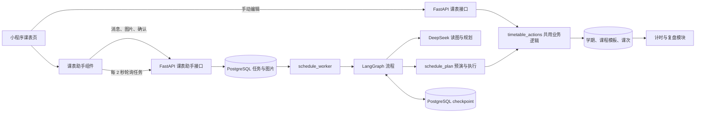
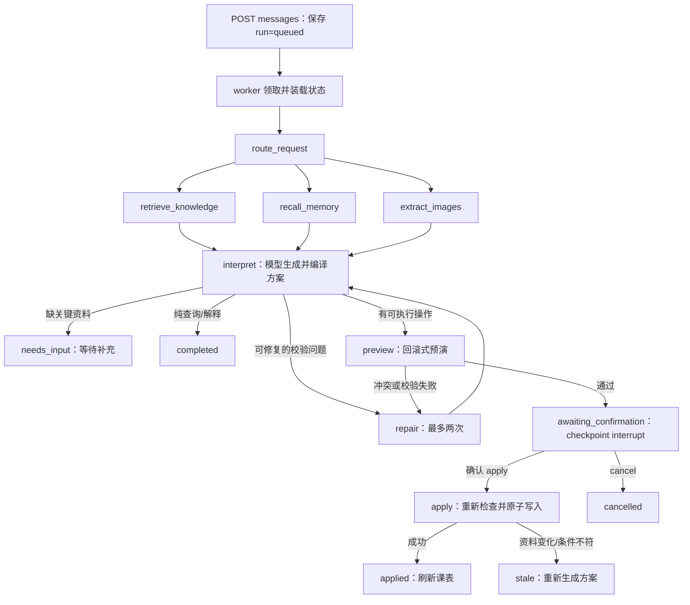

# 课表系统实现说明

核对日期：2026-10-12。本文依据当前工作区源码（包含尚未提交的修改）及主入口实际接入的调用链整理，不沿用计划书中的旧设计。新课表任务使用 `schedule_v5.txt`；旧检查点只按原版本恢复。这里说明的是当前代码实现，线上进程是否已重新加载该版本需要另行核实。

## 1. 整体架构与模块分工

课表以 PostgreSQL 中的数据为准。小程序负责编辑和展示；普通编辑直接调用课表 API；自然语言和图片请求先保存为任务，由独立 worker 生成方案，经服务器预演和用户确认后才写入。



| 模块 | 主要代码 | 具体职责 |
|---|---|---|
| 课表页面 | [timetable.js](miniprogram/pages/timetable/timetable.js)、[timetable.wxml](miniprogram/pages/timetable/timetable.wxml) | 学期、周次、日程切换，表单编辑，删除，打开助手 |
| 周课表绘制 | [timetable-grid.js](miniprogram/services/timetable-grid.js)、[week-timetable](miniprogram/components/week-timetable/index.js) | 把实际课次时间换算成课卡位置、处理课间和点击事件 |
| 助手交互 | [timetable-assistant](miniprogram/components/timetable-assistant/index.js)、[timetable-agent.js](miniprogram/services/timetable-agent.js) | 对话、选图、轮询、展示预览、确认和重试 |
| HTTP 接口 | [timetables.py](backend/timetables.py)、[schedule_api.py](backend/schedule_api.py) | 鉴权、请求校验、版本检查、保存任务或执行业务操作 |
| 共用课表业务 | [timetable_actions.py](backend/timetable_actions.py) | 生成课次、改模板、改单次、删除、时间校验、记录保护 |
| Agent 编排 | [schedule_worker.py](backend/schedule_worker.py)、[schedule_graph.py](backend/schedule_graph.py) | 领取任务、组装资料、调用模型、预演、等待确认、恢复执行 |
| 方案执行 | [schedule_plan.py](backend/schedule_plan.py)、[schedule_conflicts.py](backend/schedule_conflicts.py) | 严格操作 Schema、整批预演、冲突诊断、原子应用 |
| Agent 支撑 | `backend/agents/` 下的 context、retrieval、memory、schedule_image_reader 等 | 上下文预算、BM25 检索、持久记忆、图像事实提取 |

后端由 [main.py](backend/main.py) 挂载两组课表路由。课表助手不使用普通聊天 `/api/chat`，也不使用课后评估 Agent 的工具和评分流程。

## 2. 数据模型：学期 → 课程模板 → 实际课次

代码：[models.py](backend/models.py)、[timetable_actions.py](backend/timetable_actions.py)。

### 2.1 三类核心记录

| 表 / 对象 | 核心字段 | 含义 |
|---|---|---|
| `semesters` / `Semester` | `name`、`start_date`、`end_date`、`first_week_monday`、`timezone`、`periods`、`version` | 学期范围、第一周起算日、时间设置、显示节次 |
| `course_templates` / `CourseTemplate` | `semester_id`、`name`、`weekday`、`start_week/end_week`、`week_pattern`、`start_time/end_time`、`location`、`version`、`is_deleted` | 一项按星期和周次重复的安排。同名课程在不同星期/时间可有多个模板 |
| `lessons` / `Lesson` | `course_id`、`week_number`、`original_start_at`、`starts_at/ends_at`、名称/地点/时区快照、`status`、`is_override`、`is_deleted`、`version`、`note` | 某个日期实际发生的一次课，是课表展示、计时和复盘引用的对象 |

所有记录都带 `user_id`。复合外键确保课程属于本人的学期、课次属于同一账户和学期的模板；`(course_id, week_number)` 唯一，避免同一模板在一周重复生成课次。

`periods` 是 JSONB 节次表，例如 `[{"number":1,"start_time":"08:00","end_time":"08:45"}]`。最多 30 节，编号不能重复，各节不能跨日或互相重叠。它是显示轴：已有课次保存的是实际时间，修改节次表不会把已有课程整体移动。

### 2.2 周次和课次生成

`generate()` 按课程的周次范围循环，过滤单双周，再计算日期：

```text
日期 = first_week_monday + (week_number - 1) × 7 天 + (weekday - 1) 天
总周数 = floor((end_date - first_week_monday) / 7 天) + 1
```

`weekday` 的周一为 1、周日为 7；`all/odd/even` 分别表示每周、单周、双周。单双周依据学期周次，不是导入后的第几次上课。日期落在学期外的部分不生成；范围非法或最终没有任何课次则拒绝。

创建模板时就把全部符合条件的课次写入数据库，查询时直接读 `lessons`，不在每次打开页面时临时展开。名称、地点、时区也复制到课次，保留当时的安排。

### 2.3 时间设置

新学期未传 `timezone` 时，服务器使用账户已保存的 `User.timezone`，默认账户设置为 `Asia/Shanghai`。小程序在「我的」维护账户时间设置；课表表单和新提示词不要求用户重复输入技术时区。

服务器用 Python `ZoneInfo` 将本地日期和 `HH:MM` 转成 UTC 时刻，保存为带时区时间；返回课次时，再按课次自身的时区生成 `local_date/start_time/end_time`。夏令时导致不存在或对应两个 UTC 时刻的时间会被拒绝，课程也不支持跨日。

已有学期和课次保留原时区快照，修改账户设置不会搬动历史课程。学期结束不能早于开始，首尾日期差必须小于 370 天；`first_week_monday` 必须是开始日所在周的周一。

## 3. 小程序页面与周课表展示

### 3.1 页面读取流程

```text
onShow / 刷新
  → GET 学期列表
  → 保留已选学期，否则选择返回列表第一项
  → 确定选中日期和所在周，日期限制在学期范围内
  → 并行 GET 课程模板、GET 本周实际课次
  → 更新周网格、当日日程、课程管理列表
```

学期列表由服务器按开始日期倒序返回。上一周/下一周、指定周次、回到本周、选择日历日期都会重新走读取流程。客户端把 `YYYY-MM-DD` 当纯日历日期，用 UTC 零点做日期加减，避免手机时区把日期算偏；账户“今天”和学期“今天”分别按各自保存的时间设置计算。

未登录显示登录引导，没有学期先显示“设置学期”。**当前页面的助手入口位于已有学期的分支中，实际使用需先手动建立学期。**后端和组件支持未绑定学期的线程，但当前页面没有直接用 Agent 初始化空课表的入口。

### 3.2 网格如何绘制

`buildWeekGrid()` 读取实际课次的 `local_date/start_time/end_time`，只做显示计算：

- 有节次表：每节形成纵轴区段，常规课间压缩；课次实际起止落在课间或节次外时补充对应时段。
- 无节次表：按现有课次实际时段布局，节次编号轴留空，不猜学校作息；没有课程时不补造默认节次。
- 把所有时间边界映射到纵坐标，课程卡得到 `top/height`，短课保留最小可见高度。
- 同一天重叠课卡可分列显示；颜色由课程 ID 稳定哈希生成。分列是展示能力，写入时仍禁止正常课程时间重叠。
- `scheduled` 显示为周网格课卡；`leave/cancelled` 放在“本周变更”。日程模式列出当日各状态课次和备注。

`week-timetable` 验证格子/课次确实存在后发出 `selectslot` 或 `selectlesson`；点击格子打开排课表单，点击课程先展示详情，再选择单次调整或编辑每周安排。格子排课默认创建**仅本周**的课程模板，也可改成从该周重复至学期末；普通“手动排课”默认第 1 周至学期末、每周、09:00–09:45。这些只是表单初值。

## 4. 手动维护：具体会改动哪些数据

### 4.1 学期和课程录入

学期表单提交名称、日期、第一周周一、可选节次表；开始日变化会自动更新所在周一。按节次排课时，前端查询节次表，把起止节次转换为实际 `start_time/end_time` 后提交，不保存动态节次引用。

学期只要曾经建立过课程模板，日期、周次起算日和时区就不能再改；当前 `has_courses` 检查也包含已软删除模板。因此删除全部课程后仍不能修改这些字段，需另建学期。名称与节次表仍可修改。

没有单独的“创建一个 Lesson”接口。即使只排一次，也创建起止周相同的课程模板，再由服务器生成一个课次。

### 4.2 修改整项每周安排

`update_course_record()` 更新模板并重新计算其应有课次，但只同步**未来、未单独调整、未删除、没有学习记录**的现有课次：

| 现有课次情况 | 模板修改后的处理 |
|---|---|
| 已开始或过去 | 保留原样 |
| `is_override=True`，如已单独调课/请假/停课 | 保留原样 |
| 已有 `StudySession` 或 `LessonOutcome` | 保留原样 |
| `is_deleted=True` | 保留删除状态，不自动复活 |
| 普通未来课次仍在新范围且新目标时刻未开始 | 更新实际时间、名称、地点，恢复为 `scheduled` |
| 普通未来课次已不在新范围，或新目标时刻已开始 | 标为 `cancelled` |
| 新范围多出尚无课次的周 | 仅为未来时刻新增课次 |

所以“改模板”不等于改完所有历史和单独调整记录；纠正整门误录与修改未来重复安排是两种不同操作。

### 4.3 单次调整、请假、停课

`PATCH /api/lessons/{id}` 可修改日期、实际起止时间、`status`、备注。改时间必须同时提供 `date/start_time/end_time`，目标日期须在原学期内。当前单次编辑 UI 没有地点字段。

服务器拒绝修改已开始/过去或已有计时、课后记录的课次，也拒绝调到已开始的时刻。修改后 `is_override=True`，后续模板同步跳过它；`week_number` 和 `original_start_at` 保留原生成标识，不因为调到另一天就重算。

`leave` 是请假安排，`cancelled` 是停课安排，仍保留记录；`is_deleted` 才表示删除，不参与普通课表查询。三者不是同一个状态。

### 4.4 删除和记录保护

- 删除整项课程：模板软删除；该模板下所有没有 `StudySession`、没有 `LessonOutcome` 的课次都软删除，包含过去、未来和单独调整的误录，不只删除未来。
- 已有上述学习记录的课次保留，仍可能在课表中查询到，保证计时、复盘与课后确认有来源。
- 删除指定一次：无学习记录才允许；有记录返回 409。允许删除过去的未记录误录，且标记 `is_override=True`。
- 当前没有删除学期、清空全部课表、恢复已删除课次或撤销已应用 Agent 方案的接口。取消预览只取消未应用方案。

保护依据是“是否存在记录”，不是有效学习时长是否大于零；自动建立的未计时记录也属于 `StudySession`。

### 4.5 草稿、保存与错误处理

课表表单草稿在 `services/timetable.js` 模块内存中深拷贝保存，离开页面可恢复；小程序进程被清除后不保证保留。账户变化会清空该账户的草稿和请求键。

保存成功后先清表单和已消费的幂等键，再刷新列表；若刷新失败，提示“已保存，列表暂未更新”，不会重复创建。409 时保留输入，可“读取最新版本，保留输入”，更新记录版本后由用户再次保存。寻找移出原周的单次课时，会按最长 93 天的查询窗口扫描学期。

## 5. 课表 Agent 实际用了哪些技术

### 5.1 技术清单

| 项目 | 当前实际实现 |
|---|---|
| Workflow | Python LangGraph `StateGraph`，固定节点和回调，PostgreSQL checkpoint，可在确认处中断和恢复 |
| 规划模型 | 代码常量 `deepseek-flash`，通过 `httpx` 直接调用 DeepSeek Chat Completions |
| 图片文字读取 | 同一个 `deepseek-flash`，使用独立读图 prompt 与 Schema；配合 Pillow 几何检测和裁片 |
| Prompt | 新任务 `schedule_v5.txt` + `context_v1.txt` + 动态 JSON Schema；识图 `schedule_image_v1.txt` + `Reading` Schema |
| RAG | 本地中文双字/英文 token + BM25，检索产品规则及本账户课表历史 |
| Memory | PostgreSQL 来源记录和 `agent_memories`；活动任务保留用户原话、问答关联、图片来源和导入进度 |
| 服务端能力 | 当前快照、记忆、检索、读图、JSON 规划、预演、确认应用，由图节点固定调用 |
| 模型工具调用方式 | 请求没有 `tools/function_call`；模型输出操作 JSON，不能自行选择工具或直接执行 SQL |
| 未接入的能力 | 没有 embedding 服务、向量数据库、学校教务接口、联网搜课表、第三方 OCR 服务或 LLM 记忆摘要 |

依赖中虽有 LangChain，但这条模型调用链没有使用其 `ChatOpenAI` 封装。也没有把课后评估中的评分/结算工具接入课表 Agent。

### 5.2 Prompt 如何起作用

入口不是挑目录里版本号最大的文件，而是 `Worker.load_state()` 明确设置 `schedule_prompt="schedule_v5.txt"`、`context_policy="context-v1"`。`prepare_messages()` 再读取提示词并拼入 Pydantic 生成的 Schema。

当前提示词：[schedule_v5.txt](backend/agents/prompts/schedule_v5.txt)、[context_v1.txt](backend/agents/prompts/context_v1.txt)。关键约束是：

1. 输出必须是 `reply/questions/operations` JSON，不能在文字中声称已经应用。
2. 本轮明确更正优先；保留活动任务中早先已回答的周次、假期、删除范围；旧助手解释不能变成用户要求。
3. 已稳定识别的图片使用来源引用导入，不重新编写其星期和时间；截图只证明画面中的一周，不自动推成第 1–16 周。
4. `questions` 最多两项，缺少关键资料时先澄清，不重复询问已回答问题。
5. 第 N 周停课使用服务器提供的 `week_dates`；不猜国家节假日；调休移动原课次，目标日已有课不自动删。
6. 冲突不能“忽略”；不能擅自挪时间、减少图片卡片或删除未授权旧课来通过检查。
7. 新学期继承账户时间设置；没有来源时节次表留空。回复保持简短，详细变化由确认卡显示。

Prompt 负责指导模型；身份、数据归属、冲突、版本和确认授权都有服务器代码检查，不靠模型遵守文字约定来保证。

### 5.3 模型接口与结构化方案

代码：[schedule_model.py](backend/schedule_model.py)、[model_client.py](backend/agents/model_client.py)、[schedule_plan.py](backend/schedule_plan.py)。

```text
POST https://api.deepseek.com/chat/completions
Authorization: Bearer DEEPSEEK_API_KEY
model: deepseek-flash
messages: system 提示词与 Schema + user 业务资料/必要图片
response_format: {"type":"json_object"}
thinking: {"type":"disabled"}
stream: false
```

密钥只在后端读取。规划请求超时 75 秒，最多输出 12,000 tokens，响应最多 512 KiB；独立读图最多输出 8,000 tokens、响应最多 128 KiB。代码拒绝重复 JSON key、无效结构以及未完整结束的返回，不把上游响应原文转发给用户。

常规方案形式是：

```json
{
  "reply": "将把第9周现有课程设为停课，等待你核对。",
  "questions": [],
  "operations": [
    {"kind": "cancel_range", "start_date": "2026-10-26", "end_date": "2026-11-01", "reason": "第9周无课"}
  ]
}
```

以上日期只是结构示例，真实周次日期必须来自当前学期的 `context.week_dates`。

服务器最终执行的操作类型如下，最多 100 项：

| `kind` | 作用与关键参数 |
|---|---|
| `create_semester` | 新建学期，日期、第一周周一、名称及可选节次；只允许未绑定学期的任务创建一个 |
| `set_semester_periods` | 更新当前学期显示节次，不修改既有课次时刻 |
| `create_course` | 创建模板并生成实际课次；星期、周次、单双周、实际时段、名称、地点 |
| `update_course` / `delete_course` | 修改/删除模板，必须引用当前快照中的 `course_id/version` |
| `patch_lesson` / `delete_lesson` | 调整/删除某一次，必须引用当前快照中的 `lesson_id/version` |
| `cancel_range` | 指定日期范围停课，作用于范围内课次 |
| `move_day` | 将来源日课次移至目标日，保留原起止钟点，不复制 |

图片规划 Schema 额外接受 `import_image_courses`、`set_image_periods`，它们先由服务器编译成上述常规操作，数据库执行器不直接执行图片指令。

### 5.4 RAG：检索什么、怎么检索

代码：[retrieval.py](backend/agents/retrieval.py)、[tools/schedule.py](backend/agents/tools/schedule.py)。

检索语料由两部分组成：代码内三条课表产品规则（删除、周次/假期、确认/调课），以及数据库中本账户的课表历史。绑定学期时限制到该学期，未绑定时限制到当前对话；其他对话只引用已应用记录，未确认提案不能跨对话获得执行依据。

查询词由最近三条普通历史用户输入和本轮输入组成，最多 6000 字符。中文拆成相邻双字，英文/数字按 token 提取，使用 BM25 排序，不请求 embedding。每段来源携带 ID、版本、`authority`、内容 SHA256；单段最多 2400 字符，检索默认最多六段、合计不超过 16000 字节，产品规则优先保留。

`context-v1` 会再次校验来源和校验和，实际送给规划器的是三条完整产品规则加最多三条个人历史。历史只作背景，不能覆盖本轮要求、当前数据库事实或确认权限。系统没有学校知识库，也不会自动查询教务系统。

### 5.5 Memory：长期背景与未完成任务分开保存

代码：[memory.py](backend/agents/memory.py)、[schedule_memory.py](backend/agents/schedule_memory.py)。

**持久历史记忆**保存在 `agent_memories`：以账户、domain、来源 run 唯一，scope 为学期或对话，保存用户输入、状态和操作，版本来自 thread.version。更新使用 PostgreSQL upsert，旧版本不能覆盖新版本。回忆时关联原始 `ScheduleRun` 校验状态，最终选取最多八条历史摘要字段；这不是模型生成的总结。

**活动任务记忆**从同一对话的原始 `ScheduleRun` 重建，放入 `pending_proposal.task_context`，包含：

- 每轮原始输入与确认原话、run 来源和状态；
- 当时提出的问题，以及后续回复与上一问的关联；
- 图片来源 ID、最近未应用提案；
- 已导入/剩余图片卡片和识别校验和。

普通聊天背景只保留最近 12 轮，但活动任务最多保留 200 轮、64 KiB，不依赖 RAG 排名，也不经过 LLM 摘要。超过上限直接报错并保留数据库原记录，不静默丢弃早期条件。

取消或完成导入会结束活动任务。只应用一次旧课删除、只导入部分图片卡片，不会清掉尚未完成的导入；下一轮“继续”仍可沿用原图和早先说明。存在图片进度时，必须所有来源卡片导入完成才认定完整导入；没有进度字段的兼容任务以已应用方案中存在 `create_course` 作为边界。

### 5.6 上下文怎样组装与控制长度

`context_snapshot()` 从当前数据库取得本人学期、模板、课次、实际周次日期和学习记录保护标记；worker 将课次缩成规划需要的字段，避免把无关数据一并送入模型。

`context-v1` 的规划输入包含 `context`、`input_text`、`history`、`conversation_memory`、`retrieval`、`route`。受保护的待办内还可附加 `image_observations`、`validation_feedback`、失败候选方案。

文本总预算为 256 KiB，包含 system、Schema 和消息开销；课表快照还有独立 200 KiB 检查。超预算时依次移除旧助手文案、检索历史、旧确认背景、较早普通对话和旧语句；当前输入、当前课表和活动任务资料不截断，必要资料仍超限就报错。

上下文使用源码 SHA256 标记构建版本，并记录来源、裁减项、字节数和 context hash。恢复任务需要重新组装 `context-v1` 规划请求时，构建代码哈希不匹配会拒绝继续规划；已经停在确认处的方案直接恢复应用，不经过这项规划请求检查。

### 5.7 这里的 Tool 实际是什么

课表模型没有自主工具调用循环。LangGraph 依次或并行调用以下服务端函数：

| 节点/能力 | 当前调用 |
|---|---|
| 装载当前课表 | `context_snapshot()`，在 worker 构建初始状态时执行 |
| `retrieve_knowledge` | `Worker.retrieve()` → `ScheduleTools.retrieve()` → BM25 规则/历史检索 |
| `recall_memory` | `Worker.memory()` → `ScheduleTools.memory()` → 来源记录、活动任务及历史记忆 |
| `extract_images` | `Worker.extract_images()` → Pillow 布局检查、缓存或独立读图模型 |
| `interpret` | `Worker.interpret()` → 上下文组装 → 规划模型 → Schema/图片指令编译 |
| `preview` | `Worker.preview()` → `preview_plan()`，实际执行业务逻辑但回滚 |
| `apply` | `Worker.apply()` → `apply_plan()`，确认后事务写入 |

`agents/tools/schedule.py` 当前只有记忆与检索方法。项目虽然有通用 `ToolRegistry`，但课表 worker 没有实例化它，也没有注册“让模型调用”的四个课表工具；这里只借用了 registry 模块的 `Scope/record_trace` 记录上下文追踪。不能把评估 Agent 的工具列表当成课表能力。

## 6. 图片导入模块：从截图到实际课次

### 6.1 上传和保存

前端优先 `wx.chooseMedia`，兼容 `wx.chooseImage`，允许相册和拍照。先确保对话存在，再用文件系统读二进制，经 `wx.request` 以 `application/octet-stream` 上传；没有前端 OCR、前端压缩或直接请求模型。发送消息只传服务器返回的 `image_ids`。

服务器处理流程：

1. 检查当前登录、图片所属对话和账户；原始上传每张最多 2 MiB。
2. Pillow 验证 JPEG/PNG/WebP，最多 1600 万像素；校正 EXIF 方向，透明区铺白，最长边缩到 4096，重新编码 PNG，处理后最多 8 MiB。
3. 图片二进制保存到 `schedule_images.data`，不生成公开图片 URL；归属和有效登录在保存前再次核对。
4. 有效期七天，同账户同时持有的未过期且有数据图片最多 20 张。单条消息最多三张，同一未完成任务累计最多六张。

图片移出客户端附件列表只影响 UI，没有调用删除图片接口。过期后 worker 领取任务时把数据置空；取消清理该任务引用过的图片；完整导入应用后清理本任务图片数据，部分导入保留。清理的是二进制，图片元数据、识别缓存、对话与操作审计仍在。

### 6.2 规则网格图片：几何定位 + 模型读取文字

代码：[schedule_vision.py](backend/agents/schedule_vision.py)、[schedule_image_reader.py](backend/agents/schedule_image_reader.py)。

```text
规范化图片
  → Pillow 找课程色块/灰块连通区域
  → 检查七列网格、表头竖线、左侧节次行距
  → 为课程卡绑定星期、起止节次，编号 C01/C02…
  → 原图 + 表头/时间轴裁片 + 放大卡片拼图
  → 独立模型按编号读取课程名、地点、节次时间
  → bind_reading 严格核对并生成 image_observations
```

几何检测先缩图计算，再映射回原图裁片。它要求可核对的完整周表，目前条件包括 5–30 张课程卡、5–16 个规则节次行、可验证的七列间距。它不内置学校课程名、作息或截图指纹，也不是通用 OCR 引擎。

读图 prompt 是 [schedule_image_v1.txt](backend/agents/prompts/schedule_image_v1.txt)。模型读取星期表头、显示周次/学期简称、每节准确时刻、每卡名称地点和不确定项。服务器要求：星期顺序为周一至周日；卡片 ID 集合与几何检测完全一致；节次连续、覆盖卡片、时间不重叠；没有未解决的关键不确定项，课程名非空。否则整次读取失败并保留任务。

课程星期和节次来自测得的网格位置，起止钟点来自读到的节次表，模型不能重新排列卡片。结果按账户、对话、不可变图片 ID、reader/layout 版本及读图 prompt 内容的哈希缓存到 `ScheduleModelCall.response`，续聊可复用并重新校验绑定。

### 6.3 图片事实怎样变成课程

有稳定 `image_observations` 后，不再把这张图重新送给规划器。规划器只需要决定用户要求的周次和选择范围，例如：

```json
{
  "kind": "import_image_courses",
  "image_id": "00000000-0000-4000-8000-000000000001",
  "start_week": 1,
  "end_week": 19,
  "week_pattern": "all",
  "card_ids": []
}
```

这是字段示意，示例 UUID 需替换为当前任务已核对的图片 ID。`card_ids=[]` 表示导入该图尚未导入的所有卡片；用户明确只选部分时才列来源卡 ID。

`compile_image_imports_with_progress()` 用图片事实确定性展开为每卡一个 `create_course`，名称、地点、星期和实际时间全部取已核对结果。存在这种图片事实时，规划器另写普通 `create_course` 会被拒绝，避免再次猜图。同名但时段不同的卡片按不同来源卡处理。

导入默认将图片节次表一起保存到新学期或绑定学期；只修左侧时间轴可使用 `set_image_periods`，最终变为 `set_semester_periods`，不会重复导课。多图节次表不同时要求指定采用哪一份，不混写。

导入进度记录 `available_card_ids/imported_card_ids/remaining_card_ids`、识别 SHA256、`complete`。重复卡片、已导入卡片、识别资料与旧进度不一致都会拒绝。候选进度可随 checkpoint 保存；只有应用成功后，才在课程写入事务中存入 `run.result`，供后续记忆作为已导入事实使用。生成预览不算已经导入。

### 6.4 其他图片格式

几何无法可靠定位时返回 `None`，原图进入普通多模态规划路径，由规划模型输出 `create_course`，仍须经过相同的预演、冲突和确认检查。

同批图片如果一部分成功提取稳定网格事实、一部分不支持，当前会拒绝混批并提示分别上传到新对话，防止把未识别的图片误当已完成。图片过期后若已有完整读图缓存可继续复用；若没有缓存，需重新上传。

## 7. 完整 Workflow 与状态变化

### 7.1 从发消息到生成预览



`route_request` 对“查看课表”“今天有什么课”“本周有什么课”等六种精确短语，在没有本轮新图片时设为只读。只读流程仍会组织资料和调用模型，但即使模型输出修改操作也不会进入预演。

检索、记忆和读图是并行分支，全部完成后进入规划。普通新说明创建新 run；尚未确认的旧预览标为 `superseded`，原要求仍可通过任务记忆继承。已有 run 处于繁忙状态时，API 拒绝再发下一条任务。

如果方案有问题，回复会带上未显示的澄清问题，进入 `needs_input`。新版本对图片编译、引用版本、预演等确定性校验错误可附加反馈，最多重新规划两次；仍失败则保留任务要求用户补充。有待办/图片却返回空操作且无问题，也会触发校验，不能只用“方案已保留，请确认”的文字伪装可确认预览。

模型网络错误、服务错误或无法解析的 Schema 等 `ModelError` 会使任务 `failed`，不算可自动修复的业务冲突；用户通过 retry 继续。

### 7.2 预览为什么可信

`preview_plan()` 取得数据库基线并计算 `baseline_hash`，在 SQLAlchemy nested transaction/savepoint 中调用与应用相同的 `_execute()`，生成真正的前后差异后回滚。

预览包括 `semester_id`、`baseline_hash`、`changes[].before/after`、`counts`。它会实际触发课次生成、历史保护、日期/时间限制和冲突检测，只是不提交业务数据；不是让模型另写一段“预计变更”的文字。

执行顺序是先处理学期/模板/单次操作，再冻结课次来源快照，按原日期执行停课，最后移动来源日课程。移动可恢复该方案中先停掉的来源课，目标日原有课程保留；同一次课不能在一个方案中移动两次。整批结束后再查时间重叠，允许“已授权删旧课 + 导入新课”作为同一批校验。

既有过去课次仍受保护；对本批刚新建的课次，停课/调休允许处理历史日期，便于完整导入已经开始的学期，仍不能绕过学习记录保护。

### 7.3 用户确认与真正写入

有效预演后，图先保存 `awaiting_confirmation`，再在 `confirm` 节点 `interrupt()`；API 返回结果，worker 不会停在内存里一直占着等待。

用户可以点击确认/取消，或在已有有效预览时发送服务端白名单中的整句确认，例如“确认应用”“按这个方案执行”。没有有效预览时，“确认”只是新消息，不会授权写入；删除类确认词也只对纯删除预览适用。

确认 API 校验当前线程版本、是否最新 run、是否仍处于待确认；应用决策另核对课表基线，取消不要求基线一致。然后写入 `decision`，排队为 `confirm_queued`。worker 恢复相同 run 的 checkpoint，以 `Command(resume={decision})` 继续。

应用前再检查账户归属、租约所有者、决策、最新 run 和 `baseline_hash`。通过后，在同一事务保存课程/课次、图片导入进度、run 结果、线程学期关联和记忆。若 run 已是 `applied`，返回原结果，避免恢复时重复写入。

确认等待期间若课表在其他操作中变化，旧预览不能继续应用。API 可先返回 409；恢复执行阶段的业务失效则记录为 `stale`，需要发送说明重新生成预览。取消不会撤销此前已应用的课程。

### 7.4 运行状态含义

| 状态 | 含义 / 下一步 |
|---|---|
| `queued` → `running` | 消息等待领取 / 正在读图与规划 |
| `needs_input` | 资料不足或业务校验未通过，等待补充 |
| `completed` | 查询或解释已结束，没有课表写入 |
| `awaiting_confirmation` | 已有通过预演的具体方案，等待应用或取消 |
| `confirm_queued` → `confirming` | 决策已保存 / 正在恢复检查点 |
| `applied` | 写入成功 |
| `cancelled` | 未完成任务已取消 |
| `superseded` | 旧预览被新说明替代 |
| `failed` | 模型/执行异常，可对最新失败 run 重试 |
| `stale` | 确认后条件失效，需要重新生成方案 |

## 8. 冲突检查与数据一致性

### 8.1 冲突按实际 UTC 区间判断

`assert_no_overlap()` 检查同一账户**所有学期**未删除、`status=scheduled` 的课次，按实际起止时刻检测重叠。首尾恰好相接不冲突；请假、停课和删除安排不占正常课程时间。

诊断最多列六组课程对，每组最多八个示例日期，同一对跨周冲突合并计数。附带双方课程 ID、日期时段、`existing/proposed` 来源及是否已有学习记录。结构化诊断保存在进程内异常的 `.conflicts`，供图把反馈交回规划器；HTTP `detail` 仍是中文字符串，不是单独的冲突 JSON API。

手动保存和 Agent 预演共用这套检查；用户说“忽略冲突”不增加绕过权限。已保护课次保留后产生的真实冲突，也不会被自动删除。

### 8.2 幂等、版本和事务

代码：[db.py](backend/db.py)、[schedule_worker.py](backend/schedule_worker.py)。

Bearer token 在后端按 SHA256 查找 `AuthSession`，过期或已撤销返回 401；所有记录按当前账户查询，别人的 ID 返回 404。请求 Schema 拒绝额外字段；PATCH 只更新明确传入的字段，不能传 `null`，清空地点或备注用空字符串。助手详情 GET 使用只读 repeatable-read 快照，避免线程版本与消息来自不同提交。

| 机制 | 解决的问题 |
|---|---|
| `Idempotency-Key` + `timetable_mutations` | 手动写入、建线程、发消息、确认和重试丢响应后可安全重放；同键同请求返回原响应，同键不同请求返回 409 |
| 记录 `version` | 修改/删除拒绝覆盖旧版本；发消息和确认校验线程版本 |
| `User FOR UPDATE` | 同账户课表写入与相关学习写入串行化 |
| `baseline_hash` | 预览到应用之间核对绑定学期数据和账户时间设置，发现并发变化则拒绝旧方案 |
| savepoint + 外层事务 | 批量中任何错误都回滚，避免只写入半份方案 |
| run 已应用检查 + UUID5 | 应用恢复可幂等；按 run/操作索引/周次生成稳定业务 ID，预览与应用引用一致 |
| checkpoint 的 run ID | 每个方案独立恢复游标，不把业务聊天 thread ID 当成图执行游标 |

图片上传不使用上述幂等键；选图上传和提交消息是两步。

## 9. 客户端 Agent：轮询、预览与恢复

打开助手时按当前学期恢复内存草稿，读取历史线程和选中线程；发送或选图时才按需创建线程。“新对话”显式创建新线程。助手关闭或收到 `applied` 会通知课表页刷新。

繁忙状态每两秒 `GET thread?known_version=...`；版本未变返回 `unchanged=true`，避免重复传输和渲染。轮询失败后暂停自动轮询，提示“重新读取”；读取成功后按最新状态恢复轮询。没有 SSE/WebSocket；模型请求发生在 worker，客户端的普通 15 秒 HTTP 超时不等于模型 75 秒超时。

只有 `awaiting_confirmation` 且有 `preview` 时显示确认栏。预览按服务器前后差异展示，汇总模板、课次数、节次表及删除/停课提示；详情每页 20 项，长回复默认折叠，确认按钮和摘要固定。前端隐藏 ID/version 等技术字段、清理展示中的时区说明，不改变服务器方案；确认仅提交 run、version、decision。

Agent 草稿按学期保存在进程内存，包含输入、附件本地路径、线程选择和结果未确定的 pending 请求；不等于服务器长期 memory。账户变化会清理草稿和幂等键。隐藏、关闭或卸载停止轮询；用身份 generation 和 epoch 拒绝旧页面/旧账户回调。

网络超时或 5xx 时保留原 pending 请求，阻止再提交其他操作；重新读取先用相同幂等键重放该请求，再读最新线程。4xx 视为明确拒绝并清 pending；409 保留文字输入，要求读最新状态后再核对。正文历史从服务器恢复，详情最多返回最近 50 个 run；有 `has_more_messages` 提示，目前没有更早消息分页接口。

## 10. 对外接口清单

小程序统一通过 [backend.js](miniprogram/services/backend.js) 的 `wx.request` 调用，默认 `Authorization: Bearer <登录会话>`，接口地址取 [config/backend.js](miniprogram/config/backend.js)。所有 `/api/` 响应设置 `Cache-Control: no-store`。除二进制上传外，写请求均需 `Idempotency-Key`。

### 10.1 课表接口

| 方法 | 路径 | 参数 / 功能 |
|---|---|---|
| GET | `/api/timetables/semesters` | 当前账户学期，含 `total_weeks/today/has_courses` |
| POST | `/api/timetables/semesters` | 新建学期 |
| PATCH | `/api/timetables/semesters/{id}` | `version` + 修改字段 |
| GET | `/api/timetables/courses?semester_id=...` | 未删除课程模板 |
| POST | `/api/timetables/courses` | 创建模板并生成课次 |
| PATCH | `/api/timetables/courses/{id}` | `version` + 模板修改字段 |
| DELETE | `/api/timetables/courses/{id}?version=...` | 删除模板及未记录课次，返回 204 |
| GET | `/api/lessons?semester_id=...&date_from=...&date_to=...` | 按课次时区本地日期查询，含首尾，最多 93 个日期 |
| PATCH | `/api/lessons/{id}` | `version` + 单次日期/时间/状态/备注 |
| DELETE | `/api/lessons/{id}?version=...` | 删除无学习记录的单次课，返回 204 |

### 10.2 助手接口

以下路径统一前缀为 `/api/timetable-agent`：

| 方法 | 路径 | 参数 / 功能 |
|---|---|---|
| GET | `/threads[?semester_id=...]` | 线程摘要，最多 100 条 |
| POST | `/threads` | 可选 `semester_id`、`title`，返回 201 |
| GET | `/threads/{thread_id}[?known_version=...]` | 线程版本、消息、最新 run/preview；无变化时只返回 unchanged |
| POST | `/threads/{thread_id}/messages` | `{version,text,image_ids}`，文字最多 4000 字、最多三张图，通常创建任务，返回 202 |
| POST | `/threads/{thread_id}/images` | 二进制图片，返回 `{id,mime_type,expires_at}`，201 |
| POST | `/threads/{thread_id}/runs/{run_id}/confirm` | `{version,decision:"apply"或"cancel"}`，排队恢复，202 |
| POST | `/threads/{thread_id}/runs/{run_id}/retry` | `{version}`，只重试当前最新且 failed 的任务，202 |

精确取消文字可在没有预览、图片已不可读或模型不可用时直接取消未完成任务，无需调用模型；繁忙状态仍禁止同时提交下一条请求。精确确认文字只有存在有效预览时才转为确认决策。

## 11. 持久任务、运行进程与调用成本

### 11.1 任务表与恢复

| 存储 | 保存内容 |
|---|---|
| `schedule_threads` | 对话账户、绑定学期、标题、版本、更新时间 |
| `schedule_runs` | 用户输入、确认原话、图片 ID、状态、方案、预览、结果、决策、错误、租约及领取次数 |
| `schedule_images` | 归属、规范化图片二进制、格式、过期时间 |
| `schedule_model_calls` | 请求输入 hash、预留/实际费用、token 用量、成功方案或读图缓存 |
| `schedule_daily_usage` | 按账户和 UTC 日期汇总调用数、预留费用和已记费用 |
| `agent_memories` | 有来源和版本的历史记忆 |
| `agent_traces` | 当前课表接入的上下文 manifest 追踪，标签仍为 `schedule-v2`，不代表 prompt 版本 |
| PostgreSQL checkpoint 表 | LangGraph 的可序列化状态、节点位置和确认中断 |

checkpoint 使用独立 schema，默认 `lifefund_schedule_graph`；配置业务 search_path 时派生为其 `_graph` schema。初始化由 `python -m schedule_worker --setup` 显式完成，不在每次请求时自动建表。

worker 用 `FOR UPDATE SKIP LOCKED` 领取排队任务，租约五分钟，可回收过期的 running/confirming；每次领取增加 attempts，超过三次标记失败，显式重试会清零。每次状态变化递增线程版本，客户端轮询能发现进度。空队列每两秒再检查。

整次图执行还持有基于 run ID 的 PostgreSQL advisory lock，防止慢模型调用期间租约过期后两个 worker 同时执行。checkpoint 同步持久化，崩溃后从已有状态或确认中断恢复；状态中不保存数据库 Session、HTTP client 或图片二进制。

读图按不可变来源缓存；规划成功响应按账户、run、消息输入 hash 缓存。已成功的调用可在恢复时复用；失败调用不会被当成成功缓存。

运行配置见 [ecosystem.config.js](backend/ecosystem.config.js)：API 运行 `uvicorn main:app`，课表独立运行 `python -m schedule_worker`。只启动 API 能收请求，但不能完成异步课表规划；学习 worker/maintenance 负责计时复盘相关任务，不能替代课表 worker。

### 11.2 费用记录与限制

`schedule_budget.py` 在每次真实模型调用前，锁定账户并预留估算费用，返回后按 usage 结算；使用费用未知时保留保守估算。输入估算依据文本 UTF-8 字节和图片数量，不把 base64 传输长度直接当图片 token。

输入/输出单价来自 `SCHEDULE_INPUT_CNY_PER_MILLION` 和 `SCHEDULE_OUTPUT_CNY_PER_MILLION`，当前默认配置为 2、8，内部按微元记录。它们是应用估算配置，不是实时查询模型供应商账单。

**当前课表没有每日次数或每日金额硬上限**，仍记录调用和费用；普通聊天/课后评估的额度不能套用到课表。图片数量、大小、上下文字节、操作数、租约次数与修复次数等限制仍生效。

## 12. 与计时、复盘、指数的关系

课表负责提供实际 `Lesson`。计时开始时引用 `lesson_id`，并复制课程名称、地点、时区和起止时间作为学习记录快照；这些记录反过来限制课表修改和删除。

课表页“前往计时”当前只切到计时页，**不传该课次 ID，也没有调用 `timer.selectLesson()`**。计时页通过 `GET /api/sessions` 读取服务端课程和当前会话，再自动选择开始前十分钟至结束后十分钟窗口内的正常课程；正在上课的课程优先。

后续未计时补建、复盘和指数结算由学习模块处理，课表 Agent 不评分、不直接修改指数，也不执行交易。课表中的 `leave/cancelled` 与课后参与记录 `LessonOutcome` 是不同对象，不能把修改课表状态等同于已经完成课后纠错。

## 13. 查代码时的关键入口

| 想确认的问题 | 优先查看 |
|---|---|
| 页面为何显示这周、这门课 | [课表页](miniprogram/pages/timetable/timetable.js)、[网格计算](miniprogram/services/timetable-grid.js) |
| 一项模板怎样生成/修改/删除课次 | [共用业务函数](backend/timetable_actions.py) |
| 哪些请求和字段可用 | [普通课表 API](backend/timetables.py)、[助手 API](backend/schedule_api.py) |
| 当前 prompt 和模型参数是什么 | [worker 初始状态](backend/schedule_worker.py)、[模型请求](backend/schedule_model.py)、[v5 prompt](backend/agents/prompts/schedule_v5.txt) |
| 读图怎样避免错列、错节、漏卡 | [几何检测](backend/agents/schedule_vision.py)、[文字绑定与导入编译](backend/agents/schedule_image_reader.py) |
| 短答继续怎样找回原要求 | [活动任务记忆](backend/agents/schedule_memory.py)、[记忆/检索入口](backend/agents/tools/schedule.py) |
| RAG 资料从哪里来 | [检索器](backend/agents/retrieval.py)、[来源记录](backend/agents/memory.py) |
| 何时修复、等待确认、应用 | [LangGraph 图](backend/schedule_graph.py)、[worker 回调](backend/schedule_worker.py) |
| 为什么预览能通过、确认却失败 | [基线与执行器](backend/schedule_plan.py)、[冲突检测](backend/schedule_conflicts.py) |

`schedule_v2/v3/v4.txt` 和旧图分支用于历史 checkpoint 兼容，不是新任务默认入口；旧检查点保持原提示词、图分支和已预览的时间默认值。当前 `schedule-v2` 追踪标签、`schedule-image-v1` 读图版本、`schedule-task-v1` 任务记忆版本、`context-v1` 上下文版本各自独立，不能混成一个“Agent 版本”。
